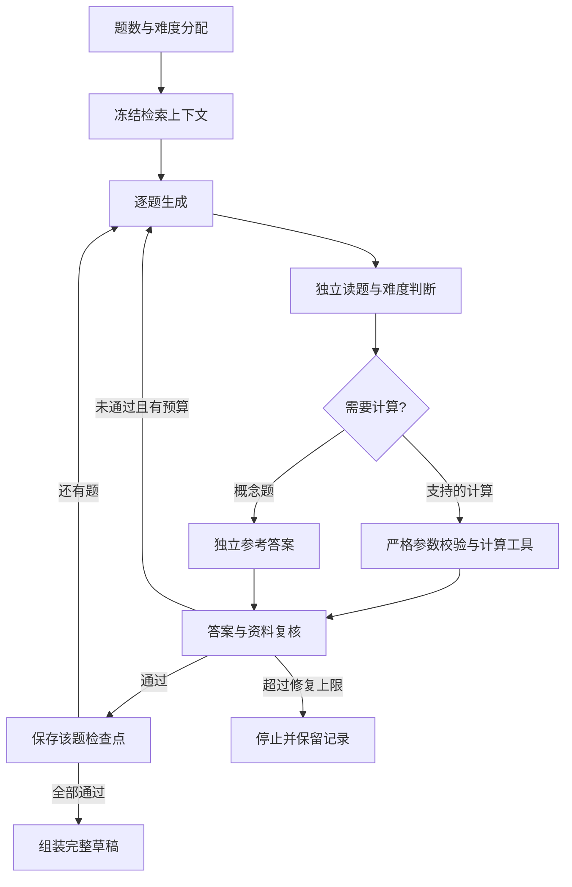

# 有界出题 Agent

2026-09-19。首版已接入现有 FastAPI、SQLite 与 DeepSeek 文本接口，不新增外部 Agent 服务。研究依据见 [Harness 调查](RESEARCH_20260919.md)，真实实验和失败记录见 [A1/A2 实验报告](EXPERIMENTS_20260919.md)。

新增可选的 [官方 Harness 候选后端](harness/README.md)：复用现有 Python 控制器、账号隔离与账本，允许各阶段使用受限 MCP 工具循环。默认仍为 native，候选后端需要单独安装和显式配置。

新增 [H6 主 Agent 与逐题子任务](harness/H6_SUPERVISOR_20260919.md)：主 Agent 分批安排知识点、学习目标与要求，独立子任务生成、解题及复核，全部通过后由程序组装。CPU 实验的作者只提交一个规格，计算交给程序；输出预算可显式提高到 32768 tokens。首版串行派发，支持检查点续做，尚不宣称并发加速。

当前保持可选实验状态。H6 中英文单题交付通过流程，但独立审核仍发现要求覆盖/难度缺口；H6 的真实多题组未完整交付。

[H7 灵活答案与逐项验收](harness/H7_FLEXIBLE_ANSWERS_20260919.md)在可选 `supervisor_v2` 中把任务要求与答案组织方式分开，允许开放题的不同合理立场；CPU 计算后增加自由解释写作。逐项检查实际题干/答案引文与来源，缺项不通过；引文检查不能代替语义审查。真实实验已完成英文两题整组交付，尚不构成大批量稳定性或实测难度的证据。

Web 设置现提供“逐题子代理（测验与作业）”开关，按账号保存、默认关闭。新建 quiz/assignment 任务开启时使用 `supervisor_v2`；此路径可运行在原生文本接口上，关闭时仍走 `sequential_v1`。旧任务若未带该字段，继续遵循原有服务器编排配置；新任务把明确选择写入生成条件以支持恢复。主控制器按冻结计划派发独立逐题工作单元，新建显式开启的任务使用 `AGENT_MAX_PARALLEL_QUESTIONS`（1–40，默认 20）有界并行，实际并发数不超过题目数；历史串行检查点原样续做。并发实验的测量范围见 [记录](../../benchmarks/subagent_parallelism_v1/README.md)。

## 当前流程



- 程序固定 `q1…qN`、每档题数、题型和顺序；模型每次只生成一题。支持 1–50 题，各档可为 0，可全部为难题。
- 解题调用看不到作者答案、解析、目标难度和设计理由。计算题先提取工具参数，不先口算；复核调用也不会收到这一步未经验证的数字答案。
- 每次模型调用都是新上下文，不积累整个聊天记录。最近 8 道题干提供去重参考，全部已通过题干另做规范化精确去重；尚不能保证 50 题之间没有较远的语义重复。
- 调度工具为纯 Python 白名单函数，目前支持有界 RR/STCF。输入、队列约定、每个进程时间、精确分数均留档，不执行模型代码、SQL、命令或文件操作。
- 完整工具时间线留在证据中；超过 40 个区间时，模型只收到完整指标与明确的省略声明。这时未展示的逐区间叙述不能获批。
- 默认每题最多修复一次，已通过题目不重做。所有槽位均通过才写入草稿；失败时可在任务证据中查看中间结果，不能把部分成功当成完整成功。

## “检查过”不等于“保证正确”

三个角色默认都是 `deepseek-flash` 的不同调用，**不是三个独立模型家族**。工具只证明输入参数下的计算；题面是否与参数一致、答案文字是否与计算一致、资料是否充分，仍依赖模型复核。没有工具支持的计算会在模型识别出需要计算时被拒绝；此识别本身也可能漏检。简单算术或概念判断可能仍以模型方式通过，证据会标记 `model_review`，不冒称确定性验算。

难度使用原有操作性量表，不是学生实测难度。本轮控制样例曾出现正确答案被误拒绝，也出现错误反馈中自相矛盾的数字；这些失败全部保留。当前不声称“答案正确性已解决”或“最强 Agent”。

## 检查点与恢复

每次调用前保存意图，返回后保存响应。提供商报错或服务中断后，可在任务详情点击“继续生成”，或由已登录的相同账号调用 `POST /api/jobs/{id}/resume`。继续沿用同一任务 ID 和已完成的响应；只重新请求未完成的步骤。

外部 API 不支持本项目的恰好一次语义：网络中断时，供应商可能已经计费。因此不自动重试不确定调用；显式继续仍可能产生一次重复费用。质量失败、协议错误、上下文超限不无限循环；质量失败需调整需求创建新任务。

恢复状态更新使用 SQLite 事务，并发点击只会排队一次；工作流/模型/预算等已冻结配置变化时拒绝混用检查点。每次新模型调用前核对任务归属与资料状态，发布事务再检查一次。原先的登录、CSRF、账号数据隔离继续生效。

## 预算与配置

正常 Web 启动 `Settings.from_env()` 默认启用 `GENERATION_WORKFLOW=agent_v1`。`legacy_v3` 保留旧实验基线；直接构造 `Settings()` 的离线夹具仍默认旧流程，新的 Agent 测试显式启用。`lesson` 暂沿用学习讲解流程，语音/图片/视频生成未改。

| 配置 | 默认值 | 含义 |
| --- | --- | --- |
| `AGENT_MAX_CALLS` | 180 | 单任务全部真实 API 预留次数，包括检索、失败和跨日恢复 |
| `MAX_DAILY_API_CALLS` | 100 | 原有每账号 UTC 每日总调用上限；不因新 Agent 自动提高 |
| `AGENT_MAX_REPAIRS` | 1 | 每题最多修复次数，环境配置最多 2 |
| `AGENT_CONTEXT_CHARS` | 48000 | 整个单次 messages 的字符上限，**不是模型 tokenizer 的精确 token 上限** |
| `AGENT_ORCHESTRATION` | `sequential_v1` | 可选 `supervisor_v1` 或 `supervisor_v2`（灵活答案和逐项验收），需要 Harness 后端 |
| `AGENT_PLAN_BATCH_SIZE` | 8 | 主 Agent 每批规划题数，范围 1–10 |

每题正常至少 3 次文本调用，另有检索。50 题在原串行模式至少约 151 次调用；主计划每批 8 题时至少约 158 次；`supervisor_v2` CPU 每题另加一次解释写作，至少约 208 次。现有默认每日 100 次不够；系统会预检并拒绝开始。重排、查询扩展、失败修复还需额外余量。预检不预占未来额度，并发任务可能耗尽每日剩余量，最终以事务内预留为准。50 题已通过模拟测试，未跑 50 题真实付费实验。

主 Agent 模式还需加上规划批次数：默认批大小 8 时，50 题最低估计为 158 次；Harness 工具循环会继续增加调用。子任务没有各自重置预算，沿用同一任务和账号额度。主计划经严格校验后冻结，恢复时复用规划和已通过题目。

## 证据与复现

已登录账号可导出 `GET /api/jobs/{id}/evidence`：固定需求、检索片段、逐题每次提示和响应、工具输入/结果、拒绝原因、检查点及真实调用账本均保留。草稿批准仍由用户完成。

```sh
.venv/bin/python -m pytest tests/test_generation_agent.py tests/test_answer_tools.py tests/test_agent_resume_api.py -q
.venv/bin/python scripts/agent_correctness_experiment.py
# 下行才会调用已配置的真实提供商，使用隔离数据库；最多 24 次。
.venv/bin/python scripts/agent_correctness_experiment.py --live --call-cap 24
```

后续优先级：扩充独立人工校正的错误/正确样例；检验异模型复核与结构化答案绑定；增加二分查找、图算法及受限算术工具；再比较批大小、通过率、错误接受率、错误拒绝率、延迟与费用。多模态可沿相同工具接口扩展，但需要单独的内容确认、预算和质量实验。
