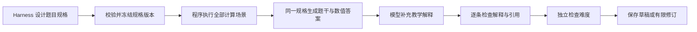

# H4：让题目、计算和答案共享同一份事实

2026-09-19。本轮以 H1–H3 已保存的错误为开发依据。目标是减少事实错误、题面与工具输入不一致、解释错误和格式失败；不把更多角色、更多调用或内部审批通过率当作正确性的证明。

## 先处理已经定位的流程缺陷：H4a

状态：代码已实现，回归结果见文末。本轮没有新增付费模型调用，没有改变默认 native。

仅在 `AGENT_RUNTIME=deepseek_harness` 下：

1. 可作答、条件明确且计算工具可用时，即使 solver 判定难度不符，仍完成答案 review，再分别记录两个检查的结论。题目仍须同时通过才能交付。
2. 资料或条件不足、工具参数无效时，正确性记录为 `not_evaluated`，不把提前拒绝算作错误检出。
3. 难度单独失败只反馈目标档位、评估档位和重新设计要求；不把未经 review 的 solver 自由文本答案或前一份工具数值直接传回作者。
4. 预检失败同样不反馈未经审核的 solver 解答；完整原响应仍保存在审计里。
5. 新增 `quality_checks`，把难度 `matched/mismatch` 与模型 review 的 `not_evaluated/passed/failed` 分开。这里的 passed 仍是模型门槛决定，不是独立正确性标签。
6. 配置冻结新增 `quality_revision=20260919-correctness-first-v1`；旧 Harness 检查点不能混入新的检查次序，native 基线配置保持兼容。

理由来自两项实证：H2 正负 canary 都在难度检查后结束，根本没有测试答案检查器；H2 事务修订稿采纳了前一轮 solver 关于 RR 提交的错误说法。H4a 关闭的是这两条流程漏洞，不能保证 review 模型从此正确。

难度不符时多一次答案复核可能增加调用量；原调用账本、日限额、任务上限、修订上限和明确恢复机制继续生效。

## 最值得投入的主方案：结构化规格与确定性渲染

以下为下一步设计，**尚未接入生产路径**。

后续进展：[H4b](H4B_STRUCTURED_CPU_20260919.md) 已在显式选择的实验路径实现 CPU 规格、确定性渲染和有限类型断言计算。以下数据库、任意解释核验和格式修复仍属规划；默认通用路径未切换。

### 1. 先从 CPU 简答题建立可验证的 ProblemSpec

内部规格包含：语言、工作负载、政策变体、边界与切换约定、要计算的指标、约束、选择目标、来源 ID。各变体共用同一工作负载，工具输入由程序派生。规格、工具和渲染器分别记录版本与哈希。

例：规格写 `boundary=after`，程序同时产生：

- 工具参数 `after`。
- 中文题干“片尾到达的任务排在刚重新入队的未完成任务之后”。
- 对应英文说明。
- 根据计算结果填入的时间线、各任务指标和精确分数。

模型不再自由重写这段规则，也不再手抄数字。改变条件必须生成新规格版本，原计算结果立即失效并重算。题目和答案的关键参数从一个源生成，避免 H3 的“先算 before，后写 after”。

有数值结论的每个子问必须对应一个已执行场景；不能只算 q=2，就在最后一问随意解释 q=3。代码负责诸如 `2 <= 2`、平均数、工作量守恒和约束是否满足的判断。

该方案优先覆盖 RR/STCF 简答题。选择题、数据库和开放设计题需要不同规格；不能给所有课程机械套同一个模板。

### 2. 解释拆成可检查的断言

先记录断言类型及证据位置，再生成自然语言，例如：

| 断言 | 可检查的依据 |
| --- | --- |
| t=3 时 P1 还剩 5 | 已执行轨迹中的服务量累计 |
| C→A 的切换免费 | 前一任务提前完成及对应规则 |
| 某方案平均响应更小 | 两个精确分数比较 |
| 满足响应上限 | 指标与阈值、比较符号 |

数值、事件和已定义指标尽可能由程序直接生成。没有定义或证据的“公平性更差”“必然更高效”等概括不允许成为已验证结论。模型仍可组织解释，但它新添的事实必须重新检查；程序验算不能证明任意自由文本。

### 3. 数据库题使用版本化规则，逐步增加执行验证

固定 PostgreSQL 版本、隔离级别、语句/提交顺序及快照时点。先补充经官方文档核查的写冲突规则和已知正反例；之后可在隔离临时数据库中用两个连接重现有限场景，记录读取值、SQLSTATE、提交/回滚结果。

课程依据只覆盖“固定快照”而没有覆盖并发更新冲突时，应补充检索或报告依据不足，不能推导一个未经支持的提交历史。[PostgreSQL 17 Repeatable Read](https://www.postgresql.org/docs/17/transaction-iso.html#XACT-REPEATABLE-READ) 明确描述该类更新冲突与序列化失败。

### 4. JSON 格式作为单独问题治理

保留严格本地 schema 验证，区分语法失败、缺字段、额外字段、截断和事实错误。可实验一次只修格式的有限步骤；需要保存原文、修复结果、调用计数，并重新做语义核验，不能仅靠提示声称“内容一定没变”。

当前 Harness 0.1.5rc1 的 Chat adapter 没有透传 `response_format`、`strict`、`tool_choice`；不能只设置 profile 就称已启用严格输出。DeepSeek [JSON Output](https://api-docs.deepseek.com/guides/json_mode/) 提供 `json_object`，其 [strict 工具模式](https://api-docs.deepseek.com/guides/tool_calls/) 约束的是工具参数形状。它们都不能证明事实正确；接入需单独的版本及兼容测试。DeepSeek [Responses](https://api-docs.deepseek.com/guides/responses_api/) 与当前 Harness Chat 路径也不能混为一谈。

## 如何设计下一轮实验

H1–H3 错误案例作为开发回归集，保留原文及缺陷分类；另外准备未用于改提示/模板的中英文保留集。控制题应把正确性与难度标签分开，避免某个前置门槛遮住被测环节。

建议逐步比较：当前 Harness → 加 H4a → 加规格冻结与计算 → 加受约束渲染和断言核验。模型、thinking、采样参数、资料和预算尽量保持固定，不能把同时换模型或开启思考带来的变化全部归因于框架。

至少分别报告：

- 答案检查覆盖率：实际进入答案 review 的可作答控制题比例。
- 错误答案误放、正确答案误拒；说明由哪个门槛决定，不混入技术失败。
- 题面与工具输入一致性、所有计算子问的覆盖率、数值与解释正确性。
- JSON/schema 合规率、难度匹配与重复调用标签稳定性。
- 全部任务的交付率、调用量、token、延迟；费用缺失保留未知。

AI 评审、程序计算、实机数据库执行和教师标注作为不同证据列保存。0/50/100 诊断分与 C=1/0/U 不能直接混合平均；正式实验前应统一评分表。

## 研究依据及适用边界

- [PAL，ICML 2023](https://proceedings.mlr.press/v202/gao23f.html)：将语言理解与运行时计算分工。这里借鉴执行器承担计算的原则，采用受限教学工具；论文分数不能套用为本系统效果，也不需要开放任意代码执行。
- [Chain-of-Verification，2023](https://arxiv.org/html/2309.11495v2)：针对具体事实提出验证问题，并分离验证上下文，减少重复原答案错误。适合用于检查残留解释，但不提供事实正确性的保证。
- [Harness DeepSeek adapter](https://github.com/deepseek-ai/deepseek-harness/tree/master/packages/llm/llm-deepseek)：仅作上游参考，具体功能以本地固定版本源码及线协议为准。

这些是方案设计依据，不是已经取得本项目准确率提升的实验结果。

## H4a 验收

测试仅替换模型响应来验证控制流、反馈隔离、账本与恢复边界；不表示真实模型题目质量提高。本轮真实模型调用：**0**。

2026-09-19 验证结果：**82 passed，2 项既有依赖弃用警告，耗时 13.41 秒**。覆盖 `test_harness_quality_gates.py`、`test_generation_agent.py`、`test_agent_resume_api.py` 与 `test_harness_experiment.py`，原始结果见 [JUnit 记录](H4A_VERIFICATION_20260919.xml)。其中新增 14 项检查覆盖难度与正确性分别记录、未核实反馈隔离、预检阻断、格式失败、双门槛交付、检查点版本兼容以及 native 基线行为。

该轮是相关回归测试，并非全库重跑，也未进行新的真实模型效果对比。下一轮应以相同题组分别测量答案检查覆盖、错误误放和正确误拒，再评估结构化规格的增量效果。
