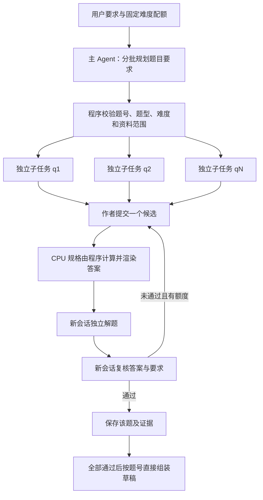

# H6：主 Agent 规划、独立逐题子任务与短规格作者

**当前结论：实验版架构已实现，单题中英文各交付一题；真实多题任务尚未成功交付，仍保留为可选模式。** 本轮 46 次真实调用均收到 HTTP 200，没有复现 H5 的输出截断或本地请求体超限；失败转移到了计划格式、工具能力匹配及最终答案对要求的覆盖。不能把“加大 tokens + 多 Agent”本身视为正确性或困难档命中的保证。

## 动机与实现边界

用户提出主 Agent 先决定各题要求，再交给新建子 Agent 生成与复核，最后组合完整材料。H5 的新题作者在同一工具会话中反复搜索方案，先后遇到思考输出耗尽和本地请求体过大。本轮将这个分工实现为 `AGENT_ORCHESTRATION=supervisor_v1`，保留原 `education-agent-v1` 持久化和原子调用账本。



首版是**主机管理的串行独立子任务**，不会让模型递归创建不受控子 Agent。子任务共享该用户、该任务的调用总额和检查点，独立持有本题要求与指定资料视图；作者、解题、复核各有新模型会话。这里的主要收益是上下文隔离和可恢复性，尚未实现或测量多题并发加速。

主计划按批输出，每批默认 8 题、最多 10 题；每题含题号、固定难度与题型、知识点、学习目标、具体要求和支持资料 ID，不包含答案。控制器拒绝缺题、重复题号、顺序变化、难度调档、未知来源和完全重复的目标组合。每批只接收最近 16 个简短计划作为方向提示；全部计划及调用历史仍存档。精确题干去重覆盖所有已接受题，模型语义复核只看最近 8 题，因此不宣称大型题集绝无语义重复。

子任务只读取分配的冻结资料，来源警告保留；只有主控制器保存完整证据，子任务不会覆盖其他题目的资料与结果。完整 brief 只交给作者，盲解题不接收目标难度、计划或作者答案；答案复核另接收 focus、learning_goal 和 requirements，检查题目是否满足分工。题型在单题请求中固定。最后由程序组装已验收内容，不额外调用模型重写整套答案。任一题未通过时，不发布半套材料；已完成题和规划保留以供合法续做。

对 CPU 结构化实验，规划器和规格作者在 Harness 中完全没有工具：MCP 列表和转发工具白名单都为空。作者只提交一个小型规格，由宿主程序计算，再让解题和复核角色核对。解题和复核保留受限工具；数值正确不自动豁免难度、来源或要求检查。通用非 CPU 作者仍保留原受限工具流程。

## 输出预算和协议依据

- `HARNESS_MAX_OUTPUT_TOKENS` 允许范围从 256–16384 扩展到 **256–32768**，配置默认仍为 4096。本轮真实实验显式使用 32768，包含思考和最终输出。
- 单阶段请求上限继续为实验设定的 4；本轮总调用硬计划上限 48。提高单次 token 上限增加潜在消耗，调用次数上限不等于美元费用上限。
- 主计划及所有子任务实际请求均进入同一任务账本；初始最低调用估计加上规划批次数。修改模式、规划版本、批大小、预算或 schema 后不能混用旧检查点。
- 官方接口允许更大的 `max_tokens`，但总输入和输出仍受模型上下文约束。[DeepSeek Chat Completions](https://api-docs.deepseek.com/api/create-chat-completion/)
- 带工具的思考调用需要回传先前完整 reasoning 历史；无工具请求无需把之前 reasoning 累积到上下文。采用独立短阶段，不通过随意截断必需历史掩盖问题。[DeepSeek Thinking Mode](https://api-docs.deepseek.com/guides/thinking_mode/)

## 调用前固定的实验计划

| 组别 | 内容 | 模式 | 输出上限 | 调用上限 |
| --- | --- | --- | ---: | ---: |
| H6A | 英文、中文各从头生成 1 道 hard CPU 题 | 主计划 + 独立子任务 + high + JSON + 最多一次字段重评 | 32768 | 20 |
| H6B | 英文、中文各从头生成 2 道 hard CPU 题并组装 | 同 H6A | 32768 | 28 |
| 合计 | 4 个任务，计划 6 道新题 | 隔离实验资料和数据库 | — | 48 |

资料仍使用既有冻结课程片段，跳过真实检索，因此本轮不衡量 RAG。与 H5 同时改变了主计划、作者工具能力、提示词及输出预算，是完整策略开发测试，不能单独归因于其中一个改动。不同组调用账本独立，但实际合计不得超过上表上限。所有未运行、未完成、质量否决与新增修复均保留，不能只统计成功候选。

指标分开记录：主计划契约、作者规格完成、工具输入绑定、模型正确性判断、模型难度符合、独立数值核查、子任务完成与完整题集交付；另计调用、tokens、耗时、截断、请求大小失败和缺失费用。没有教师/学生标注，模型判为 hard 不等于实测难度。

## 验证与结果

完整回归 **1461 passed、6 skipped、2 warnings**，88.72 秒，包含真实固定 Harness 与模拟提供商的协议测试；无付费模型调用。六项跳过仍是隔离 Docling/解析指标依赖，警告来自既有依赖弃用。见 [完整测试 XML](H6_FULL_VERIFICATION_20260919.xml)。

### H6A：中英文各一道新题

两题均在首次候选通过模型门槛，每题 6 次调用：主计划 1、作者 1、解题 2、复核 2。真实运行确认各角色 session ID 独立，规划和作者没有工具，解题/复核仍使用受限计算工具。没有发生字段重评或候选重写。

| 语言 | 完整交付 | 调用 | tokens | 已报告 reasoning tokens | API 耗时累加 |
| --- | ---: | ---: | ---: | ---: | ---: |
| 英文 | 1/1 | 6 | 81,257 | 31,647 | 140.909 秒 |
| 中文 | 1/1 | 6 | 88,260 | 27,403 | 130.046 秒 |
| 合计 | 2/2 | 12 | 169,517 | 59,050 | 270.955 秒 |

这不是 100% 的总体正确率。首次独立核查发现计划落实存在缺口：英文 focus 提到公平性，但实际仅验证了其任选分支中的切换预算；中文明确要求解释时间片取舍，最终说明却主要是服务量守恒核算。模型门槛通过不能替代逐条要求核查。独立数值审计和难度评分见 [英文复核](H6A_EN_INDEPENDENT_REVIEW_20260919.md)、[中文复核](H6A_ZH_INDEPENDENT_REVIEW_20260919.md)。

### H6B 观察后的有界修订

H6B 英文第一题的两个候选均通过工具输入绑定与模型数值检查、模型判断 hard，但复核两次指出缺少主计划要求的结尾解释，最终质量失败，第二题未开始。消耗 11 次调用、交付 0/2。这一失败说明：作者只允许修改数值规格时，无法补写由固定渲染器遗漏的解释；直接让它重做相同规格浪费调用，也不能修复缺项。中文同样在 q1 两次尝试后停止，12 次调用、交付 0/2。四个候选都没有通过完整质量门槛，两个 q2 均未执行；这些未执行题不计作数值错误。B 未做全量独立算术 oracle，模型复核中还出现了自身解释错误，详见 [失败审计](H6B_FAILURE_REVIEW_20260919.md)。

因此，本轮追加确定性渲染修订：由已有真实计算结果生成选择理由、指标比较、当前约束适用范围，明确已知服务量和提前完成约定；禁止凭空声称小时间片必然更优。数学计算和自由文本 schema 不变，编译器版本单独更新，H6A/B 原档案保留，不覆盖为新结果。

追加 H6C 将使用 H6A/B **实际调用之后的剩余额度**，本轮总计仍最多 48 次。优先重新生成英文两题并验证完整汇总；若剩余额度不足以支持两题的正常 Harness 往返，则只验证一题，并明确不计作多题交付。新题不是同一冻结问题，不能把结果变化完全归因于渲染修复。运行条件和实际调用将在开始前记录。

### H6C 调用前追加计划

H6B 已完成，英文 11 次、中文 12 次，共 23 次；两组均 `quality_failed`，接受 0/4 题，交付 0/4 题。H6A/B 已合计使用 **35 次**，因此 H6C 硬上限固定为 **13 次**。H6C 只测试英文新生成两题：`supervisor_v1`、`cpu_schedule_v1`、high、JSON、32768 输出预算、单阶段最多 4 次请求、最多一次字段重评和一次候选重写。采用独立数据库和同一 AI 自编教学 fixture，不读取账号课程；compiler 的解释修订及测试通过后才开始。若不能在 13 次内完成，不追加付费重试；已通过题目保留，完整题集交付仍按原分母 2 计算。

### H6C 结果与最后一次自适应修订

H6C 在规划阶段失败，实际仅用 1 次调用。q1 的第四条要求为 310 个字符，超过严格 schema 的 300 上限，控制器以 `protocol_failure` 停止，两个子任务均未执行。另经内容检查，q2 计划要求当前 CPU worker 不支持的 MLFQ；这个能力问题未被结构校验识别，不能把本次停止误写成能力校验成功。详见 [规划独立审核](H6C_PLAN_REVIEW_20260919.md)。这组不能验证新版 renderer 的实际效果。

据此显式修订上一节“停止后不再试”的开发计划：不续跑或覆盖 H6C，追加唯一一组 **H6D**，仍受原 48 次总额约束；这属于看到失败后的自适应开发，不是预注册的验证实验。H6A/B/C 已用 36 次，H6D 最多 **12 次**、英文两题、其他参数同 H6C，之后不再追加本轮付费实验。规划版本改为 `question-planner-v2-20260919`：CPU 能力中明确列出仅 `rr/stcf`，不支持 `fcfs/sjf/mlfq`，并要求能力范围优先于材料中的其他方法；要求每条目标控制在 200 字符内，为原 300 字符校验留余量。原 schema 不放宽，仍失败即停止；这里加强的是提示约束，尚无通用自然语言能力匹配证明。

renderer 修订后的完整回归为 **1478 passed、6 skipped、2 warnings**，86.73 秒，见 [完整测试 XML](H6_FINAL_VERIFICATION_20260919.xml)。规划提示修订后的相关回归为 **154 passed**，5.98 秒，见 [规划修订测试 XML](H6_PLANNER_V2_VERIFICATION_20260919.xml)，包括 310 字符要求阻止子任务启动及策略列表与真实编译 schema 一致的回归。完整回归包含模拟服务的真实 Harness 协议测试，不包含付费模型调用。

### H6D 结果与全轮账本

H6D 主计划通过结构校验，使用支持的 RR/STCF，但 q1 两个候选都未满足主计划要求的“进程之间响应/周转排序不一致的具体比较”。新增 renderer 已输出正确的方案级取舍、可行集合、选择理由及已知 burst 前提，仍无法补出该进程级论证。第二次复核把这一缺项同时标为 `explanation_correct=false`；它是要求覆盖缺口，不能不加区分地记为调度数值算错。q2 未执行，最终 10 次调用、0/2 题交付。见 [H6D 独立复核](H6D_INDEPENDENT_REVIEW_20260919.md) 和 [独立标准库计算程序](H6D_ORACLE_20260919.py)，不回写候选或放松验收要求。

独立计算确认两个候选各 3/3 场景、45/45 时间区间、12/12 进程行、15/15 汇总通过；计算声明分别 10/10、13/13。实际送审题目文字中的轨迹、指标、约束和最优结果一致。两个候选只改变 selection 约束，只有一组独特的三个仿真场景，不能作为六个独立场景计数。两轮主计划完整落实均为临时评分 4/5，hard 暂评均 3/5；关键教学目标缺失不能用总分平均掩盖。

| 组别 | 完整任务交付 | 计划题数 | 启动题数 | 编译候选 | 交付题数 | 调用 | 已报告 tokens |
| --- | ---: | ---: | ---: | ---: | ---: | ---: | ---: |
| H6A（旧 renderer） | 2/2 | 2 | 2 | 2 | 2 | 12 | 169,517 |
| H6B（旧 renderer，多题） | 0/2 | 4 | 2 | 4 | 0 | 23 | 348,514 |
| H6C（新 renderer，计划未通过） | 0/1 | 2 | 0 | 0 | 0 | 1 | 3,511 |
| H6D（新 renderer + 新规划提示） | 0/1 | 2 | 1 | 2 | 0 | 10 | 153,804 |
| 合计 | 2/6 | 10 | 5 | 8 | 2 | **46** | **675,346** |

“启动题数”按创建 attempt 记录计；本轮实际 8 条 attempt 均完成作者响应并编译成候选，两列没有差额。未启动的题仍留在计划/交付分母中，但不作为数值正确性反例。表格汇总的是不同开发版本、逐步自适应实验的工作量与交付情况，**不是独立同分布评测集上的正确率，也不应合并计算策略优劣显著性**。

46/46 次均有 tokens，已报告 reasoning tokens 为 232,805，是 completion/total 的子集，不能再加到总 tokens 上。API 耗时累加 1,081.615 秒，不是用户等待时间或并发速度。费用字段 **46/46 缺失，美元费用未知**。所有真实请求均设置 32768，模型请求和返回 ID 都是 `deepseek-flash`；schema 字段重评本轮没有触发。作者和主计划无工具，各次角色调用使用新 session。

审计序列化请求最大为 86,480 字符；这是审计 JSON 序列化口径，不能当成精确网络字节或模型输入 token 数。未发生截断、413 或预算拒绝，只能说明这些问题在本轮小样本中没有复现，不能保证大题集没有上下文问题。

可重新执行 [汇总脚本](H6_SUMMARIZE_20260919.py) 得到 [结构化结果](H6_RESULTS_20260919.json)。脚本对账调用 usage、独立任务 ID、角色会话、各组预算、代码快照与冻结资料哈希；每组 19 个代码文件全部通过校验，不读取凭据或调用模型。

## 复现与运行状态

开发入口是 `scripts/harness_correctness_experiment.py`。本轮各组共同参数为：

```sh
.venv/bin/python scripts/harness_correctness_experiment.py \
  --runtime deepseek_harness --question-spec cpu_schedule_v1 \
  --orchestration supervisor_v1 --plan-batch-size 8 \
  --thinking high --response-format json_object --schema-repairs 1 \
  --harness-max-requests 4 --max-output-tokens 32768 \
  --cases cpu_en_hard --questions-per-case 2 --call-cap 12
```

上例默认只冻结实验计划，**不调用 API**；本轮真实实验显式另加 `--live` 和各组独立 `--output` 目录。重做时使用新目录，保留原始档案。A/B/C/D 的 cases、题数、调用上限以各自 `manifest.json` 为准，不能将后来版本覆盖到前组代码快照后仍沿用旧结论。当前代码只支持相同配置和编译版本下续做，跨版本须建新任务。

应用默认仍保留 `sequential_v1`；未修改生产 `.env` 或用户课程。主 Agent 路径作为可配置实验功能提供，需要 `GENERATION_WORKFLOW=agent_v1`、`AGENT_RUNTIME=deepseek_harness` 和 `AGENT_ORCHESTRATION=supervisor_v1`。CPU 规格和本轮思考/JSON/预算选项均须另外显式启用。通用课程作者路径尚未在 H6 进行真实模型实验。

后续正式评测应冻结新的独立测试集，分别评估：计划能否由工具执行、逐条要求是否落实、答案正确、难度匹配、整组交付、tokens/费用/时延。模型复核本身出现过错误，不能充当唯一金标；教师标注和学生作答校准仍未完成。并发派发、通用自然语言能力验证和完整要求覆盖评分不在本轮已验证范围内。

下一轮优先改主计划与子任务之间的契约：把“方案约束选优”“指定时刻剩余服务”“进程间响应/周转比较”等任务表示成明确类型，每种类型对应题干、答案和复核条目；对当前不支持的类型，在派发前拒绝或改用支持它的生成路径。反馈若指向 renderer 不具备的表达能力，不能只让规格作者换数字重试。该方向尚未实现，不能把本轮的自然语言能力提示当成完整解决方案。
