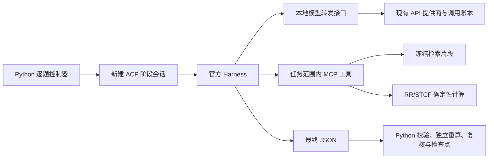

# Harness 候选后端

状态：可选实验后端。默认仍为 `AGENT_RUNTIME=native`。本轮没有更改生产 `.env`、用户资料或已生成内容。

已完成的 60 次真实调用、逐题复核、失败原因与最终选择见 [实验报告](EXPERIMENTS_20260919.md)。系统检查通过不等于答案已被独立证明正确。

追加的 35 次真实调用与 233 项相关回归见 [H4b 与 M1 记录](PROGRESS_20260919_H4B_M1.md)：结构化 CPU 出题及 DeepSeek off/high、Gemini high 的六题诊断。两个实验分别衡量生成流程与模型错误识别，不混合评分。

后续思考模式、严格 JSON、冻结题复核与有界字段重评见 [H5 记录](H5_THINKING_JSON_20260919.md)。JSON 语法、业务字段、工具输入绑定、答案正确性和难度分别计分；失败响应及新增调用完整保存。

[H6 主 Agent 规划与独立子任务](H6_SUPERVISOR_20260919.md)增加分批出题计划、每题资料范围和独立 worker；CPU 规格作者不再在工具循环中搜索方案，提交一次候选后由程序计算。该可选模式保留原持久化、权限和预算，单次输出预算可设置至 32768。

H6 真实多题交付尚未通过，当前不切换默认模式。已归档 46 次调用及全部失败，区分模型门槛、独立数值检查和实际要求覆盖。

[H7 灵活答案](H7_FLEXIBLE_ANSWERS_20260919.md)增加 `supervisor_v2`，通用题自由作答并逐项验收；CPU 题由无工具的 compose 会话为冻结结果补写解释。只有表达缺项时复用原规格重新写作，随后仍重新解题与复核；事实、难度和来源门槛保留。

H7 真实实验 31 次调用交付 5/6 道草稿，包含英文双题整组；引文修复成功仍可能漏检推理错误。全部逐题独立审核与负面样本已保留。当前实现另外按题归属资料，完整保留最多 50 题的局部上下文；该组卷修订仅完成离线重放和回归，未追加付费生成。

2026-09-24 起，新建且明确开启“逐题子代理”的任务采用 `isolated-question-recovery-v1`：正面复核若只有引文归属无效，先对原候选做一次独立重评；真实缺项、无效重评或角色输出结构错误会进入该题有界候选修复。耗尽后继续其余已规划题目，但只保存检查点，不发布残缺题组；用户明确继续时可同时扩展所有耗尽的题目。既有检查点保留创建时的策略，提供商错误、额度、权限和取消仍停止新派发。该策略的离线验证不等于真实模型修复成功率。

后续 [H4 正确性方案](H4_CORRECTNESS_PLAN_20260919.md) 已先修正 Harness 的检查次序与未核实反馈传播；[H4b CPU 结构化实验](H4B_STRUCTURED_CPU_20260919.md) 进一步实现冻结规格、确定性答案渲染及有限类型的断言计算。数据库及任意自由文本核查仍需后续工作。

## 接入边界

Python 控制器继续固定题目数量、难度配额、检索依据、逐题检查点和发布门槛。在 `deepseek_harness` 条件下，自动探索的资料覆盖判断、联网搜索、来源选择，课程讲解写作，以及题目的规划、作者、盲解、复核分别进入 ACP 会话；官方 Harness 在允许工具的阶段执行模型与 MCP 工具的循环。阶段完成后仍必须通过原有结构、来源、计算和质量门槛。

这属于在官方运行时上增加教学工具、控制器和实验设施，没有维护一份修改过的 Harness 核心，也不要求把现有 Python 后端迁到 TypeScript。官方 Python SDK 的安装包提供了匹配的原生运行时；应用通过 ACP 管理会话，以使用其取消和恢复协议。

## 可用工具与限制

- `get_reference_chunks`：读取本任务已经检索并冻结的资料，不是再次检索，不代表 RAG 召回率提高。
- `cpu_schedule_v1`：有界 RR/STCF 调度。工具证明输入对应的计算结果；输入是否忠实于题干，仍需检查。
- `search_web`：仅在开启 Auto exploration 的搜索阶段提供。Harness 从覆盖判断提出的公开概念查询中选择并调用；父进程沿用已有 curated/hybrid/Brave 搜索、账号额度和审计，返回候选网址。后续下载、许可证、正文证据、索引和最终覆盖检查仍按原流程进行。搜索工具不接收私有课程全文，也不能自行访问任意 URL。
- 关闭默认 Shell、文件操作、网页、子 Agent、自动目标推进、环境指令加载、辅助标题生成和远程遥测；运行时配置和版本一并固定。模型转发接口另外限制工具名称。
- MCP 每次调用重新检查任务、课程、账号归属及资料启用/删除状态。即使是离线实验，也要求资料属于已建档的课程。
- 每个子进程只得到一次性的本地代理令牌；真实提供商密钥留在父进程。所有真正的模型请求经过原有 API 账本，包含失败请求。
- 每阶段默认最多 6 次模型请求、每次最多 4096 输出 token、阶段超时 240 秒；单任务及账号每日总调用上限继续生效。字符限制不是精确的 tokenizer 上下文测量。
- 运行时不自动重试模型请求。超时会发送 ACP 取消并关闭该次进程及 MCP 子进程。

这里没有独立的操作系统沙箱声明：隔离由受限工具、最小子进程环境、版本固定、应用权限检查和本地代理共同实施。升级官方运行时必须重新检查工具清单，不能直接沿用本版禁用列表。

## 启用与恢复

安装和版本证据见 [安装记录](INSTALL_20260919.md)。保留 `GENERATION_WORKFLOW=agent_v1`，仅在希望试用候选后端时设置 `AGENT_RUNTIME=deepseek_harness` 并重启服务。`native` 则使用既有实现。Harness 模式也覆盖 `lesson` 和 Auto exploration 的模型阶段；网页“逐题子代理”开启后，父规划阶段和每题子任务都使用 Harness 会话，宿主按 `AGENT_MAX_PARALLEL_QUESTIONS` 有界并发调度。这里的子任务由宿主创建，Harness 内建的任意子代理派生仍关闭。

| 配置 | 默认值 |
| --- | --- |
| `AGENT_RUNTIME` | `native` |
| `AGENT_ORCHESTRATION` | `sequential_v1`；可选 `supervisor_v1` / `supervisor_v2` |
| `AGENT_PLAN_BATCH_SIZE` | 8；允许 1–10 |
| `AGENT_QUESTION_SPEC` | `none`；CPU 简答题实验可显式设置 `cpu_schedule_v1` |
| `HARNESS_PYTHON` | 项目 `.venv-harness/bin/python` |
| `HARNESS_EXECUTABLE` | 项目 `.venv-harness/bin/dsh` |
| `HARNESS_TIMEOUT` | 240 秒 |
| `HARNESS_MAX_REQUESTS` | 每阶段 6 次 |
| `HARNESS_MAX_OUTPUT_TOKENS` | 每次 4096；允许 256–32768，含思考 |
| `HARNESS_REASONING_EFFORT` | `off`；可选 `high` |
| `HARNESS_RESPONSE_FORMAT` | `text`；可选 `json_object` |
| `HARNESS_SCHEMA_REPAIRS` | `0`；`1` 允许 v2 规划、解题、复核及补写各最多一次字段重评；v2 复核也可改用一次引文重评，两者共享额度 |

`high` 会把工具循环中的思考字段完整传回模型；最终显示的答案仍须符合 JSON 契约。使用 high 时，`TEXT_EXTRA_JSON` 需要与其一致，例如 `{"thinking":{"type":"enabled"},"reasoning_effort":"high","max_tokens":8192}`；同时按实验需求设置 `HARNESS_MAX_OUTPUT_TOKENS=8192`。冲突配置在真实请求前拒绝。`HARNESS_RESPONSE_FORMAT` 控制 Harness 上游请求，不能只依赖 `TEXT_JSON_MODE`。

字段重评仅处理完整 JSON 对象中的字段缺失、额外字段或类型错误。v2 规划的重评也遵守这一开关：只重评 schema 字段错误，来源归属、题数、难度配额和重复规划仍直接拒绝。它使用原始任务与证据重新判断，可能改变质量结论，不能当成保持原答案不变的格式整理。原始响应、诊断、新响应分别保留；合法的错误判定、难度不符、无效 JSON、截断或上游错误不触发该分支。一次重评是一个新的 Harness 阶段，可能包含多次 API 往返，受 `HARNESS_MAX_REQUESTS` 限制；所有请求仍受同一任务及每日调用上限控制。

`supervisor_v2` 还可对其他判断均正面、但逐项成品引文无效的复核重新审核一次。它与该次复核的字段重评共享一次机会，不累计；不会据此重评已有负面质量判断。新审核必须重新验证实际题干和答案，可给出负面结论。原始和重评结果全部保留。

业务恢复仍采用现有“继续生成”：缓存已完成阶段，仅为未完成阶段创建新的独立会话。不会在不确定计费时自动重放请求。官方 ACP 原生 `session/resume` 另有隔离验收，不能把它等同于应用已经恢复了阶段内部的每次工具调用。

切换后端、模型、提示版本或相关预算时，旧任务不能混用新配置继续运行。生成过程的最少调用数预检仍只是下界；Harness 额外工具循环会增加真实调用数。

## 记录与实验方法

任务 evidence 中每次阶段调用新增 `harness` 记录，包含实际模型往返、ACP 事件、会话编号、版本、停止原因和工具审计路径。完整工具输入与计算轨迹另存于私有运行目录。重试、超时、格式失败、误接受和误拒绝都保留。

2026-09-24 的 adapter v8 在逐项复核阶段使用 `candidate-evidence-selection-v1`：程序仅从当前成品的题干、答案和解析生成原文片段编号，模型选择题干与答案编号并解释语义判断，程序还原成原有逐字引文字段后继续验证要求、来源范围和质量。编号错误、题干/答案字段混用、缺少正面判断所需的证据均拒绝；负面判断保持原值。片段目录、候选哈希及模型原始编号保存在阶段报告中，独立解答与课程资料不混入成品证据目录。实际传给 Harness 的扩展上下文仍受字符上限约束。真实原文锚点只解决引用归属，不能证明语义判断正确；该协议没有提高通过标准之外的内容可信度。

同版在作者阶段明确重复 `Question`、`DifficultyDesign` 的合法字段与当前难度的评分步骤数量；困难题需保留必要原始证据，并避免在题干中提前给出学生应推导的解释或结论。所有修改分别有版本记录，旧实验输出不回写。

固定题重放、困难题重复及 high 截断诊断见 [2026-09-24 后续改进报告](../runtime-comparison/IMPROVEMENT_20260924.md)：26 次真实调用；3 份新草稿中 2 份严格匹配目标难度，1 份降为 medium。引用有效性与内容正确性、实测难度分别报告。

运行 `scripts/harness_correctness_experiment.py` 默认只保存计划及代码快照，不调用 API。加 `--live` 才跑真实模型；可用 `--cases canary`、`--cases live` 缩小范围。默认全局上限为 64 次，两个条件交错运行，并使用相同模型、冻结资料、4096 输出上限和关闭 thinking 的配置。

候选条件增加了工具循环说明及 Harness 系统包装，所以比较对象是两套运行策略；不能把差异全部归因于某一个提示词。真实实验还需单独复核题目正确性，不能把内部质量门槛通过率直接称作准确率。当前样本是开发回归样例，没有教师或学生标注，不能证明学习者的实测难度。

## 官方参考

- [DeepSeek Harness](https://github.com/deepseek-ai/deepseek-harness)：运行时、插件与许可证。
- [Python SDK 文档](https://github.com/deepseek-ai/deepseek-harness/tree/master/python/sdk)：隔离运行时和 SDK 边界。线上 master 可能高于本项目固定发布版。
- [ACP 实现与说明](https://github.com/deepseek-ai/deepseek-harness/tree/master/packages/acp/acp)：会话、取消、恢复与 MCP 接入。
- [MCP 客户端](https://github.com/deepseek-ai/deepseek-harness/tree/master/packages/mcp/mcp-client)：外部工具接入。

当前具体行为以本地安装版本和实测归档为准，而不是把最新分支文档当成已安装版本的保证。
