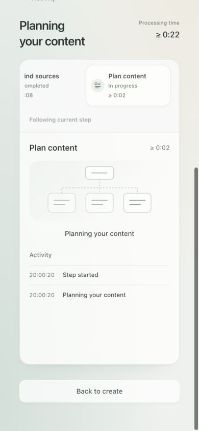
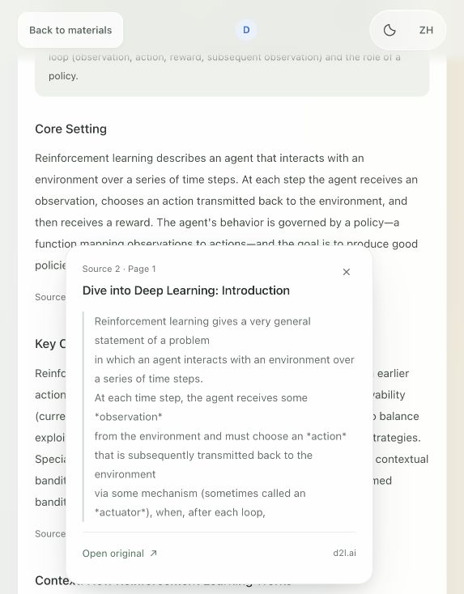
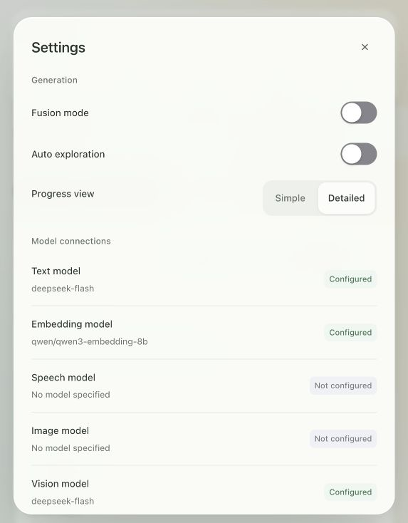
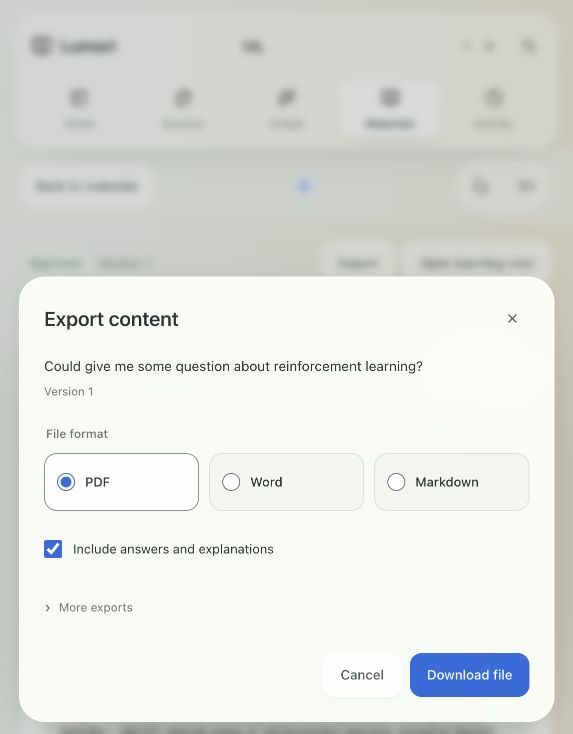
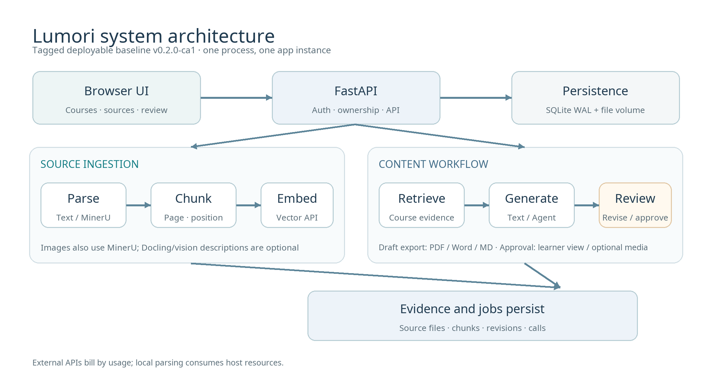
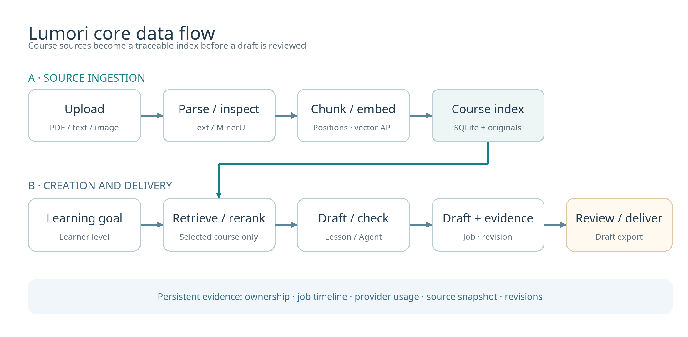

# Lumori Business Plan Handoff

Snapshot: 23 September 2026  |  For a future business plan, product demo, and cost model

> Lumori is a working prototype for producing source-grounded learning materials and assessments from course documents. Its review workflow can be demonstrated. Separate teacher and learner permissions, classroom deployment, learning outcomes, and revenue have not yet been established.

## Executive brief

Lumori ingests course PDFs, text files, and images; builds a source-aware retrieval index; and drafts lessons, quizzes, and assignments. A user can inspect citations and answers, edit versions, approve content, open the owner's learner view, and export PDF, Word, or Markdown files.[S1][S2] This supports a product and technical feasibility story. Automated checks and fixture screenshots do not establish educational accuracy or student outcomes.

| Area | Evidence ready for the plan | Evidence still needed |
| --- | --- | --- |
| Use case | Source import, guided creation, citation review, editing, learner view, export | Paying customer, buyer, operator, and pilot setting |
| Product state | Tagged deployable code baseline `v0.2.0-ca1`; separate research worktree has later changes | Frozen live demonstration and verified deployment |
| Architecture | FastAPI, browser ES modules, SQLite, in-process queue, RAG, provider adapters | Capacity, service targets, institutional permissions, security review |
| Cost | Official unit prices and reproducible model-cost example | Actual tokens, retries, hosting, backup, reviewer labor |
| Outcomes | Archived live API/RAG runs, tests, retrieval experiment | Same-version end-to-end run, independent teacher review, learner results |

## Version and evidence boundaries

The **tagged deployable baseline** is the separate `/Users/theoverflow/Downloads/Lumori` repository at commit `ef173657`, tag `v0.2.0-ca1`. The research repository `/Users/theoverflow/Downloads/FYP` has committed snapshot `698ad29` / `ca1-2026-09-20`, plus uncommitted changes as of this handoff. A feature in the research worktree is not automatically in the tagged deployment baseline.[S3][S4]

| Evidence tier | Available material | Supported claim |
| --- | --- | --- |
| A: code and tag | Deployment README, Compose, Dockerfile, routes, Git tag | Implemented flow and deployment constraints |
| B: interface and tests | Browser captures, fixture descriptions, regression tests | Visible UI and behavior in a stated environment |
| C: archived live runs | CA1 records, RAG experiments, provider call logs | Technical result for that version, date, and dataset |
| D: human outcomes | Independent teacher and learner evidence is insufficient | No correctness rate, time saved, grade gain, or market validation claim |

In the R4 held-out experiment, answer-span hit rate remained 97.02% to 97.02%, while MRR@5 rose from 0.8868 to 0.9524. This supports better ranking under those experimental conditions. It is neither a recall gain nor a learner outcome.[S5] Archived live calls show that particular earlier interfaces and flows worked; they do not verify every feature in the current worktree or a current provider connection.[S6]

## User manual

### Users and preparation

All accounts currently have the same capabilities. An account owner can create a course, generate and review content, and open its own learner view. There are no separate teacher and learner roles, cross-account sharing, email verification, or password recovery. Describe this as a review-oriented workflow, not an institution-wide role system.[S2]

For a demonstration, use an authorized sample course, a test account, and non-sensitive materials. The operator configures text, embedding, and chosen reranking services in `.env`. A UI label of *Configured* means fields are present; a real call must verify connectivity. The default limit is 100 API calls per account per UTC day, including failed attempts. It limits call count, not spend.[S1][S2]

### From source document to reviewed material

1. **Sign in and create a course.** Open `http://127.0.0.1:8765`, sign up or sign in, and create a course. Courses, files, jobs, content, and ratings are account-scoped.[S1][S2]
2. **Import sources.** In *Course sources*, upload PDF, UTF-8 TXT/Markdown, PNG, or JPEG. One file may contain at most 10 MB or 300 pages. For PDFs and images, select MinerU Standard or Advanced; figure understanding is optional. Identical file content is deduplicated within a course.[S1][S2]
3. **Check and index.** In *Text and images*, compare extracted text with the original page. The presence of text does not prove accurate recognition. Build the index and enable the source for new retrieval. Rebuild after reparsing or changing embedding endpoint/model settings.[S2]
4. **Set the request.** In *Create materials*, choose lesson, quiz, or assignment. Supply the learning goal, language, and learners' prior knowledge. Quizzes and assignments support question type, 1 to 50 questions, and integer allocations across Easy, Medium, and Hard; the allocations must sum to the question count. An introduction, clarification, and query fusion are optional.[S1][S2]
5. **Follow the job.** The activity page shows stages relevant to that job. Generation may show retrieval, optional exploration/planning, writing/checking, and saving; parsing and indexing are separate jobs. A failed request can be restored for editing; checkpointed question jobs may resume. An upstream request already sent may still be billed after interruption.[S2]
6. **Review the draft.** In *Materials & review*, inspect each question, answer, explanation, target versus model-assessed difficulty, and cited source. Editing creates a new version and removes prior approval. Citation IDs and model checks are review aids, not proof of correctness.[S1][S2]
7. **Export or approve.** Any saved draft may be exported as PDF, Word, or Markdown for review; question exports may omit answers. Approval is required for the owner's learner view and for optional audio or image generation, which then needs separate media review. Video has a placeholder but no generation request. Ratings are version-specific.[S1][S2]


Figure 1. English difficulty-allocation UI, captured locally on 20 September 2026 before submission. It shows controls, not a completed generation.[I1]



Figure 2. English mobile progress UI from an isolated fixture on 20 September 2026. Stage events and elapsed time are simulated, not performance data.[I2]



Figure 3. English citation popover on an existing local version, captured on 20 September 2026. A visible citation does not prove that its claim is correct.[I3]



Figure 4. English settings UI, captured on 20 September 2026 without changing preferences. *Configured* is not a connection test.[I4]



Figure 5. English export sheet, captured on 20 September 2026 without downloading. It illustrates formats and the answer toggle.[I5]

Disabling a source excludes it from **new retrieval** but retains the file, index, and historical citations. Deletion moves it to *Recently deleted* without immediately freeing disk space; restoration leaves it disabled until re-enabled. Existing materials are not rewritten. An in-progress question Agent may stop at its next source-scope check after a source is disabled or deleted. Editing text creates a new version; old media does not carry into that version's learner view.[S2][S4]

The research worktree gained safe job stopping, read-only partial results, and single-question revision on 22 September 2026. Fixture and test evidence exists, but these changes are not in tag `v0.2.0-ca1`. Treat them as an iteration pending a new frozen deployment and acceptance run.[S7]

## System architecture and technical design



Figure 6. Architecture of the tagged deployable code baseline. Audio and image paths are optional; video is not shown as an implemented output.[S3][S4]

| Layer | Main modules | Responsibility and boundary |
| --- | --- | --- |
| Browser | Native HTML/CSS/ES modules | Course, source, creation, activity, review, learner, export screens |
| API | FastAPI `app/main.py` | Sessions, ownership checks, course/file/job/content routes, static UI, exports |
| Workflow | `app/pipeline.py`, `app/generation_agent.py` | In-process queue, parsing/indexing/retrieval, generation and checking |
| Data | SQLite `app/store.py` and `data/` | Users, sessions, chunks, jobs, evidence, revisions, calls; files and media on disk |
| Providers | `app/providers.py` | Text, embedding, reranking; optional vision, speech, image services |

**Ingestion.** TXT and Markdown are read directly. PDF/image parsing uses local MinerU Standard/Advanced; optional Docling figure crops can be described by a vision provider. The R4 chunking configuration uses a 256-token Qwen-tokenizer body limit and preserves page, section, and source-position metadata. A replacement index is committed only after a successful embedding batch.[S1][S8]

**Retrieval.** Requests are restricted to enabled, indexed sources in the account's selected course. Bounded hybrid retrieval can be followed by a dedicated reranker before evidence enters a limited source-context budget. Optional query fusion may add text and embedding calls; exploratory results do not prove a default gain.[S1][S2][S8]

**Generation.** Lessons use structured text generation. Quizzes and assignments use a per-question Agent by default: authoring, independent solving, answer/source/difficulty review, and bounded repair with checkpoints. Model assessments support human review. Draft, source snapshot, call record, and first revision are persisted together.[S1][S4]

**Security and reliability.** Passwords use scrypt; only session-token digests are stored. Write requests have CSRF and origin/Host checks; data routes verify account ownership; model endpoints require HTTPS. Operator-level model connections are shared across accounts. SQLite WAL and the in-process queue require one Uvicorn process and one app replica. The tagged baseline's `/healthz` confirms HTTP responsiveness only, not database or worker readiness. On restart, queued work is restored and interrupted running work is recorded as failed. External providers do not offer end-to-end exactly-once guarantees.[S1][S3][S4]

## Core data flows



Figure 7. The upper path builds a traceable course index. The lower path creates and reviews material. A saved draft can be exported; approval unlocks the learner view and optional media. Providers have variable usage, and local parsing consumes host resources.[S1][S4]

| Step | Input to processing to stored output | Failure or review point |
| --- | --- | --- |
| 1 Import | File/course ID to type, size, ownership and hash checks to original and job | Confirm file rights and sensitivity before upload |
| 2 Parse | TXT/MD directly; PDF/images via MinerU; optional Docling/vision to pages, text, figures | Compare extraction and descriptions with original |
| 3 Index | Chunks/source positions to embedding API to SQLite vectors and metadata | Rebuild after embedding changes; avoid mixed versions |
| 4 Retrieve | Goal and enabled course sources to query embedding, hybrid retrieval, optional rerank to evidence snapshot | Weak evidence may trigger refusal; a hit is not semantic support |
| 5 Draft | Learner context, type, difficulty, evidence to model/Agent/checks to job and draft | Preserve failures; human checks answers |
| 6 Deliver | Saved revision to review export; approved revision to learner view and optional media | New edit removes approval; no cross-account public sharing |

## Deployment and operations

The tagged deployment repository starts with Docker Compose. On a new machine, the operator supplies API credentials in `.env`; never include keys in a business-plan attachment or screenshot.[S3]

```sh
git clone https://github.com/TheOverflowing/Lumori.git
cd Lumori
cp .env.example .env
# Edit .env locally; set at least TEXT_API_KEY and EMBEDDING_API_KEY.
docker compose up -d --build
docker compose logs -f init app
```

The default `full` CPU-oriented image includes isolated MinerU 4.0.2 and Docling 2.128.0 environments. `init` downloads/verifies models before app startup. `core` is for TXT/Markdown trials only; it lacks complete PDF/image parsing. The default listener is `127.0.0.1:8765`. Public use would require an HTTPS proxy, correct Host/protocol forwarding, trusted proxy IPs, and secure cookies. Registration is open, so this prototype is not an enterprise permission system.[S3]

Docker volume `lumori_data` holds runtime data; `lumori_models` holds models. Stop the app before copying the whole `data/` directory, including SQLite WAL, uploads, revisions, and media; back up `.env` separately and securely. Ordinary `docker compose down` preserves volumes; `down -v` deletes them. Review schema changes and take a matched backup before upgrading or rolling back. Adding Uvicorn processes or app replicas is unsupported; changing internal task-worker counts alone is not a validated capacity plan.[S3]

## Costs and unit economics

### Current default models and official list prices

Prices were checked on **23 September 2026** and are supplier list prices, **not a Lumori bill**. USD and CNY DeepSeek schedules are separate quotations, not currency conversions. Apply the billing currency and rates of the actual account.[P1][P2][P3][P4]

| Service or fee | Unit | Off-peak or standard | Peak or qualification |
| --- | --- | --- | --- |
| DeepSeek `deepseek-flash`, uncached input | 1M tokens | US$0.15; China page ¥1 | US$0.30; China page ¥2 |
| DeepSeek cached input | 1M tokens | US$0.003; China page ¥0.02 | US$0.006; China page ¥0.04 |
| DeepSeek output | 1M tokens | US$0.60; China page ¥4 | US$1.20; China page ¥8 |
| OpenRouter Qwen3 Embedding 8B | 1M input tokens | US$0.01 | Routing and availability can change |
| OpenRouter Qwen3 Reranker 8B | 1M input tokens | US$0.20 | Routing and availability can change |
| OpenRouter Standard credit fee | Credit purchase | 5.5% | At purchase, not a second per-call inference charge |

The Chinese DeepSeek page defines peak hours as 09:00 to 12:00 and 14:00 to 18:00 Beijing time on weekdays, excluding Chinese public holidays. Confirm the account's applicable schedule.[P1][P2] A research record shows `known_cost_usd=0` together with `unknown_cost_attempts=132`: this is **unknown cost**, not free inference.[S9]

### Reproducible illustrative workload

Assume **one generation job**, across all model calls, uses 20,000 uncached text-input tokens, 5,000 text-output tokens, 2,000 embedding-input tokens (including amortized indexing), and 10,000 reranker-input tokens; assume no retries or cache hits. These are planning inputs, not measured Lumori usage.

```text
Text off-peak = 20,000 / 1,000,000 x $0.15 + 5,000 / 1,000,000 x $0.60 = $0.006
Text peak     = 20,000 / 1,000,000 x $0.30 + 5,000 / 1,000,000 x $1.20 = $0.012
Embedding + reranking = 2,000 / 1,000,000 x $0.01 + 10,000 / 1,000,000 x $0.20 = $0.00202
USD-list inference total = $0.00802 to $0.01402 per job
China-page text only = ¥0.04 to ¥0.08 per job; OpenRouter remains US$0.00202 per job
```

| Monthly assumption | USD-list inference | Separate China-page text plus OpenRouter |
| --- | --- | --- |
| 100 jobs | US$0.802 to 1.402 | ¥4 to 8 plus US$0.202 |
| 1,000 jobs | US$8.02 to 14.02 | ¥40 to 80 plus US$2.02 |
| Every token category x10 | Each inference figure x10 if rates/timing stay the same | Same proportional condition |

These figures exclude any credit-purchase fee, clarification, query fusion, retries, extra Agent repairs, vision/media calls, tax, exchange, hosting, and labor. A complex job can consume far more tokens. Build P50/P90 unit costs from provider usage and bills, then divide by **acceptable drafts**, not raw jobs. A 100-call daily limit is not a money budget.[S1][P4]

### Infrastructure and future capabilities

The existing local demo adds no cloud-server rent, but MinerU/Docling/OCR consumes CPU, disk, electricity, and maintenance. Estimate electricity as `incremental watts x operating hours / 1000 x local electricity price`. For a hosted pilot, separately quote instance, storage, snapshots/backup, bandwidth/egress, domain amortization, monitoring, and support. No minimum host size for the `full` parser has been established by representative load tests; no public-hosting bill is established here.[S3][P5]

Do not include speech, generated images, or video in the **current default** unit cost. Speech/image are configurable code paths but need a provider and acceptance test; video is not integrated. China-region alternatives must be priced and adapted before inclusion. Replacing the embedding model requires a rebuilt index and renewed retrieval evaluation; a reranker or media provider may need protocol adaptation.[S1][S2][P6]

A future monthly sheet should track `fixed infrastructure + text tokens + embedding tokens + reranking tokens + local parsing compute + media + backup + human review/support + payment/tax`. Revenue, gross margin, or cost per learner remain assumptions until buyer, price, usage distribution, review labor, and invoices are known.

## Material for the future business plan

| Plan section | Reusable material | Evidence required for an external claim |
| --- | --- | --- |
| Problem and customer | Course-grounded drafts with citations and human review | Teacher interviews, baseline preparation time, alternative comparison |
| Solution | Figures 1 to 7, user journey, tagged deployable prototype | Same-version demo with non-sensitive examples |
| Technology | Account/course scope, source positions, ranking, per-question checks, revision evidence | Human-labeled held-out course set, independent quality/competitor comparison |
| Market | Initial use-case hypothesis | Auditable TAM/SAM/SOM sources, procurement, willingness to pay |
| Business model | Explicit unit-cost formula | Offering/pricing, actual cloud bill, support/reviewer labor |
| Milestones | `v0.2.0-ca1` code baseline and research iterations | Frozen next release, teacher pilot, learner results, reliability/security review |

The next writer should collect: (1) a frozen-version demonstration from import through indexing, generation, review, and export, including a failure; (2) independent subject-teacher ratings of source support, correctness, answerability, and difficulty; (3) pilot users' editing time and any learning outcomes; and (4) per-job tokens/calls/bills plus hosting, backup, and reviewer time. Until then, customer value and margins are hypotheses and validation plans.[S6]

## Source and image register

| ID | Source and use |
| --- | --- |
| S1 | `lumori-fyp/README.md`, `app/main.py`, `app/pipeline.py`, `app/providers.py`, `app/store.py`: research-code behavior and configuration |
| S2 | `lumori-fyp/docs/USER_GUIDE.md`: account, source, generation, review, learner, export behavior |
| S3 | `Lumori/README.md`, `compose.yaml`, `Dockerfile`: tagged deployment, volumes, backup, single-instance limit |
| S4 | `Lumori/app/main.py`, `app/pipeline.py`, `app/generation_agent.py`: tagged routes/workflow at `v0.2.0-ca1` / `ef173657` |
| S5 | `lumori-fyp/docs/rag/R4_RESULTS_20260912.md`: held-out ranking result and conditions |
| S6 | `lumori-fyp/docs/ca1/CA1_Readiness_Audit_20260919.md`: demo and independent review gaps |
| S7 | `lumori-fyp/docs/ops/TASK_RELIABILITY_AND_REVISION_20260922.md`: research-worktree job controls and revision |
| S8 | `lumori-fyp/docs/rag/README.md`, `docs/parsing/README.md`: chunking/parsing/retrieval research boundaries |
| S9 | `lumori-fyp/docs/rag/r8b-experiments/20260920T020637637502Z/costs.json`: missing provider cost fields |
| I1, I3-I5 | Screenshot provenance: `lumori-fyp/docs/thesis/figures/v0.4/screenshot_provenance.json` |
| I2 | Fixture provenance: `lumori-fyp/docs/ui/citations-motion-20260920/README.md` |
| P1 | DeepSeek international price: https://api-docs.deepseek.com/quick_start/pricing/ |
| P2 | DeepSeek China price: https://api-docs.deepseek.com/zh-cn/quick_start/pricing/ |
| P3 | OpenRouter embedding: https://openrouter.ai/qwen/qwen3-embedding-8b ; reranker: https://openrouter.ai/qwen/qwen3-reranker-8b |
| P4 | OpenRouter credit fee: https://openrouter.ai/pricing ; support: https://openrouter.ai/support/ |
| P5 | Alibaba Cloud ECS billing categories: https://help.aliyun.com/zh/ecs/billing-overview |
| P6 | Alibaba Cloud Model Studio prices: https://help.aliyun.com/zh/model-studio/model-pricing |

Before commercial deployment, review the released parser/model versions and licenses, course-content rights, and the chosen region's data-processing terms. This handoff is not a legal or procurement approval.[S3]
