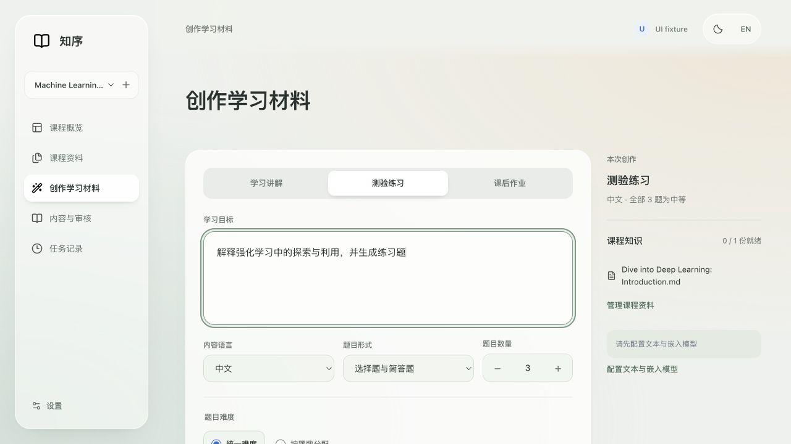
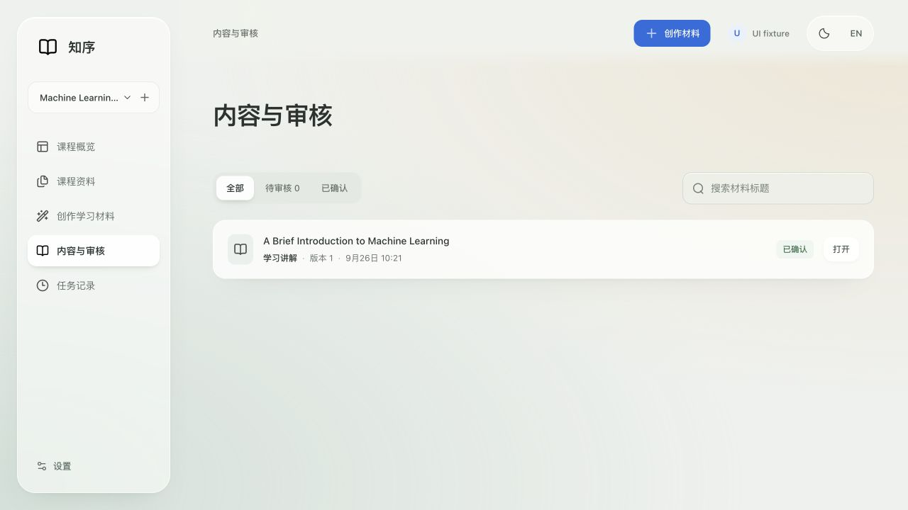
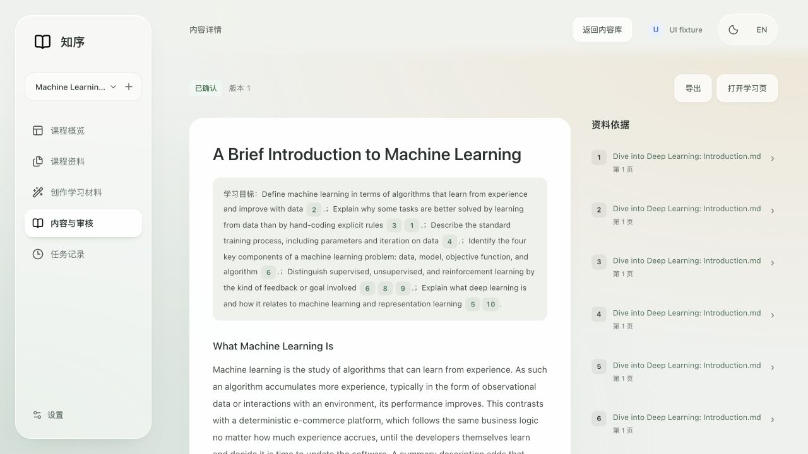
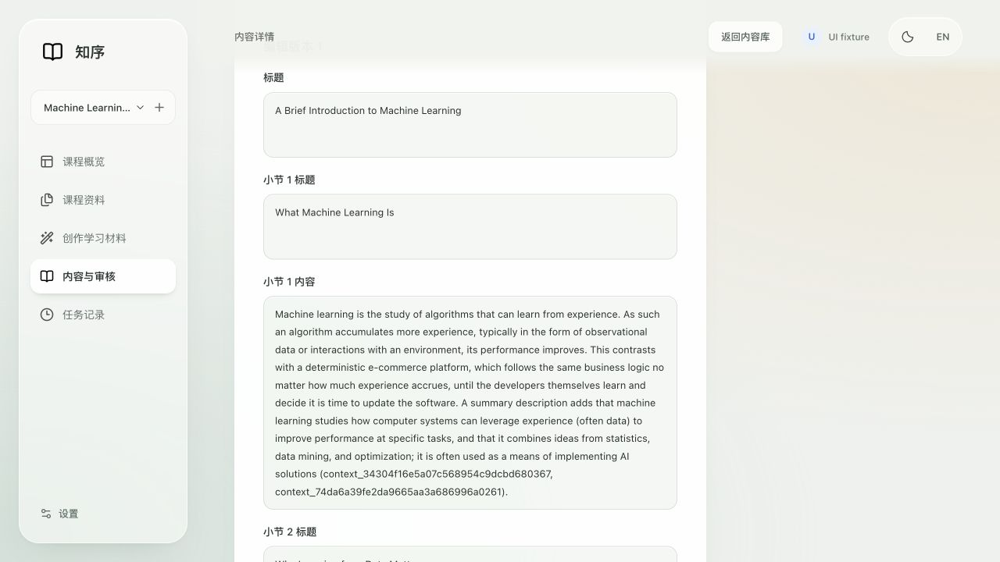
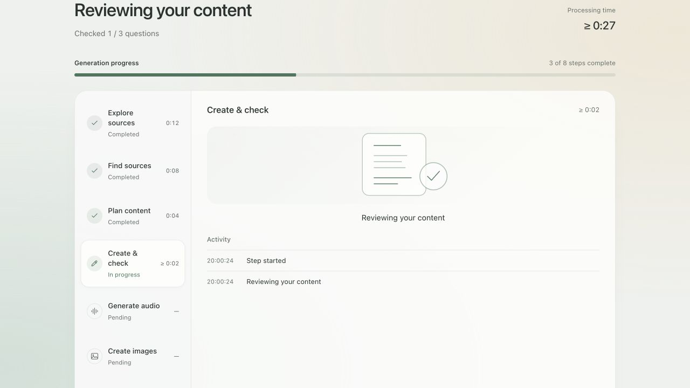

# 前端下一轮改进建议

2026-09-26。范围：创作表单、内容库、长文阅读、手动编辑、生成进度。使用当前代码的隔离课程与临时数据库；未修改产品代码或真实课程。

## 本次查看的步骤

### 1. 填写创作要求 — 结构清楚，草稿保护需要优先补齐

材料类型、目标与难度已有明确分区。实际填写目标并选择测验后刷新，目标清空、类型恢复为学习讲解。代码中草稿只保存在按课程划分的内存 Map（app/static/app.js:41、349）。建议持久保存账号和课程各自的生成草稿，返回或刷新后恢复，提供清空草稿入口。既有失败任务从服务器恢复条件的能力应保留。

该隔离页面未配置模型，生成按钮禁用并给出配置入口；这不是对正式环境配置状态的判断。

### 2. 浏览内容库 — 基础清晰，适合补齐连续浏览与规模管理

已有课程隔离、材料类型图标和标签、状态筛选及标题搜索。建议增加材料类型筛选、排序，以及返回列表时的滚动位置和焦点恢复。代码目前在路由渲染后统一回到页面顶部（app/static/app.js:290），内容库搜索和状态筛选本身已有保留。

内容和资料的规模优化应先用大列表测量，再选择分页或加载更多。任务历史后端只返回最近 30 条（app/main.py:513–519），可增加查看更早记录的入口。本次单条内容样本不能证明大列表的性能瓶颈。

### 3. 阅读并核对资料 — 引用入口明确，长内容定位有改进空间

正文已有引用标签与资料侧栏，导出和学习页入口清楚。长篇内容缺少章节目录；顶部学习目标被拼成大段文字。同一文档的十个片段在右侧显示为十条同名来源。

建议增加可收起的章节／题号导航，把学习目标分点显示，并把资料侧栏按文档分组、组内保留每个片段及页码。引用点击仍应准确定位原片段，不能因合并显示而丢失追溯关系。

### 4. 手动编辑 — 可以编辑，但需要降低操作负担

点击编辑后出现完整长表单；正文中的内部 context 编号直接暴露在文本框中。建议按章节／题目就地编辑，把引用变成受保护的标签或独立选择项，保留引用绑定关系。补充编辑草稿保存与未保存离开保护。

代码已具备逐题 AI 修改及本次修改前后对比（question-revision.js），建议是在其基础上完善手动操作，而不是重复建设。

### 5. 查看生成进度 — 当前反馈完整，可暂时保持

模拟状态下能看到阶段、已检查题数、耗时、进度条和处理记录，阶段可以选择查看。这部分当前优先级低于草稿和审核体验。截图包含为验证扩展能力而声明的媒体阶段，不代表正式任务已启用所有媒体功能，也不代表真实模型耗时。

## 建议的执行顺序

1. 草稿保存和未保存编辑保护：先避免重复填写和编辑丢失。
2. 长内容导航与局部手动编辑：减少长距离滚动和反复定位。
3. 引用编辑保护、同文档资料分组：兼顾整洁与证据可追溯。
4. 返回位置恢复、材料类型筛选、历史记录入口：改善日常连续操作。
5. 用大量资料、长内容和窄屏建立可重复的性能检查，再决定分页、分段渲染或其他优化。

## 可访问性与证据边界

已观察到跳转到内容入口、表单标签和焦点样式。小号次要文字、长编辑表单的键盘路径、缩放和屏幕阅读器体验仍应专项检查；仅凭截图不宣称可访问性达标。截图均在本轮捕获、保存并查看。一次异常的整页拼接截图已被正常视窗截图替换，不作为证据。

本次没有真实生成任务、性能跟踪或正式数据修改。刷新丢失生成草稿通过实际交互确认；路由返回顶部、逐题编辑结构和最近 30 条任务限制来自当前代码检查。保留既有按行更新、请求取消和后台暂停轮询，不推断这些功能缺失。
