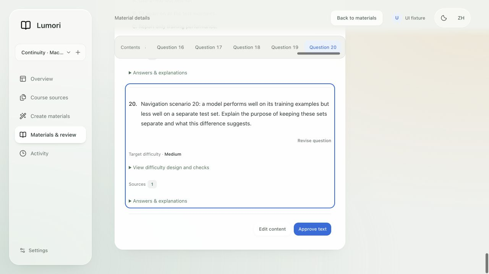
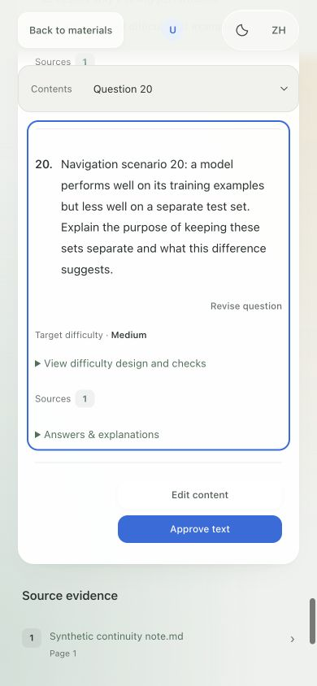

# 草稿、返回位置与内容导航

2026-09-26。完成上一轮审查建议中的第一批优化；没有改动真实课程数据，也未调用真实模型。

| Before | After | Why |
| --- | --- | --- |
| 生成条件只保存在页面内存，刷新丢失。 | 生成草稿按账号与课程保存到当前浏览器，支持恢复与清空。 | 减少重复填写。 |
| 手动编辑只在提交新版本后保存。 | 编辑草稿绑定账号、课程、内容及基础版本；支持刷新恢复、收起继续、主动丢弃。 | 保留未提交的工作，避免把旧稿覆盖到新版本。 |
| 返回列表统一滚到顶部。 | 内容、资料、任务列表按原可见行恢复位置和按钮焦点；保留内容库与资料页的搜索／筛选。 | 便于连续查看多个项目。 |
| 长内容只能连续滚动阅读。 | 正文上方增加吸顶章节／题号目录，窄屏使用下拉选择。 | 快速定位并保留当前阅读位置。 |

## 行为细节

- 草稿写入有 400 ms 防抖，页面隐藏、离开及关闭前同步处理待保存内容。恢复只读取当前账号和课程；编辑草稿还必须匹配基础版本。
- 只保存可编辑字段，不写入模型密钥、会话令牌、来源正文等无关数据；正文中的原有引用与题目绑定由当前服务器内容保留。
- 草稿保留 30 天。这是本浏览器保存，不是跨设备同步。每份持久化记录上限为 512 KiB；超限或存储失败时保留同一页面会话内的草稿，并显示限制、在关闭／刷新前进行未保存保护。
- 创建生成任务成功后，只清除仍与该次提交一致的草稿；后续新输入不被旧请求清除。保存编辑新版本时同样比较提交快照，避免迟到回复删掉更新的编辑稿。
- 资料页和内容库的筛选状态按课程保留。返回位置以可见行及其屏幕偏移恢复，行被删除时退回原滚动偏移；加载期间用户主动操作会取消迟到的位置恢复。
- 目录不修改页面路由；键盘定位携带焦点，减少动态效果模式立即定位。长题观察题号标记，页尾会正确高亮最后一题。导航适用于审核正文、部分题目结果和学习阅读页，空内容／单一内容块不显示多余目录。

## 验证

- `node --test tests/frontend_*.test.mjs`：291 项通过，0 失败。
- JavaScript 语法检查及 `git diff --check` 通过。
- 隔离测试入口：`scripts.frontend_continuity_fixture:create_fixture`，本次使用 loopback 8777。临时数据库有两个账号、三个课程、主课程 36 条内容，以及一份含 20 题和 2 章节的长内容。模型端点全部未配置，不调用模型服务。
- 实际填写目标、材料类型、内容语言和追问选项后刷新，内容恢复；第二课程初始为空，输入自己的草稿后可以独立恢复；清空后保持默认空表单，不重新生成“已保存”的空草稿。
- 切到第二账号，未显示第一个账号的目标；第二账号填写自己的草稿后退出，原账号重新登录仍恢复原目标。
- 在长列表打开材料再返回，恢复到原材料附近并重新聚焦该材料的打开按钮。
- 修改长内容标题后刷新，显示编辑草稿入口；继续编辑时恢复修改，收起后仍可继续。提交后产生版本 2，标题更新，旧版本草稿入口消失。
- 桌面和 390 px 窄屏均验证第 20 题定位；窄屏页面宽度仍为 390 px，无横向页面溢出。修复了底部空间不足时仍高亮第 19 题的问题。浏览器捕获的控制台错误为 0。
- 单元测试还覆盖损坏记录、过期、跨版本、延迟回复、删除回退、用户中断、超大草稿内存恢复、存储异常和减少动态效果。未做跨设备同步、真实生成耗时或设备帧率测量。

## 最终界面

桌面：目录跟随阅读，并支持键盘直接定位。

窄屏：目录自动收为下拉选择，题目不被顶部栏遮住。

