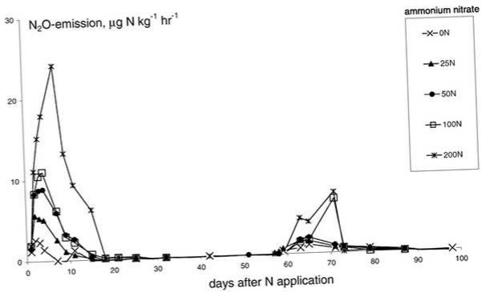
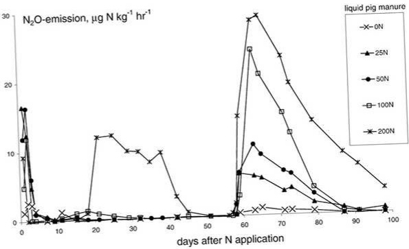

Fig. 3 Time course of the $N _{2} O$ fluxes from the control (ON) and $\mathrm{(NH_{4})_{2}SO_{4}}$ (upper figure) and liquid fattening pig manure (traditional farming; lower $\widehat{fg}-$ ure) applied to soil at four application rates: 25 mg N $\mathbf{k}\boldsymbol{\wp}^{-1}$ (25N), 50 mg N kg1 (50N), 100 mg $N K \varepsilon ^ { - 1 }$ (100N), 200 mg $\mathrm{N~kg^{-1}~(200N)}$ . At day 57 water was added (see Fig. 2)

Table 4 Total $N _{20}$ emission after application of $\mathrm{NH_{4}NO_{3}}$ and liquid pig manure (traditional farming) with different application techniques. For each column, different letters indicate statistically

significant differences $( \alpha = 0.05 )$ in log-transformed $N _2 O$ emission between treatments

<table><tr><td rowspan="3">Application method</td><td colspan="4">emission  $N _2 O$ </td><td colspan="2">(% of N applied)</td></tr><tr><td colspan="4"> $\overline{( mg   N   kg ^{-1})}$ </td><td colspan="2">Liquid pig manure  $\mathrm{NH_{4}NO_{3}}$ </td></tr><tr><td> $\mathrm{NH_{4}NO_{3}}$ </td><td></td><td>Liquid pig manure</td><td></td><td>2.1</td><td>7.3</td></tr><tr><td>Homogeneously mixed into soil</td><td></td><td></td><td>7.9</td><td></td><td>0.9</td><td>4.9</td></tr><tr><td></td><td>2.7 1.5</td><td></td><td>5.5</td><td></td><td>3.1</td><td>6.9</td></tr><tr><td>Surface applied Placed at 5 cm depth</td><td>3.7</td><td></td><td>7.5</td><td></td><td>4.0</td><td>3.4</td></tr><tr><td>Placed at 10 cm depth</td><td>4.6</td><td></td><td>4.0 12.9</td><td>bbbac</td><td>4.3</td><td>12.3</td></tr><tr><td>Placed in a row at 5 cm depth</td><td>4.9</td><td>baccc</td><td></td><td></td><td></td><td></td></tr></table>

## Discussion

Application of manure and fertilizer increases the amount of mineral N in soil and leads to higher emission of $\mathrm{N}_{2}\mathrm{O}$ Most research so far provides emissions for animal manure as such without discriminating between a range of manure qualities that are found in agricultural practice. The results reported here suggest that $\mathrm{N_{2}O}$ emission may be quite different depending on manure species and related quality and on manure management and handling. Most of these effects can be attributed to specific manure or fertilizer characteristics. Even though our results are from laboratory incubations using a soil with relatively low organic matter content and low pH, they may form the basis for designed testing and verification methods in field conditions and eventually lead to the formulation of