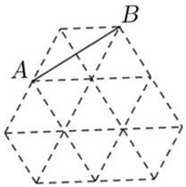
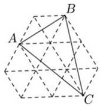
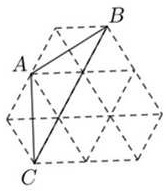
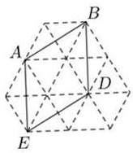

$$
\begin{aligned} &\therefore \left[ (2b)2 + \left( \frac{3\sqrt{2}}{b} \right)^2 \right] + \left[ (2b - b)2 + \left( \frac{6\sqrt{2}}{b} - \frac{3\sqrt{2}}{b} \right)^2 \right] = b^2 + \left( \frac{6\sqrt{2}}{b} \right)^2,\\ \end{aligned}
$$

$$
\therefore b = \sqrt{3} ,
$$

$$
\therefore B(\sqrt{3},2\sqrt{6}),D(2\sqrt{3},\sqrt{6}),
$$

直线OB的解析式为: $y = 2\sqrt{2}x,$ ∴直线DF的解析式为: $y = 2\sqrt{2}x - 3\sqrt{6},$ 当y=0时， $2\sqrt{2}x-3\sqrt{6}=0,$

$$
\therefore x = \frac{3\sqrt{3}}{2},
$$

$$
\therefore F\left(\frac{3\sqrt{3}}{2},0\right),
$$

$$
\because OE = \sqrt{3},OF = \frac{3\sqrt{3}}{2},
$$

$$
\therefore EF = OF - OE = \frac{\sqrt{3}}{2},
$$

$$
\therefore \frac{EF}{OE} = \frac{1}{2},
$$

故答案为: $\frac{1}{2}, \left( \frac{3\sqrt{3}}{2}, 0 \right)$

| 得分 |  |
| --- | --- |
| 阅卷人 |  |

三、解答题:本题共8小题，每小题5分，请考生在22、23题中选择一题，并在答题纸上涂黑，不涂黑、多涂或多答均按第一题评分. TE

17. (1) 计算: $(x + 1)(x - 1) + x(2 - x).$ (2) 解不等式组: $\left\{ \begin{array}{c} 4x - 3 > 9 \\ 2 + x \geqslant 0 \end{array} \right.$

[答案]:【小问1详解】解:原式 $x^{2}-1+2x-x^{2}=2x-1;$ 【小问2详解】解: $\left\{ \begin{array}{l} 4x - 3 > 9(1) \\ 2 + x \geqslant 0(2) \end{array} \right.$ ，解不等式(1),得x>3,解不等式(2),得x≥-2,所以原不等式组的解是x>3.[解析]: 18. 图1，图2都是由边长为1的小等边三角形构成的网格，每个小等边三角形的顶点称为格点，线段的端点均在格点上，分别按要求画出图形.

图1

图2

(1) 在图 1 中画出等腰三角形 ABC, 且点 C 在格点上. (画出一个即可)(2) 在图 2 中画出以 AB 为边的菱形 ABDE，且点 D,E均在格点上.

[答案]:(1) 答案不唯一

(2)

[解析]:

$y = - \frac{2}{3}x$ 的图像与反比例函数 $y = \frac{k}{x} (k \neq 0)$ 的图像都经过点 A(a,2)(1）求点 A 19. 如图，正比例函数的坐标和反比例函数表达式. (2) 若点 P(m,n) 在该反比例函数图像上，且它到y 轴距离小于 3，请根据图像直接写出n的取值范围.