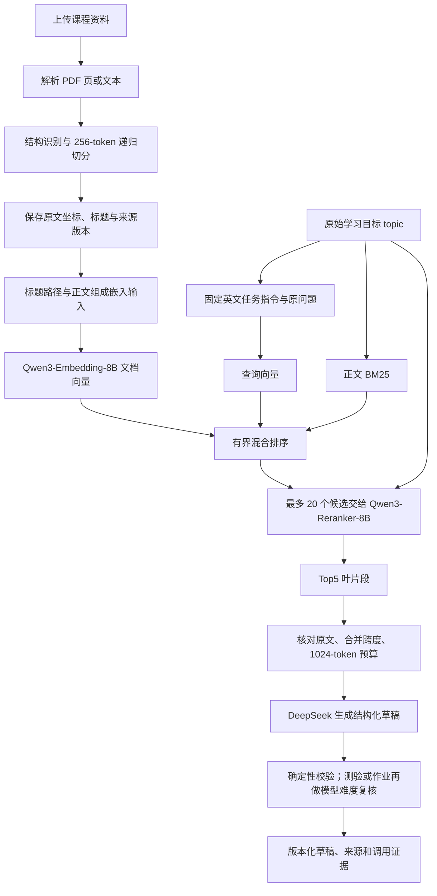

# 2026 年 9 月 12 日实验总记录：双语教育 RAG 的切分、召回与策略选择

项目：AI-Powered Multimodal Content & Assessment Generation for Educational Applications。研究范围：面向中英文计算机本科课程的文本内容与测评生成，当前重点为 CA1 的文本生成和 RAG。

本记录汇总当天已经完成的 CA1 实际调用、难度控制验收及 R1–R5 检索实验，为后续论文方法、实验章节、图表和补充实验提供依据。它是对原始记录的整理，没有新增模型调用、人工标签或算法选型。原始协议、失败运行、代码快照和结果均保留。

**当天的最终选择是：256-token 递归切分、无重叠、标题路径编码、查询任务指令、有界混合召回、云端 Qwen3-Reranker-8B 重排、Top5 和 1024-token 原文预算。查询不自动翻译，关键词独立加分和父级扩展不启用。** 这是本轮可运行候选中的开发集选择，通过了预设工程验证门槛；不代表所有课程、模型或预算下的最强方案。

## 阅读入口

- 了解当前方案及原因：第 1–2 节。
- 查当天实验及数据的承接关系：第 3–4 节。
- 查指标定义及五轮具体结果：第 5–10 节。
- 查 CA1、难度控制、费用和验证：第 11–12 节。
- 为论文组织论点、限制和后续实验：第 13–16 节。
- 查全部方法的数值和可复用数据：[完整对照表](daily-records/20260912/comparison-tables.md)、[机器可读指标表](daily-records/20260912/metric-summary.csv)、[来源与配置索引](daily-records/20260912/record-index.json)。指标表保存原始小数、分母、单位、预算和来源位置，不能跨轮直接混合求均值。

## 1. 当天最终策略与取舍

| 模块 | 当前采用 | 选择依据及适用边界 |
|---|---|---|
| 文本模型 | `deepseek-flash` | 实际完成文本生成、难度复核和 R5 查询翻译实验；用户提到的后续型号尚未接入，本日不是文字模型选型实验 |
| 嵌入 | OpenRouter `qwen/qwen3-embedding-8b`，实际 4096 维 | R1–R5 固定使用，减少模型变化带来的混淆；没有证明它优于所有其他嵌入模型 |
| 切分 | `recursive_token_v1`，正文最多 256 Qwen token，无重叠 | R4 开发集选定组合的组成部分；token256 单独组没有稳定胜过字符基线，不能把组合收益归因于切分一项 |
| 边界 | 标题分节，段落→句子→行→词，必要时更细分；同节短单元合并 | 保留可追溯原文，限制每片正文长度；已识别且不超限的代码／表格尽量完整，复杂格式仍有限制 |
| 文档表示 | `title_path_v1`：文件名主干、标题路径、原文正文 | 标题帮助提供片段上下文；原文独立保留，标题不是生成摘要。实验文章标题与真实上传文件名有分布差异 |
| 查询表示 | `cs_instruction_v1`：固定英文任务指令加原始 `topic` | R4 指令单独组也是有竞争力的低成本候选；英文指令不会把中文问题翻译成英文 |
| 首阶段召回 | `hybrid_dense_lexical_v1` | 向量为主，BM25 归一化词法加分最多 0.05，减少词法信号压过明显语义优势的情况 |
| 候选数量 | 向量与词法各最多 20，融合后取总计最多 20 进入重排 | 中间并集最多 40，不等于向重排器提交 40；R5 双查询也限制最终重排池为 20 |
| 专用重排 | OpenRouter `qwen/qwen3-reranker-8b` | R4 开发集 Hit/MRR 最佳，锁定后通过新保留集门槛；额外网络依赖和 503 失败必须计入取舍 |
| 最终证据 | 重排 Top5 叶片段作为种子，原文合并去重，总预算 1024 Qwen token | 不是保证最终恰有 5 段；超预算可跳过，合并后段数可减少。预算只计原文，不是生成模型全部输入或计费 token |
| 元数据 | 保留页码、坐标、标题、关键词、来源哈希和配置版本 | 用于引用与追踪；保存元数据不等于全部元数据都参与排序 |
| 关键词独立加分 | 权重 0，暂不启用 | R3 权重 0.25 改变过排名，但没有额外答案命中；不能把“关键词未加分”误写成“标题未使用” |
| 父级／邻接扩展 | `none` | R4 对照没有新增命中或 MRR，平均上下文更长；未证明它对跨段教学必要条件没有价值 |
| 查询翻译 | 不默认启用 | R5 英文查中文没有净提升，总体差异区间包含零；存在歧义、额外延迟和接口失败混淆 |
| 多模态 | 本日不调用 | 留待后续阶段，不计入本日 CA1 文本／RAG 实验成果 |

这些是本地配置快照。配置类为兼容旧环境保留了部分旧默认值，新安装不能只凭源码默认值推断已经启用 R4。安全的当前配置摘录见 [record-index.json](daily-records/20260912/record-index.json)，不包含密钥。

## 2. 当前实际数据流

应用先按课程及用户选定资料过滤，再检查索引与当前切分／嵌入身份是否一致。现有检索仍是在选定课程片段上计算向量相似度和词法分数，没有在本日验证百万级向量库、ANN、分布式检索或索引吞吐。

查询编码使用固定格式 `Instruct: …\nQuery: 原始 topic`。BM25 和重排接收原始 `topic`；没有把整段生成系统提示交给检索，也没有自动翻译、自由扩写或多轮自主检索。模型检索分数不是证据充分性的概率。

文档表示改变或 tokenizer／切分变化时，需要重建受影响索引；只改查询指令不需要重建文档向量。新向量全部成功后才原子替换旧索引。历史草稿、版本和引用快照不会随重新切分被改写。

代码入口：[切分](../../app/chunking.py)、[token 候选与预算装配](../../app/rag_candidates.py)、[排序](../../app/retrieval.py)、[应用管线](../../app/pipeline.py)、[运行时原文装配](../../app/rag_runtime.py)。冻结实验使用各自归档代码，不能用当前文件冒充历史版本。

## 3. 当天实验推进顺序

时间均按 2026-09-12 Asia/Shanghai 表示，取运行 ID 或协议记录中的开始时间，不把目录名当作完成时间。

| 阶段 | 开始／记录时间 | 当时的问题 | 完成内容 | 当时的选择 |
|---|---|---|---|---|
| CA1 首次真实验收 | 11:56 | 真实 API 能否完成文本与 RAG 流程？ | 首轮讲解失败被记录，随后修复并新建运行 | 不能将首轮写为全部成功 |
| CA1 修正后验收 | 12:01 | 修正后的结构和工作流是否通过？ | 索引、讲解、测验、作业、资料外目标和审核版本流程 | 技术验收通过，人工质量仍未验证 |
| 难度控制验收 | 12:25 | 能否明确指定全难及混合分布？ | 精确槽位、模型复核、拦截与一次重生 | 采用明确数量分配及模型筛查，不宣称学生难度校准 |
| R1 | 13:37 | 混合检索是否天然优于向量检索？ | 固定自编双语集比较 dense、BM25、RRF、MMR | 保持 dense；记录混合退步机制 |
| R2 | 13:57／13:58 | 真实来源和公开人工标签上能否改善？ | 真实教材准备、MLQA/T2、加入有界词法加分 | 候选保留，默认仍 dense |
| R3 | 14:29 | 递归边界、长度、关键词是否有效？ | 字符切分与元数据消融、教材结构审计 | 采用递归 1200/120，排序暂不变 |
| 文献候选整理 | R3 后、R4 前 | 哪些研究思路值得在现有资源上实测？ | 冻结候选及未实施方向 | 文献作为假设来源，不直接当实验成果 |
| R4 | 15:26；15:52／15:57 补充协议 | token、标题、指令、重排与扩展如何组合？ | 16 组 dev、14 组新 test；先选后验 | 采用当前 R4 完整方案 |
| R5 | 16:51 冻结 | 中英语言不一致时是否应先翻译？ | 原查询／译文／双路，同预算，新保留集 | 保持原查询，不启用默认翻译 |

R4 最初的本地重排耗时较长；在查看保留集排名之前，记录了限制未胜出重排模型测试范围的补充，以及加入已真实探测可用的云端重排的补充。这不是所有细节一次性预定的完美实验；论文必须保留补充的时间、理由和实际范围。[原协议](R4_PROTOCOL_V1.md)、[补充 1](R4_PROTOCOL_AMENDMENT_1.md)、[补充 2](R4_PROTOCOL_AMENDMENT_2.md)。

## 4. 数据来源、人工标签与划分的承接关系

| 数据 | 规模及标签来源 | 用途与限制 |
|---|---|---|
| R1 自编试点 | 40 片段、32 查询；28 可答、4 不可答；全部助手编写、未人工复核 | 验证评测流程、发现故障机制；不是论文正式人类金标 |
| Hello 算法＋OpenDSA | 中英各 6 篇，固定作者版本及许可；初始标注包 80 片段 | 真实教材、结构审计与人工标注准备；课程专属真人标签仍为 0 |
| R2 MLQA | 81 原文、92 查询、46 双语问题组；本地 dev 12、test 80 | 继承公开人工问题与答案位置；不是穷尽的检索相关性或教学必要事实标注 |
| R2 T2Ranking | 339 网页片段、20 中文查询；157 正例、182 负例；本地 dev/test 各 10 查询 | 公开人类相关性二值标签；均源于 official dev，不冒称官方 test |
| R3 | 同一份 R2 MLQA，按原答案坐标重映射到不同切分 | 原 test 已暴露；保留名称只为追踪，不能再称未见验证 |
| R4 | 旧 46 组全转 dev；另 42 组新 test；共同库 156 原文 | 每题 mixed/cross 两种模式，dev 184、test 168 场景；family 与完整原文不跨划分，标题可能重合 |
| R5 | 从旧 88 组选 24 组作 dev，另 31 组新 test；共同库 207 原文、236 个 token256 片段 | dev 48、test 62 条查询；加 mixed/cross 为 96/124 场景；组件抽样避免把共享来源反复当独立样本 |

**数据谱系：R2 的 46 组 → R3 复用 → R4 作为已见 dev，加 42 组 → R5 从已见 88 组选 dev，加 31 组。** 新增量与复用量必须分开统计；R3 的 92 查询不是新增 92 个人工问题，离线重放也不是新样本。

MLQA 的 bilingual family 是同一信息需求的两种语言表达；mixed 允许两种语言资料，cross 只允许另一语言资料。R2 MLQA 的混合库结果不能直接当作强制跨语言能力。R4 按 42 个 family 抽样；R5 进一步将共享答案原文的 family 连成 25 个来源组件抽样。

本日没有新增真实教师评分、盲评一致性或学生答题数据。公开原始人类标签、助手选题、助手译文检查、模型难度复核、模拟浏览器评分是不同来源，不能合称“人工标注”。资料许可、原始文件哈希和筛选记录沿用各轮档案。[课程资料](research/course_sources.md)、[人工标注指南](../../benchmarks/rag/course_sources/ANNOTATION_GUIDE.md)、[外部数据说明](EXTERNAL_DATA_RESULTS_20260912.md)。

## 5. 指标口径：论文必须先定义再引用

| 指标 | 本项目含义 | 不能替代什么 |
|---|---|---|
| R1/R2 Recall@5 | 前 5 片段中的已标注正例数／该题全部已标注正例数，先逐题再求均值 | 不是“是否至少有一处答案”，也不是穷尽真实相关性的保证 |
| Hit@5 | 至少一个已知正例位于前 5 即为 1 | 不是所有必要信息都齐全 |
| MRR@5 | 前 5 中首个正例的倒数名次，无正例为 0 | 不是学习效果或生成答案正确率 |
| nDCG@5 | 带名次折扣的相关性得分，相对理想排名归一化 | 不同数据标签和任务间不能直接排强弱 |
| R1 必要证据组覆盖 | 同一组来源可替代，不同组需同时满足 | R2 的单一可替代组使 all-evidence 等同 Hit，不能据此宣称多跳事实找齐 |
| R3 已知答案跨度 Hit | 返回原文区间完整包含至少一个公开人工答案跨度 | 不等于官方 MLQA 答案 F1，也不是课程必要事实完整度 |
| R4/R5 budget Hit | 装配后、固定原文 token 预算内完整包含已知答案跨度 | 不等于全部相关子片段的 Recall |
| Candidate Hit@20 | 候选是否覆盖已知答案，帮助定位首阶段上限 | R4 API 行包含远程失败，需看 token_hybrid 才是该候选的首阶段；R5 已单独保留重排前覆盖 |
| 重复字符比例／片段数 | 结构及索引工作量指标 | 不等于总存储、计费或语义完整度 |
| 本地排序／重排网络／阶段合成耗时 | 分别反映不同执行阶段 | 不能混写为线上完整出题 p95 |

R3 的 6000 字符装配沿排名加入完整片段，下一片放不下就停止；R4/R5 的 1024-token 装配只从 Top5 种子中选，放不下可跳过，并按原文跨度合并去重。预算单位及装配规则都变了，所以不能把它们的百分比直接相减。

比较结果用“百分点”表示两个比例的绝对差，例如 91.25%→91.875% 是 +0.625 个百分点。MRR 建议保留 0–1 小数并报告绝对差。Bootstrap 区间均为探索性；早期 query-level 抽样存在双语相关性限制，后期改进抽样单位也不追溯修改旧结果。

## 6. R1：固定切片上的召回策略基线

**问题与控制变量。** 固定资料、问题、Qwen 嵌入、原文输入及片段边界，只改变排序。BM25 使用中英词法规则、k1=1.2、b=0.75；RRF 两路各取 20，常数 60；MMR 在融合前 20 上以 λ=0.7 平衡相关性和相似冗余。dev/test 各 14 条可答、2 条不可答。

| 方法 | dev Recall@5 | test Recall@5 | test 必要证据全覆盖 | test MRR@5 |
|---|---:|---:|---:|---:|
| dense | 98.21% | 90.48% | 100.00% | 0.9643 |
| BM25 | 46.43% | 46.43% | 50.00% | 0.7857 |
| 等权 RRF | 46.43% | 46.43% | 50.00% | 0.7857 |
| RRF＋MMR | 46.43% | 46.43% | 50.00% | 0.7857 |

**机制诊断。** 在 q18 中，中文问题对应英文证据 db10；向量把正确片段排第一，但词法没有匹配。RRF 优先了两路均出现的中文片段。对本轮参数，双路各在前 20 的得分至少为 2/(60+20)=0.025，而单路第一最多为 1/(60+1)≈0.01639；交集足够大时，跨语言单路高排名也会被挤后。

这个反例解释了本配置的退步，不能证明所有 RRF 都差。4 条不可答问题在四组中均返回非空结果；当时未实现检索级拒答阈值，不能从非空返回推断最终生成必然幻觉。

**选择。** 不采用三个替代候选，保持 dense；下一轮测试限制词法影响的融合。5 次嵌入、0 次文字调用，4 个策略共享同一缓存，重放一致，294 项软件测试通过。[协议](EXPERIMENT_PROTOCOL.md)、[原始结果](experiments/20260912T053716373758Z/report.md)、[验证](verification-20260912.json)。

## 7. R2：真实来源与有界词法加分

**改动。** 为防止弱词法线索压过强语义优势，新增：score = cosine + 0.05 × max-normalized BM25。先取两路 Top20 并集再按该分数排序。对于进入候选比较的片段，大于 0.05 的余弦差不会仅因该加分颠倒；这个性质不是全局召回保证。

新系数在新数据首次排名前固定，没有对 test 搜索参数。旧四种策略继续保留，嵌入输入仍是原文，无标题、查询指令、翻译或专用重排。

| 方法 | MLQA test Recall@5，80 查询 | T2 test Recall@5，10 查询 |
|---|---:|---:|
| dense | 91.25% | 40.58% |
| BM25 | 47.50% | 37.31% |
| RRF | 61.25% | 47.02% |
| RRF＋MMR | 50.00% | 28.29% |
| 有界词法加分 | 91.88% | 44.74% |

MLQA 相对 dense 的未舍入提升为 +0.625 个百分点，4 查询改善、3 退步、73 持平；Hit 96.25%→100%，MRR 0.8858→0.9390。T2 Recall 增加约 4.17 个百分点，但 MRR 0.7333→0.7167，且 RRF 的 Recall 更高。不能只挑弱基线或只挑召回均值写成全方位最优。

MLQA 与 T2 的分母、标签性质及数据分布不同，不能比较两列绝对值高低。早期配对区间和小样本限制见原报告；两套数据都不证明学生学习收益。

**选择。** 保留有界融合候选，生产默认仍 dense，待后续组合验证。12＋24=36 次嵌入，均成功；离线重建和重放一致，364 项测试通过。12 篇教材的标注表仍为空，不输出假人类审核结果。[完整报告](EXTERNAL_DATA_RESULTS_20260912.md)、[MLQA 原始结果](experiments/20260912T055718752885Z/report.md)、[T2 原始结果](experiments/20260912T055800717636Z/report.md)。

## 8. R3：递归切分、原文坐标和关键词消融

**改动与控制。** 旧窗口 1200/120 字符，对比新递归 1200/120 和 800/80；三组均配同一 dense。另在递归1200上加有界融合，再比较元数据词法权重 0 与 0.25。嵌入正文没有加入标题或关键词。沿用 R2 已见数据，答案坐标逐条核验，切分后按原始跨度判断，未复制父标签给全部子片段。

| 方法 | 全部 92 题 Top5 Hit | 原 test 80 题 Top5 Hit | 全部 92 题／6000 字符 Hit |
|---|---:|---:|---:|
| 旧1200/120＋dense | 93.48% | 96.25% | 98.91% |
| 递归1200/120＋dense | 93.48% | 96.25% | 98.91% |
| 递归800/80＋dense | 94.57% | 95.00% | 97.83% |
| 递归1200/120＋有界混合 | 98.91% | 100.00% | 100.00% |
| 上组＋元数据权重0.25 | 98.91% | 100.00% | 100.00% |

旧1200→递归1200，两种预算均为 0 改善、92 持平、0 退步。800 的总体 Top5 略好，但 test 和字符预算下退步；其两条改善是同一 dev 问题组的双语表达。融合的提升属于排序贡献，不能归入纯切分。关键词／元数据权重参与了排名：Top5 列表有 12 题变化，但额外命中仍为零。

**真实教材结构审计。** 对 12 篇、74,353 字符原文件重新切分，区别于标注包的固定 80 片段：

| 切分 | 片段数 | 长度中位数 | 索引正文字符 | 重复字符比例 |
|---|---:|---:|---:|---:|
| 旧1200/120 | 75 | 1172 | 81,857 | 9.20% |
| 递归1200/120 | 115 | 660 | 76,802 | 3.41% |
| 递归800/80 | 144 | 621 | 76,937 | 3.62% |

递归1200的正文字符减少 5,055（约 6.18%），同时多 40 个向量记录（约 53.33%）。所以可以说减少重复正文，不能直接说总存储或索引成本下降。各切分均保留全部非空白原文字符，但这不是教师认定的语义完整性。

标准 Markdown 的 19 个围栏、2 个表格，旧／新均保护 21/21；没有证据说这批标准块保护率提高。将缩进嵌套围栏纳入后，旧／新为 41/47、43/47，仍有 3 块退步。RST 的 `~~~~` 标题下划线会被误识别为围栏；10 个相应 split 标记不能当作真实代码拆分率。标题硬边界也可能产生极短片段。

**选择。** 当时采用递归1200/120及可追踪元数据，默认排序仍 dense，关键词加分关闭；R4 后来升级了长度策略。研究新增 4 次嵌入，应用迁移另 2 次；507 项测试通过，920 条逐题／策略／预算记录重放一致。[完整结果](CHUNKING_RESULTS_20260912.md)、[结构审计](chunking-structure-audit-20260912.json)、[验证](chunking-verification-20260912.json)。

## 9. R4：token、标题、查询指令、重排和上下文扩展

**实验设计。** 旧 MLQA 全部转为已见 dev，另加 42 组新保留问题。在同一组数据、嵌入模型和 1024-token 原文预算下，比较 12 个首阶段／扩展配置，再在开发集选出的 Top20 上加本地0.6B和云端8B重排，各测不扩展／父级扩展，总计16个dev配置。新test实际运行12个首阶段及云端两组，共14组，本地未运行test。

方法配置和全部 dev/test 数值见 [完整矩阵](daily-records/20260912/comparison-tables.md)。其中包含：字符基线、单独查询指令、单独标题、标题＋指令、字符有界混合、token256、token128、token＋标题＋指令、再加有界混合或RRF、父级或窗口扩展、两种专用重排。

**控制变量的边界。** token 组同时改变长度度量、长度预算和重叠方式，不能声称纯 tokenizer 单因素；标题与指令各有独立组，但完整组合收益也不能拆成可相加的因果贡献。本地与云端重排的模型大小、运行平台、接口提示均不同，不是纯参数规模消融。

**事先选择规则。** dev 先比预算 Hit，再比 MRR，再优先无重排、较少上下文及预定顺序。锁定 `api8b_none` 后才处理 test。升级门槛要求 test Hit 不低于基线、MRR 不低于基线超过0.02，mixed/cross各组Hit不下降；这是工程选择门槛，不等于统计显著。

| 指标 | 字符递归＋dense 基线 | 选定完整方案 |
|---|---:|---:|
| dev 预算 Hit，184 场景 | 88.04% | 98.37% |
| dev MRR@5 | 0.8053 | 0.9570 |
| 新 test 预算 Hit，168 场景 | 97.02% | 97.02% |
| 新 test MRR@5 | 0.8868 | 0.9524 |
| 新 test 平均上下文 token | 493.4 | 553.4 |

保留集新增命中5、丢失命中5、持平158，净命中持平。丢失中4个是重排接口失败，1个为成功但未命中。MRR差为+0.0656，按42组配对的探索性95%区间约[+0.0048,+0.1317]；Hit差区间约[−4.17,+4.76]个百分点。可报告排序改善，不能写成保留集召回率已经提升。

**为什么没有选择其他配置。**

- token128 的 test Hit 98.21% 更高，但 dev 仅86.96%，没有在看过test后改选冠军。
- 单独查询指令的 test Hit 97.02%、MRR0.9484，与完整方案接近，且免重排；这是下一轮成本对照的重要候选，不能隐去。
- 父级扩展对云端方案的 Hit/MRR 无增益，test 平均原文由553.4增至591.8 token；首阶段父级／窗口组也未提高主指标，因此不默认扩展。
- 本地0.6B dev Hit96.74%、MRR0.9248，平均约9.14秒／Top20；云端8B dev平均约0.70秒。未运行本地test，不能写为它已在保留集败北。
- 单独 token256、单独标题没有在新test稳定胜出；当前采用的是开发集选出的整体方案，而非每个模块都已有独立正收益证明。

**执行与接入。** 42次嵌入；352次数据集重排加1次探测，7次失败全部保留，无自动重试。归档重放2352条test记录一致。先在业务库副本完成索引及中英检索，用另6次API验证，再原子切换两份自编演示材料到20片段；534项测试通过，原课程、资料、任务、内容和引用版本保留。

本轮没有重新生成题目并请教师盲评，因此检索升级不等于出题质量已经实测提高。[结果](R4_RESULTS_20260912.md)、[选择锁](r4-experiments/20260912T072619024568Z/selection-lock.json)、[接入设计](R4_RUNTIME_DESIGN.md)。

## 10. R5：跨语言查询翻译的受控对照

**问题。** 英文输入查中文材料时，是否应先翻译？比较原查询、仅译文召回、原文＋译文双路。翻译只接收单个问题和目标语言，不接收资料、答案或公开平行问题；重排始终用原问题。双路分别召回再交替合并去重，最终只交20候选给重排器，不能靠扩大预算获益。

110条问题均实际翻译，全部通过格式与关键标识机械检查。文档向量按相同输入／接口身份复用171个、新增65个；原问题与译文查询向量本轮新调用、相同请求去重。dev有24组旧题、test有31组新题，共同库207篇原文。

**dev选择。** 原查询与仅翻译的Hit均98.96%、MRR均0.9844；双路少一次命中，对应一次接口失败。按预定平局规则锁定original，所以没有被选中的翻译方案进入升级验证；不能把它写成“某个翻译冠军后来未通过门槛”。三组test照常完整报告，但不重新选冠军。

| 新保留集场景 | 原查询 | 仅译文 | 原文＋译文 |
|---|---:|---:|---:|
| 英文查中文，31题 | 29/31，93.55% | 29/31，93.55% | 28/31，90.32% |
| 中文查英文，31题 | 25/31，80.65% | 29/31，93.55% | 29/31，93.55% |
| 双语混合资料，62题 | 55/62，88.71% | 53/62，85.48% | 53/62，85.48% |
| 全部124场景 | 87.90% | 89.52% | 88.71% |
| 全部场景MRR@5 | 0.8602 | 0.8777 | 0.8696 |
| 全部场景重排前Hit@20 | 92.74% | 94.35% | 94.35% |

仅翻译净增2场景（新增8、丢失6），+1.61个百分点，按25个来源组件配对95%区间约[−4.84,+7.50]；双路净增1，+0.81，区间约[−4.17,+5.56]。不能宣称稳定提升。

**接口噪声的影响。** 本轮660次重排有21次HTTP503：dev1、test20；test原查询／翻译／双路分别失败6/6/8场景。中文查英文多出的4次命中中，3次对应原查询组失败，只有1次发生在双方成功时；重排前实际覆盖从28/31到29/31。英文查中文的净持平也包含具体题目的增损抵消。事后拆分用于解释主结果，不剔除失败重算一个更好看的正式实验。

**翻译质量与时间。** 助手按固定哈希抽查20条，不是新增人类标注。foundation被译为“基础”，而原题指“基金会”；保留真实译文，没有根据答案修正。翻译p50约750ms、p95约1176ms；阶段合成平均查询耗时原查询3.55秒、翻译3.84秒、双路4.85秒，受嵌入网络波动影响，不能当线上端到端p95。

**选择。** 保留原查询，不默认翻译；不能由此断言翻译在所有查询上无用。660条dev/test策略记录离线复现一致，最终548项测试通过；业务库及R4策略保持不变。[完整结果](R5_RESULTS_20260912.md)、[逐题增损](r5-experiments/20260912T085156100010Z/test-changes.csv)、[译文审核表](r5-experiments/20260912T085156100010Z/translation-review.csv)。

## 11. 同日完成的功能与难度验收：与检索实验分开报告

### 11.1 CA1真实文本与RAG调用

首次隔离验收中，讲解因题目数量与请求不一致而失败，实际10次API尝试。修正后新建`education-v2`运行，实际9次调用完成预定结果，包括14片段索引、讲解、测验、作业、资料外目标、编辑和审核／导出工作流。资料外目标的预期结果是失败／拒绝，所以`all_tasks_succeeded=false`不等于技术验收未通过；应看`all_expected_outcomes_observed`与具体case。

加上最小接口检查2次，CA1该项任务累计21次真实API。最终运行写入正常开发库，新增一门自编演示课程；不能概括为“当天所有真实调用都完全隔离”。前后原有记录保留，技术验收后内容留作草稿，不将临时工作流批准当作教师真实审核。

53项软件测试通过；`manual_quality_verified=false`。这是小规模功能演示，不是模型质量基准。9月11日的旧CA1报告仍写着API尚未配置，是保留的历史稿，不能复制为本日最新状态。[后端核验](../ca1/evidence/backend-verification-20260912.json)、[最终验收](../ca1/evidence/live-20260912T040126795872Z/results.json)。

### 11.2 精确难度分配与模型复核

分配由“全局模糊档位”改为可明确指定各档题数、逐题固定槽位；支持全难`0/0/3`和混合`1/1/1`，零题档不被自动补入。讲解深度与题目难度分配独立。目标学习者背景随中英文界面一致处理，属于功能修正，不算教学效果实验。

生成后先做确定性结构校验，再由单独请求复核题目认知要求、可答性与歧义。复核输入不含目标分布、生成难度标签及作者理由，但仍使用同一个DeepSeek模型，存在共同偏差；不是独立人类盲审。

`education-v3`实际用9次API：索引1、全难5、混合3。全难首稿q1/q3被复核为中等，未直接保存，通过一次重生后3题均通过；混合首轮通过。最终6题的分布均符合请求。106项Python、33项前端测试以及隔离mock浏览器场景通过。

可证明约束、拦截和重生路径在这些样例上运行，不能写成“难度准确率100%”。教师评分及学生答题校准尚未完成；`manual_quality_verified=false`、`student_difficulty_calibrated=false`。R4后来新增了重排调用，早期难度文档中的每任务调用次数不能直接当当前完整管线费用。[难度设计及验收](../Difficulty_Control.md)、[验证汇总](../ca1/evidence/difficulty-verification-20260912.json)。

## 12. 调用、费用、软件验证与可复现性

### 12.1 研究运行账目

| 运行 | 嵌入请求 | 文字／翻译 | 重排请求 | API失败 | 已返回cost合计 |
|---|---:|---:|---:|---:|---:|
| R1 | 5 | 0 | 0 | 0 | 0.00006321 |
| R2 MLQA | 12 | 0 | 0 | 0 | 0.00012236 |
| R2 T2 | 24 | 0 | 0 | 0 | 0.00226145 |
| R3 | 4 | 0 | 0 | 0 | 0.00007121 |
| R4，含1次重排探测 | 42 | 0 | 353 | 7 | 0.29398760 |
| R5 | 222 | 110 | 660 | 21 | 0.56427819 |
| 指定研究运行合计 | 309 | 110 | 1013 | 28 | 0.86078402 |

以上共1432次API尝试，全部返回的货币cost来自OpenRouter；DeepSeek110次翻译没有费用字段，另28次重排失败没有费用字段。0.86078402为已报告USD金额合计，不是完整账单，也不是账号全天总花费；没有计入本地推理、模型下载、机器时间或免费缓存的机会成本。

CA1的21次、难度验收9次、R3应用升级2次、R4应用迁移验证6次与上表分列。R4迁移6次已报告费用0.00095247；其余未在本记录完成统一账单核对。不能把保存到业务库的调用记录转移再计成新API请求，也不能将一个请求服务的多个策略场景重复计费。

### 12.2 验证记录

| 阶段 | 当时通过的软件测试 | 重放及数据核验 |
|---|---|---|
| CA1 | 53 Python | 真实预定结果通过；原数据保留；人工质量未确认 |
| 难度控制 | 106 Python＋33前端 | 2份草稿、6题、两种分布；真实模型复核及失败重生 |
| R1 | 294 Python | 排名、指标、缓存重放一致，新增API0 |
| R2 | 364 Python | 两套原数据可重建，两个运行重放一致，新增API0 |
| R3 | 507 Python | 920条策略／预算记录及原文坐标核验，新增API0 |
| R4 | 534 Python | 2352条保留集策略记录重放一致；副本验证后原子迁移 |
| R5最终 | 548 Python | 660条dev/test策略记录重放一致；来源组件统计检查通过 |

测试数量是不同时间的软件测试集合，不能相加成“当天独立实验样本数”。它们主要证明软件按规则运行，不是模型事实正确率或教师评分。本次整理没有再次执行模型或重算原始实验；依据现有文件核对与导出。

每轮保存原文、参数、协议、代码、源文件与输入SHA、向量、模型身份、排名、逐题指标、失败和响应。模型别名不保证供应商永远使用相同权重；冻结实际向量与重排返回，能够复现当时的排序结果，但不能保证以后在线重新调用得到完全相同文本或分数。

## 13. 文献参考与“已测／未测”的界限

当天参考资料的核验与适用限制见 [文献整理](research/CHUNKING_RETRIEVAL_REVIEW_20260912.md)及其来源登记表。本总记录沿用当日阅读档案，不把它改写成新的文献检索或系统性综述。

| 参考方向 | 本项目实际做到的部分 | 尚未完成的部分 |
|---|---|---|
| 递归与结构／token约束，Docling等实现思路 | 自有递归、同节合并、准确token计数和原文追溯 | 未迁移Docling，也未比较各文档解析器的质量 |
| 标题链及Contextual Retrieval | 原生标题路径前缀消融 | 未对全部片段用LLM生成上下文描述；不能称已复现完整Contextual Retrieval |
| Qwen查询指令与专用重排 | 指令消融、本地0.6B开发集、云端8B开发及保留集 | 没有完整的同硬件同提示模型规模比较 |
| AutoMerging／父子检索 | 有预算的同节父原文和邻接窗口补全 | 不是完整框架的逐条件复现，尚无课程必要前提人工标签 |
| 真正的Late Chunking | 阅读并确认当前汇总向量接口缺少必要中间表示 | 未实现长文本token表示后分块池化，不能说该方向被本轮击败 |
| Jina v3.5 | 已列入当日参考候选 | 未本机／API实测 |
| ColBERT／mLateOn／NextPlaid | 识别多向量编码、索引和成本需求 | 未建立多向量系统，未比较质量或吞吐 |
| 语义聚类切分、LLM切分 | 保留为可能的后续对照 | 未执行，不能以文献上的平均结论代替本项目成绩 |

外部论文数字只用于提出假设和讨论设计。本项目没有获得那些论文中的百分比，也没有证明自己的方法超过未运行的系统。

## 14. 论文可用的结论与必须保留的限制

### 14.1 已有证据可以支撑的内容

1. 建立了双语检索实验框架，保留固定基线、数据与代码版本、失败、费用、逐题增损及零新增调用重放。
2. 在本项目试点中识别出等权RRF偏好双路交集的跨语言失败案例，并提出有界词法加分作为可解释候选；不同数据仍存在性能取舍。
3. 递归切分实现原文位置追踪并减少这批教材的重复正文，但片段数量增加、命中持平和复杂格式退步均被保留。
4. 通过先开发集选择、再新保留集验证，采用带专用重排的组合。R4保留集Hit持平、MRR改善；只陈述本轮范围内的观察。
5. 受控查询翻译没有证明稳定的整体收益，英文查中文没有净改善；展示了翻译语义风险与服务可用性对结果解释的影响。
6. 难度数量分配、结构约束、模型筛查和失败重生已运行，且与教师确认和学生难度校准明确区分。

### 14.2 当前不能声称的内容

- “RAG召回率从R1到R5持续提升”：各轮数据、正例、切分和预算变了，跨轮相减无效。
- “256 token、无重叠、关键词或重排各自都显著提升”：有些是组合变化，有些单项持平或退步。
- “采用全球最强方案”：候选不穷尽，部分模型未测，本地重排未运行test。
- “真实本科课程召回率达到某个百分比”：教材专属人类标签尚未完成。
- “RAG确保事实正确／难度准确率100%／教学效率或学习成绩已提高”：没有对应教师或学生研究。
- “R5中文查英文提高12.90个百分点均由翻译导致”：其中3个新增命中对应基线接口失败。
- “查到合法引用就证明答案受支持”：引用ID存在、原文坐标正确和原文支持生成论断是不同检查。

最主要的效度限制是：主题筛选和样本量小；公共数据是否进入模型训练未知；公开答案跨度不是全部教学必要事实；短指代问题缺上下文；同源双语问题相关；服务别名及网络失败不稳定；真实上传解析、文件名标题与Wikipedia实验表示存在差异。

## 15. 后续论文及补充实验的建议结构

以下是基于本日证据提出的计划，尚未预登记或执行。

| 论文／工作部分 | 可直接使用的基础 | 还应补齐 |
|---|---|---|
| System Design | 当前流程、索引身份、原文追踪、难度槽位和审核版本机制 | 按最终范围统一图示和接口文档，更新旧CA1状态描述 |
| Research Questions | 有界融合、结构与表示、重排、跨语言查询策略 | 预先固定主指标、成本约束和允许结论 |
| Dataset & Annotation | 12篇真实教材及公开标签来源、数据谱系和空白标注包 | 真人原文跨度、必要事实组、不可答题；评审者身份、审核和一致性记录 |
| Baselines & Ablations | R1–R5已保存的基线和候选实现 | 在同一新课程测试集比较，不能拼接跨轮最高成绩 |
| Results | 各轮全表、失败、区间、费用、已有PNG/PDF | 新数据的主表与分组图；教师生成质量评价另立一组实验 |
| Discussion | RRF跨语言反例、结构代价、指令低成本候选、翻译和503问题 | 分析真实课程的错误类型，避免从少量案例作普遍推断 |
| Reproducibility | 归档代码、响应、向量、依赖和哈希 | 明确公开范围、许可、可分享数据和敏感配置处理 |

建议首先补齐课程标签与独立保留划分，同时独立研究重排接口失败处理。当前R4可作为完整基线，与“同样预算、仅查询指令、无重排”的较低成本方案比较；重试／降级应单独预设次数、延迟和失败注入／真实请求记录，不能一边改变检索一边改变失败分母。

随后按实际错误频率决定是否研究复杂格式、短节合并、必要前提补全或受条件触发的查询翻译。对每项先定数据、变量、预算、失败规则、选择和停止标准，后看结果；不需要同时引入所有复杂方法来证明项目价值。

制作图表时，每轮画本轮配对差异并标明样本数与预算；把片段数、重复正文和延迟／费用放在独立图中。不得把R1的Recall、R3字符预算Hit和R4/R5的token预算Hit接成连续性能曲线。正式论文主结论应优先来自后续同一课程集上的受控比较，本日结果作为方法演进与探索性证据。

## 16. 档案与后续记录规则

### 16.1 本日主要入口

| 内容 | 文件 |
|---|---|
| 全部数值汇总、方法配置与调用账目 | [comparison-tables.md](daily-records/20260912/comparison-tables.md) |
| 含原始小数、分母、单位、源文件和位置的指标台账 | [metric-summary.csv](daily-records/20260912/metric-summary.csv) |
| 原始运行目录、配置快照、输入文件SHA | [record-index.json](daily-records/20260912/record-index.json) |
| R1原始结果与复现 | [原始报告](experiments/20260912T053716373758Z/report.md)、[复现](replays/20260912T053741948363Z/report.md) |
| R2两套数据与复现验证 | [综合报告](EXTERNAL_DATA_RESULTS_20260912.md)、[验证](external-data-verification-20260912.json) |
| R3切分与原文完整性 | [综合报告](CHUNKING_RESULTS_20260912.md)、[验证](chunking-verification-20260912.json) |
| R4候选、锁定、接入及复现 | [综合报告](R4_RESULTS_20260912.md)、[复现](r4-experiments/20260912T072619024568Z/replay-verification.json) |
| R5翻译、失败分解及复现 | [综合报告](R5_RESULTS_20260912.md)、[复现](r5-experiments/20260912T085156100010Z/replay-verification.json) |
| R4配对差异图 | [Hit PDF](r4-experiments/20260912T072619024568Z/paired-hit-differences.pdf)、[MRR PDF](r4-experiments/20260912T072619024568Z/paired-mrr5-differences.pdf) |
| R5方向分组图 | [PNG](r5-experiments/20260912T085156100010Z/r5-heldout-quality.png)、[PDF](r5-experiments/20260912T085156100010Z/r5-heldout-quality.pdf) |
| 连续更新的实验日志 | [OPTIMIZATION_LOG.md](OPTIMIZATION_LOG.md) |

数值台账由 [汇总构建脚本](../../scripts/build_daily_experiment_record.py)读取原始JSON生成，不运行模型、不写业务库、不改原实验。`source_pointer`提供JSON定位路径；哈希只能验证快照身份，不替代阅读协议或正确性检查。本记录内四舍五入值以原始数值文件为准。

### 16.2 新一轮实验记录模板

每一轮至少记录下列内容，先写计划和判据，结果出来后补执行与结论，不能将事后变化追记成事先规则：

1. **问题与假设：** 为什么做，准备改变什么，什么现象会否定假设。
2. **对照与变量：** 基线、候选、固定模型与输入、切分、重排池、上下文预算和运行环境。
3. **数据与标签：** 来源许可、规模、人工／模型／助手来源、已见情况、分组和划分、原文真值映射。
4. **预定选择：** 主次指标、故障处理、费用与请求上限、开发集选择及新测试集验证规则。
5. **执行记录：** 开始结束、版本哈希、实际调用与失败、协议偏离及发生在结果曝光前还是后。
6. **完整结果：** 所有候选、分母、逐题增损、适当抽样单位的不确定性、延迟和费用。
7. **决策：** 采用、暂缓、未测或拒绝；证据是什么，应用是否真的激活以及迁移验证结果。
8. **复现与论文边界：** 零新增调用重放、原文件保留、可以支持的结论、不能外推的范围和下一步。

本记录构成当天研究工作的可追溯起点。后续版本在新文件中补充，不覆盖本日原始实验，也不将相同数据的反复重放计为独立结果。
