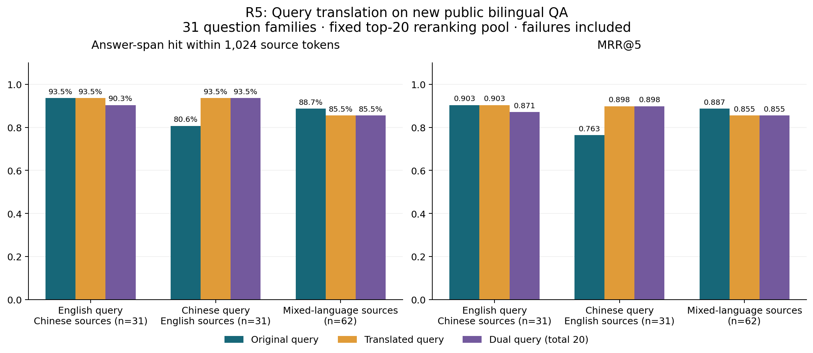

# R5：跨语言查询翻译对照

本轮暂不默认开启查询翻译。用户关心的“英文提问、中文资料”在新保留集上的最终答案命中没有净提升；翻译存在个别帮助，也有丢失原有命中、词义歧义和额外延迟。开发集原查询与仅翻译查询持平，按事先规则锁定原查询，保留集没有用于重新选择。当前应用继续采用 R4。

## 对照条件

比较原查询、仅译文召回、原文加译文双路召回。三组均用 Qwen3-Embedding-8B、256-token 无重叠切分、标题编码、查询任务指令、有界混合检索及 Qwen3-Reranker-8B；重排问题始终是原问题，总候选数最多 20，最终 Top5、原文预算 1,024 token。双路以原文先行的交替合并去重，不能扩大到 40 个重排候选。

DeepSeek `deepseek-flash` 只看到待翻译问题和目标语言，没有看到资料、答案或现成双语问题。原文资料及引用不翻译。协议、代码和数据在第一次本轮 API 调用前冻结，开发集选择在首次保留集排名前锁定。

开发集：24 个已见双语问题组、48 条查询、96 个 mixed/cross 场景。保留集：31 个此前未使用的问题组、62 条查询、124 个场景，排除旧问题及任一语言完整答案原文重合。共同语料为 207 篇原文、236 个片段，含旧资料作为干扰项。

数据来自 MLQA 的公开人工答案跨度，主题为软件、计算机产品和人物相关 Wikipedia。它不是计算机本科课程金标；“答案片段命中率”也不等于全部相关片段的 Recall 或教学内容质量。

## 保留集结果

以下为 1,024-token 原文预算内的完整答案跨度命中，接口失败保留在分母。

| 场景 | 原查询 | 仅译文 | 原文＋译文 |
|---|---:|---:|---:|
| 英文查中文，31 题 | 29/31（93.55%） | 29/31（93.55%） | 28/31（90.32%） |
| 中文查英文，31 题 | 25/31（80.65%） | 29/31（93.55%） | 29/31（93.55%） |
| 双语资料混合，62 题 | 55/62（88.71%） | 53/62（85.48%） | 53/62（85.48%） |
| 全部 124 个场景 | 109/124（87.90%） | 111/124（89.52%） | 110/124（88.71%） |

总体 MRR@5：0.8602 → 0.8777 / 0.8696；重排前 Candidate Hit@20：92.74% → 94.35% / 94.35%。仅翻译最终净增加 2 个场景命中（新增 8、丢失 6），双路净增加 1 个（新增 7、丢失 6）。

仅翻译相对原查询的最终命中差为 +1.61 个百分点，按 25 个来源关联组件配对 bootstrap 的 95% 区间约为 **−4.84 至 +7.50 个百分点**；双路为 +0.81，区间约 −4.17 至 +5.56。两者均不能据此宣称稳定提升。同一问题的两种语言、两种资料模式没有被当作四道独立题。

[可导出的矢量 PDF](r5-experiments/20260912T085156100010Z/r5-heldout-quality.pdf)。图中包含接口失败，需结合下面的故障分解阅读。

## 为什么不能直接把提升归因于翻译

全轮 660 次重排有 21 次 HTTP 503，其中开发集 1 次、保留集 20 次。保留集原查询、仅翻译、双路分别失败 6、6、8 个场景；这些请求没有自动重试，也没有从分母删除。

“中文查英文”多出的 4 次命中中，3 次对应原查询组接口失败，只有 1 次发生在双方重排都成功时。该方向在重排前的候选覆盖从 28/31 到 29/31，反映的增益远小于最终表面的 +12.90 个百分点。

“英文查中文”的最终净命中虽持平，但命中题不完全相同。双方重排都成功的 30 个配对场景中，仅翻译少命中 1 个；另有 1 个场景因原查询组失败而被抵消。上述事后拆分只用于解释主结果，不能替代包含失败的实验或当作新的成功子集实验。

110 条译文均通过格式、目标语言字符和关键标识检查。助手另抽查 20 条，其中 foundation 在问题中指“基金会”，却被译为“基础”；译文未据此修正。助手抽查与公开原始人工标签分开保存，真人译文审核列仍未填写。

## 时间、费用与验证

翻译请求的实际 p50 为 750 ms，p95 为 1,176 ms。保留集按阶段依赖关系合成的平均查询延迟估计，原查询约 3.55 秒、仅翻译 3.84 秒、双路 4.85 秒；嵌入网络时间有波动，这些估计不是线上端到端压测结果，不能用相减值代替翻译本身的耗时。

实际调用：110 次翻译、222 次嵌入、660 次重排。OpenRouter 已报告费用合计 0.56427819 USD；21 次失败未报告费用。DeepSeek 实际输入 13,766、输出 1,646 token，没有返回费用字段，因此没有声称这是合并总账单。文档向量按输入和接口身份复用 171 个，新增 65 个；查询向量在本轮新调用并按完全相同请求去重。

归档代码离线重放全部 660 条场景策略记录，候选请求、候选 ID、最终排名、逐题指标与上下文完全一致，新增 API 调用 0 次。应用源码的冻结哈希保持一致，正常业务库所有表与 R4 激活后逐行一致。

[全部 548 项自动测试通过](r5-final-tests-20260912.xml)，失败、错误与跳过均为 0；包含翻译标识保留、双路去重、并发失败缓存、旧数据隔离和按来源组件抽样的检查。

## 证据与后续研究

- [冻结协议](R5_PROTOCOL_V1.md)、[选择锁](r5-experiments/20260912T085156100010Z/selection-lock.json)
- [完整报告及统计](r5-experiments/20260912T085156100010Z/report.md)、[逐题增损表](r5-experiments/20260912T085156100010Z/test-changes.csv)
- [接口状态与增损拆分](r5-experiments/20260912T085156100010Z/test-failure-attribution.json)、[失败场景](r5-experiments/20260912T085156100010Z/failed-scenarios.csv)
- [译文与待人工审核表](r5-experiments/20260912T085156100010Z/translation-review.csv)、[单独标明的助手抽查](r5-experiments/20260912T085156100010Z/assistant-translation-review.json)
- [零新增调用重放验证](r5-experiments/20260912T085156100010Z/replay-verification.json)、[应用与业务库核验](r5-experiments/20260912T085156100010Z/production-verification.json)

论文可以将本轮写成受控消融：跨语言翻译并非必然提高召回，收益依赖查询语言、资料语言、实体表达及接口可靠性；本次小样本尚不足以支持默认启用。后续可在新的真实课程人工标签上预先定义按语言差异或证据不足触发的补检索，并独立规定重排失败处理。不能将已经查看过的 31 个问题组继续当作未见测试集，也不能把本轮百分比与不同题目和语料的 R4 直接相减。
