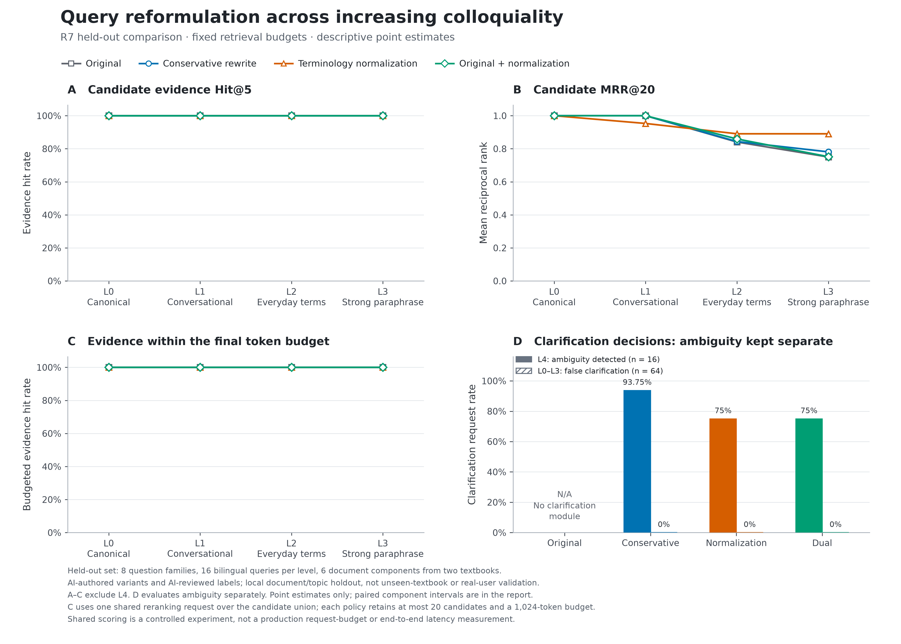

# R7：分级口语、术语归一化与歧义识别实验

日期：2026-09-20（归档目录使用 UTC 时间）。状态：真实 API 实验、查询语义审核和离线复现已完成；生产默认配置未改。

## 1. 本轮得到的判断

**强口语主要损害证据排序，专业术语归一化是本轮最有希望的改写候选；已经含糊到多义的输入需要独立处理。** 开发集依据事先固定的 Hit@5 → MRR@20 规则选择 normalize，留出部分的排序结果支持继续研究它。不能把该选择写成已找到所有场景下普遍最强的方法。

留出部分原文的首阶段 MRR@20 从 L0 的 1.0000 降到 L3 的 0.7500；同一批 L3 输入经术语归一化达到 0.8906，差值 +0.1406，来源文档分量配对区间为 [0.0677, 0.2202]。但四臂所有 L0–L3 的 Hit@5 和最终预算内命中均为 100%，因此这是**排序收益，不是召回命中率提升**。小语料的命中指标依然饱和。

明显歧义的 L4 单独统计：保守改写识别 15/16（93.75%），术语归一化识别 12/16（75%）。两者在这批 64 条非歧义留出输入中均没有误要求澄清。归一化有把模糊说法强行对应到某个算法的倾向；“更敢改写”并不等于“更理解用户”。

完整结论必须同时保留失败、意图风险、样本限制和正结果。自动聚合报告只依据冻结度量选胜；本总结另外综合了事后完成、独立于检索分数的 AI 语义审核。

## 2. 五组输入如何定义

| 组别 | 输入特征 | 评价方式 |
|---|---|---|
| L0 | 基本无口语，术语清晰、问法完整 | 检索质量参照 |
| L1 | 语气词、学习任务包装、自然口头句式，保留术语 | 同一意图下的检索质量 |
| L2 | 部分术语换成生活化表达，目标仍明确 | 同一意图下的检索质量 |
| L3 | 强替换、绕话、机制描述，尽量移除算法名称，但保留区别条件 | 可恢复强口语检索质量 |
| L4 | 刻意缺少区别条件，至少两种实质不同的解释合理 | 是否识别需要澄清；不评分隐藏单一答案 |

口语程度和信息是否充分是两个维度。L3 可以很口语但意思明确；L4 也可能语法工整却不知具体指什么。L4不能接在同一条“正确答案召回率下降曲线”上，否则会奖励模型碰巧猜中作者心中的意思。

例如二分查找的 L3 英文输入描述“检查中间数后排除一半可能”，再问检查次数怎样随规模增长及原因；归一化补回 binary search 术语，没有把 logarithmic 答案加进这条查询。相对地，L4 只谈范围变小，可以是二分、树搜索剪枝或其他过滤过程，不应直接认定二分。

这些是 AI 编写的定性档位，不是经真人测量的连续口语量表。解释算法名称有时增加机制线索；BFS L3描述当前探索前沿会提示一部分访问顺序。不能声称各档除表面风格外信息量完全相同。[构造说明](../../benchmarks/rag/query-severity-v1/VARIANT_NOTES.md)和[冻结前逐条核验](R7_INPUT_AUDIT.md)记录了边界；AVL 两条 L3 在冻结前补上“高度最多差一层”的区别条件，未补出所问的平衡因子公式。

## 3. 数据与标签的可信范围

12 个本科算法/数据结构信息需求，每个中英文各一套、每套5组，共120条输入，包含96条可恢复查询和24条歧义查询。规范问题及20个已知证据span由AI依据真实教材构造，语义变体作者只看规范问句，不看教材、答案或检索结果。输入审阅与输出审阅都是AI辅助，不能称教师人工金标或真实学生日志。

主语料为固定版本的 Hello Algo 和 OpenDSA 12篇原文，切成144个片段；另加入R5的207篇公开软件主题原文、236个干扰片段。合计219篇原文、380个片段。已核验的原始出处、许可、全文哈希和精确字符span保留在 [base.json](../../benchmarks/rag/query-severity-v1/base.json)。外部图片、交互练习及代码宏未展开，题目只依赖已导入文字。

7个需求有双语证据，其余仅一种资料语言有支持，因此本轮统一在混合语料中检索，不把缺失方向当跨语言失败。证据是已知支持span，非穷尽相关性；hash-delete两个span有互补事实，任一span命中不证明答案所有事实都已找齐。

按支持文档建立8个连通分量，哈希固定划分：dev为2分量/4信息需求/40输入，test为6分量/8信息需求/80输入。test每档16条查询；L0–L3共64条进入质量评估，L4另16条。各档和语言相互关联，不能把120作为独立信息需求样本数。两本教材中的章节仍可能相关，所以这里只是**局部文档/主题留出**，不是未见教材、未见领域或真实用户泛化。

## 4. 实验策略与公平控制

| 策略 | 行为 | 本轮实际模型调用 |
|---|---|---|
| original | 原文直接检索 | 无改写调用 |
| conservative | 去套话、精简表达，按约定不新增算法名称；缺少意图时澄清 | 每条查询一个独立DeepSeek提示 |
| normalize | 描述足够明确时恢复标准CS术语，保留约束；多义时澄清 | 每条查询另一个独立DeepSeek提示 |
| dual | 原文与normalize两路交替去重，总共最多20；沿用normalize澄清动作 | 复用normalize输出 |

模型只看到当前输入、语言和统一的本科计算机领域说明；不看到level、family ID、原始标准问句、另一语言问句、资料或标签。文字模型为 deepseek-flash、temperature 0、thinking disabled、max output 320 token。澄清成功时忽略query字段；输出校验失败则回退原文，两种情况分开记录。

检索固定Qwen3-Embedding-8B、CS查询指令、256-token递归无重叠切片、标题路径、有界dense+lexical混合、metadata weight 0、每臂20候选。排序指标以已知完整证据span定义：Hit@1/5/20允许返回片段联合覆盖；MRR@20要求某个单片段完整覆盖。因错误澄清或查询失败得零分的输入不删分母。

最终重排采用四臂候选并集的一次共享Qwen3-Reranker-8B评分，再对各臂自己的候选排序，取Top5、1024源文本token上下文。实际共享池为20–30条，平均22.21条。共享失败由四臂共同承担，避免R6中503不对称制造净收益。这是受控评分实验，**不是生产环境四个独立20候选请求的延迟或计费测试**。

全部提示、规则、调用边界和选择标准在首次API前冻结：[R7_PROTOCOL_V1.md](R7_PROTOCOL_V1.md)。开发集四臂Hit@5均为1，MRR@20依次为0.8760、0.8734、0.9010、0.8854，故锁定normalize，再生成test排名。未使用test最高值反向改prompt或选择。

## 5. 分组结果：区别在排序

下面是留出部分首阶段 **MRR@20**，每格16条查询；数值越高，第一条已知证据平均排得越靠前。

| 输入组 | 原文 | 保守精简 | 术语归一化 | 原文＋归一化 |
|---|---:|---:|---:|---:|
| L0 规范表达 | 1.0000 | 1.0000 | 1.0000 | 1.0000 |
| L1 轻度口语 | 1.0000 | 1.0000 | 0.9531 | 1.0000 |
| L2 日常词替换 | 0.8406 | 0.8438 | **0.8906** | 0.8594 |
| L3 强口语但可恢复 | 0.7500 | 0.7812 | **0.8906** | 0.7521 |
| L0–L3合计，64条 | 0.8977 | 0.9063 | **0.9336** | 0.9029 |

四臂、所有组的首阶段Hit@5及最终预算内Hit均为100%。总体Hit@1分别为82.81%、84.38%、89.06%、82.81%。最终MRR@5分别为0.9427、0.9505、0.9505、0.9505，三种改写策略间的最终排序并没有重复首阶段同样明显的优势。

| 相对原文 | 全部L0–L3 MRR差 / 95%区间 | L3 MRR差 / 95%区间 |
|---|---|---|
| 保守精简 | +0.0086 / [−0.0056, +0.0366] | +0.0313 / [−0.0250, +0.1429] |
| 术语归一化 | +0.0359 / [+0.0177, +0.0560] | +0.1406 / [+0.0677, +0.2202] |
| 双路 | +0.0052 / [0.0000, +0.0104] | +0.0021 / [−0.0200, +0.0357] |

区间按6个文档分量整体配对bootstrap，2000次、种子20260920。没有多重比较校正，来源和样本数量有限，应作探索性描述；不能仅凭区间未跨零宣布普遍有效。

可用于论文的[矢量PDF](r7-experiments/20260919T161914951306Z/figure-query-severity.pdf)及[SVG](r7-experiments/20260919T161914951306Z/figure-query-severity.svg)同时保留。图中L4单独显示，不与检索曲线相连。

## 6. 几个能解释收益和退步的实例

| L3输入的核心说法 | normalize恢复的检索概念 | 第一条完整证据位置变化 |
|---|---|---|
| 每次检查中间数后排除一半，检查次数怎样增长（英文） | binary search，仍询问比较次数增长及原因 | 第2 → 第1 |
| 两路树会旋转、每处高度最多差一层，带正负号的数怎么算（中文） | AVL树节点平衡因子如何计算 | 第2 → 第1 |
| 挑参照数、挪动其他数、递归处理分段，第一步应达到什么状态（中文） | 快速排序分区后的状态 | 第3 → 第1 |
| 每次把下一个放进前面排好的部分，原序列近乎有序（中文） | 插入排序在近有序输入下为何开销低 | 第3 → 第1 |
| 总选第一项作为参照，输入倒序，为什么可能很慢（英文） | 改为询问“worst-case time complexity” | 第3 → 第4 |

最后一例说明恢复算法名称仍可能强化问题范围：“可能很慢”被改成“最坏情况”，审核标记了这一风险。L1同主题的一条改写也出现第1→第4的退步，解释了轻口语组不宜无条件改写。

## 7. L4歧义识别单独比较

| 策略 | 需要澄清的16条中识别多少 | 64条明确输入中的误澄清 | 说明 |
|---|---:|---:|---|
| 原文 | 未实现该检测模块 | 未实现 | 不能把缺模块说成已证明检索全错 |
| 保守精简 | **15/16，93.75%** | 0/64 | 本轮歧义识别更稳健 |
| 术语归一化 | 12/16，75.00% | 0/64 | 4条歧义输入未要求澄清 |
| 双路 | 12/16，75.00% | 0/64 | 与normalize共用标记，并非独立检测器 |

只测了模型是否预测需要澄清，未测真正的澄清问句质量、用户回复后的检索成功率或产品交互。L4列出的可能解释只是AI示例集合，不是穷尽人类意图标签。

## 8. 240条改写的语义审核与敏感性分析

查询及模型输出由AI逐条审核，审核时不看教材、证据span、候选排名或指标；可见标识符和问句，不能称完全盲法或独立人工裁决。主实验分母和选择锁没有因审核而改变。[审核报告](R7_REWRITE_AUDIT.md)及逐条 `rewrite-semantic-audit.json` 可追溯。

| AI审阅分类 | conservative（120条） | normalize（120条） |
|---|---:|---:|
| 未发现明确实质性意图偏移 | 95 | 81 |
| 返回澄清，检索query被忽略 | 21 | 17 |
| 范围变化风险 | 0 | 11 |
| 主动查询加入用户所问答案提示 | 0 | 9 |
| 其他约束警告 | 4 | 0 |
| 机械校验失败 | 0 | 2 |

9条答案提示包括将栈顺序直接补成LIFO/后进先出、把近有序排序加入“接近线性”等。11条范围风险中包括多义L4被猜成某个算法，以及“可能慢”被强化为最坏情况；风险标记不等于11条全部被证实语义错误。2条机械失败是DFS被替换为完整名称，未保留指定字面量，不是HTTP失败或已证明的幻觉。

将事先于成绩阅读完成的AI分类与test结果事后关联，得到：

- normalize的64条质量查询中，54条被标为未发现实质偏移，MRR从0.9049变为0.9630，6次改善、0次退步。
- 7条被标记含答案提示的质量查询，原文和改写MRR都为1.0000，本轮观察到的排序净增益**不来自这7条**。
- 3条范围风险查询，MRR从0.5278降为0.2500，含2次退步。
- L3中13条“未发现实质偏移”的诊断子集从0.7436变为0.9231；它不是新的主分母或人工正确性证明。

以上只是事后敏感性描述，不替代完整64条的主结果，不用于重新挑选策略、删题或修复prompt。[敏感性数据](r7-experiments/20260919T161914951306Z/semantic-sensitivity.json)有独立可重建脚本。

## 9. 调用、成本和故障

| 能力 | 逻辑请求 / 实际HTTP attempts | 首次HTTP失败 | 恢复 | 已报告费用 |
|---|---:|---:|---:|---:|
| DeepSeek改写 | 240 / 240 | 0 | 不适用 | 金额未报告；88,691 token |
| Qwen3嵌入 | 26批 / 26 | 0 | 不适用 | 0.00038966美元 |
| 共享Qwen3重排 | 96 / 103 | 7次503 | 7次均由预定的一次重试恢复 | 0.12295840美元 |

OpenRouter已知费用合计0.12334806美元；7次503和所有DeepSeek记录没有金额，不能把这当完整账单。DeepSeek计量为74,088输入、14,603输出token。币种按[OpenRouter官方计费说明](https://openrouter.ai/support)，不核验用户账户总账单。未触及4美元已报告金额阈值或attempt上限。

嵌入包括144个新课程片段（9批）、263个去重查询输入（17批）；R5的236个干扰片段向量经签名、完整输入哈希、NPZ哈希和维度核验后复用。批量编码不能用总墙钟平均声称生产单查询延迟。成功响应模型ID分别为deepseek-flash、Qwen/Qwen3-Embedding-8B、accounts/fireworks/models/qwen3-reranker-8b。

最终96个共享重排全部成功，本轮排序差异不再由不同臂恰好遇到503解释。所有首次失败和重试均保留，没有隐瞒重试成本。

## 10. 本轮选什么，以及尚未实现什么

本冻结基准在dev选出的全局候选是normalize；test呈现的使用方向是：规范与轻度口语优先保留原文，明确但术语缺失的强口语更值得尝试术语归一化，明显多义时优先识别并澄清。单纯去套话的收益较小，交替合并双路没有取得同样的强口语排序收益。

**这不是已验证的自动分流系统。** 本轮输入档位由作者定义；没有部署分级器，也没有按test档位拼装一个“最优路由器”。不能使用运行时未知的level去宣称产品收益。若下一步实施，应另冻结仅依赖用户实际文本的意图充分性判断与归一化流程，保留原始生成要求，加入禁止答案提示和范围强化的规则，再用新样本验证路由错误、语义忠实度与真实延迟。

目前保持应用原文检索默认值，保留normalize为后续受控候选。依据是本轮最终命中没有增益、仍有改写约束违例、规模只有两本教材的8个留出信息需求；自动启用尚缺证据。

## 11. 档案、复现和参考文献

完整运行：`r7-experiments/20260919T161914951306Z/`。包含数据及代码freeze、输入、提示、原始HTTP响应、向量、四臂候选、共享评分、逐题指标、选择锁、审核和图表。22项测试通过。禁用网络的临时副本重放验证160条dev、320条test，候选（除重新计时）、首阶段分数、共享请求、最终排名及指标完全一致；调用账本和选择锁未变，新增API为0。[验证记录](r7-experiments/20260919T161914951306Z/offline-verification.json)

可阅读的[自动统计报告](r7-experiments/20260919T161914951306Z/report.md)、[全部分组指标CSV](r7-experiments/20260919T161914951306Z/metrics.csv)、[澄清指标CSV](r7-experiments/20260919T161914951306Z/clarification.csv)、[逐题差值CSV](r7-experiments/20260919T161914951306Z/test-changes.csv)分开保存。离线重放目录为 `r7-replays/20260919T162652548517Z/`；[操作说明](R7_REPRODUCTION.md)给出不新增API的重建命令。

研究参考：

1. Ma et al. (2023). Query Rewriting in Retrieval-Augmented Large Language Models. EMNLP. https://aclanthology.org/2023.emnlp-main.322/ —— 查询适配的研究动机，不把其训练或下游结果当成本轮复现。
2. Min et al. (2020). AmbigQA: Answering Ambiguous Open-domain Questions. EMNLP. https://aclanthology.org/2020.emnlp-main.466/ —— 多种合理解释的评价思想；本轮未复现其数据集或训练过程。
3. Zhang et al. (2025). Qwen3 Embedding: Advancing Text Embedding and Reranking Through Foundation Models. https://arxiv.org/abs/2506.05176 —— 嵌入与重排模型参考，不证明第三方端点在不同批大小下完全等价。

R7新增记录而不重写R6负结果，二者的数据、划分、口语构造及重排协议不同，不能跨轮相减成连续的召回提升曲线。论文DOCX/PDF本轮未重建；本页与矢量图可以作为后续论文实验章材料。
