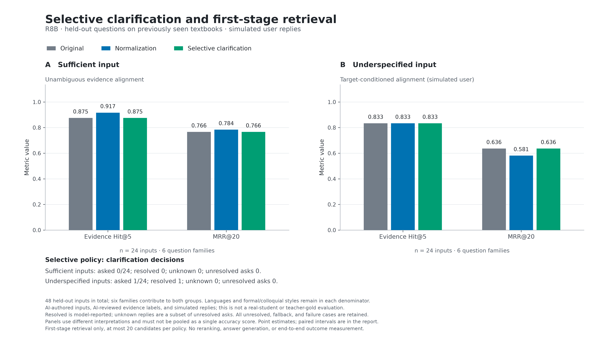

# R8B：选择性单次追问与查询归一化的对照实验

2026-09-20 · Lumori RAG 研究记录 · 中英文计算机本科课程 · 探索性实验

## 结论

**本轮没有证实当前追问策略能提高留出问题的检索表现，不据此默认启用产品追问。** 选择性策略在 64 条输入中保留原文 53 次、改写 9 次、追问 2 次；在留出集的 48 条输入中，各项已知证据命中与首个证据排序指标均与原文相同。两个追问的模拟回答都未完全符合预设约束，因此模型自报的两次 `resolved=true` 不能作为两次成功澄清。

直接归一化也不是稳定改进：在信息充分的 24 条留出输入上，Hit@5 从 21/24 变成 22/24；但新增命中的那条改写加入了用户原本想问的快排优化答案。对于信息不足的 24 条输入，指定模拟意图下的 MRR@20 从 0.6363 降到 0.5809。主结果保留全部样本，不删去语义缺陷以美化结果。

这些结果支持继续研究“先判断缺少哪项信息，再做有限追问”，但不支持“遇到口语就追问”或“所有输入都改写”。它们也不能证明追问机制本身无效：本轮只测一个冻结提示、一个模型、一次采样及两个实际追问。

## 1. 研究动机与文献关系

R7 将强口语但可识别的输入与真正缺少信息的输入分开。R8A 使用固定改写研究融合；本轮另建问题研究：当信息缺失会改变检索目标时，模型能否适当地问一次，并利用回答检索更符合意图的证据。

角色隔离、单次追问、模拟用户的想法参考 [Clarify-Then-Search](https://arxiv.org/abs/2608.20357) 等研究，文献范围和局限汇总于 [查询改写与澄清参考](research/QUERY_REWRITING_REVIEW_20260920.md)。本轮是本项目的受控试点，没有复现其完整训练、数据或评测体系；模拟回答不等于真实学生行为。

## 2. 数据与冻结设计

| 项目 | 本轮设置 |
|---|---|
| 语料 | 沿用 R7 的 219 份资料、380 个切片和文档向量；其中 12 份课程原文来自两本教材 |
| 新问题 | 8 个信息需求，相对 R7 为新问题，但教材已见 |
| 表达组合 | 每个需求 × 中/英文 × 正式/口语 × 信息充分/信息不足，共 64 条 |
| 开发集 | 2 个需求、16 条输入；充分/不足各 8 条 |
| 留出集 | 6 个需求、48 条输入；充分/不足各 24 条 |
| 标签 | AI 构造、AI 辅助审核的条件、意图 profile 与证据 span，没有教师或学生人工金标 |
| 生成模型 | API 实际返回 `deepseek-flash`，temperature=0、关闭 thinking，每角色最大 512 输出 token |
| 查询向量 | `Qwen/Qwen3-Embedding-8B`，4096 维，沿用固定 CS 查询指令 |
| 检索 | 相同混合检索、metadata bonus=0、最多 20 个首阶段候选 |
| 评价范围 | 不运行重排、最终内容生成，也不测教学效果或线上端到端延迟 |

8 个需求涵盖二分边界更新、哈希二次探测偏移、AVL 旋转、快排栈深度、动态数组栈入栈、图的连通分量覆盖、插入排序的小输入表现和归并空输入处理。每个需求的中英文与不同风格随支持文档分量一起划分。开发集为 graph-cover-components、merge-empty-input，其余六个为留出集。

留出集只有 6 个需求，且其正例文档以中文为主（5 个中文、1 个英文），不能把 48 条表述当成 48 个独立主题，也不能把查询语言分组等同于均衡的中英文语料评价。

数据 SHA-256：`5dc1410823ae785435be8192986854030b80ede01042eebedaa00ec3aada9324`。首次 API 前修正了 AVL 平衡因子约定、探测偏移起点等可见条件，详见 [输入审阅](R8B_INPUT_AUDIT.md)。没有在看到检索结果后更改问题、意图或标签。

## 3. 三种策略及信息边界

1. **original**：直接检索原始输入。
2. **normalize**：只根据原始输入恢复明确可识别的技术术语；禁止补充答案、猜测缺失约束或追问。
3. **selective**：根据原始输入选择 keep、rewrite 或 clarify。只有缺少的信息会改变知识需求时才问一个短问题；回答后再构造查询，仍无法确定时回退原文。

决策器与普通改写器仅接收原始文本和语言，不接收正式/口语标签、充分性标签、标准问题、隐藏意图或证据。模拟用户只接收原问题、实际追问及预先冻结的意图 profile；要求只回答被问到的区别，并给出 profile 原文片段。resolver 只接收原问题、追问和实际回答。

引用文字完全匹配只能验证“这段话存在于 profile”，不能保证回答被它支持，也不能保证模型没有主动透露额外条件。本轮专门保存独立的回复语义审阅。数字校验等自动约束同样不能替代语义判断。

选择性策略的成本包含判断及可能的解析调用。实验中额外生成模拟用户回复；真实产品若由真人作答，这一模拟调用不是产品必需成本。

## 4. 指标解释

- **信息充分**：Hit@K 表示前 K 个候选中是否包含冻结的完整已知证据跨度；MRR@20 为首个这样的片段排名的倒数，20 内没有则为 0。
- **信息不足**：仍计算相同数值，但含义是“与预先声明的某一模拟用户意图相匹配的证据”。另一个合理解释没有命中此 span，不能据此判成普遍错误。
- `resolved` 是 resolver 自报，不能代表真实用户满意或语义审阅通过。
- 所有动作、unknown、未解决、回退和 API 失败保留分母；不只对追问成功样本计算主指标。本轮有效运行没有 API/向量失败，也没有 unknown 或回退。

本任务的部分不充分输入可以通过条件式或概览式回答处理。“需要补充信息”是为了恢复指定目标，不意味着产品必须对每条这样的输入打断用户。

## 5. 留出结果

每类 n=24，均来自相同 6 个需求。以下为首阶段证据指标，两个输入类别不合并为单一正确率。

| 输入 | 策略 | Hit@5 | MRR@20 | 追问 | 模型自报解决 |
|---|---|---:|---:|---:|---:|
| 信息充分 | original | 21/24（87.50%） | 0.7662 | 0 | 0 |
| 信息充分 | normalize | 22/24（91.67%） | 0.7836 | 0 | 0 |
| 信息充分 | selective | 21/24（87.50%） | 0.7662 | 0 | 0 |
| 信息不足、指定意图 | original | 20/24（83.33%） | 0.6363 | 0 | 0 |
| 信息不足、指定意图 | normalize | 20/24（83.33%） | 0.5809 | 0 | 0 |
| 信息不足、指定意图 | selective | 20/24（83.33%） | 0.6363 | 1 | 1 |

| 配对比较 | 输入 | MRR 差值 | 95% 聚类 bootstrap 区间 | 改善 / 受损 / 持平 |
|---|---|---:|---|---:|
| normalize − original | 充分 | +0.0174 | [−0.0139, +0.0521] | 3 / 1 / 20 |
| selective − original | 充分 | 0.0000 | [0.0000, 0.0000] | 0 / 0 / 24 |
| normalize − original | 不足 | −0.0554 | [−0.1179, −0.0011] | 1 / 3 / 20 |
| selective − original | 不足 | 0.0000 | [0.0000, 0.0000] | 0 / 0 / 24 |

按支持文档分量聚类，2000 次重采样，种子 20260920；属于小样本探索，没有多重比较校正。部分差值区间不跨零，也不能外推到所有课程。指标相同不代表查询、候选顺序或语义相同。

独立复核确认 selective 与 original 的 48/48 条留出输入四项指标逐项相同，但完整 Top20 排序只有 42/48 相同；不能把指标持平写成所有检索结果完全相同。

充分组 normalize 唯一的新增 Hit@5 来自英文口语快排问题：原文询问如何控制调用栈，改写直接加入 `tail call elimination`、`recurse on smaller partition first`，首个已知证据从第 6 升到第 2。**这条结果违反了“只改写、不添加待求答案”的实验条件，不能把 4.17 个百分点的净增益报告成忠实改写的有效性证据。** 原始统计仍完整保留，以便复核模型实际行为。

不足组出现英文哈希偏移、英文 AVL 以及中文插入排序的下降；相关问题可能同时涉及查询词变化、约束遗漏或意图漂移。单次试验不能仅凭排名给出因果归因，具体原文和改写保存在逐条记录中。

## 6. 开发结果与追问行为

| 输入 | 策略 | n | Hit@5 | MRR@20 |
|---|---|---:|---:|---:|
| 充分 | original | 8 | 0.8750 | 0.6012 |
| 充分 | normalize | 8 | 1.0000 | 0.5833 |
| 充分 | selective | 8 | 1.0000 | 0.6458 |
| 不足、指定意图 | original | 8 | 1.0000 | 0.6875 |
| 不足、指定意图 | normalize | 8 | 1.0000 | 0.7708 |
| 不足、指定意图 | selective | 8 | 1.0000 | 0.7083 |

| 分组 | keep | rewrite | clarify | 总数 |
|---|---:|---:|---:|---:|
| dev 充分 | 6 | 2 | 0 | 8 |
| dev 不足 | 5 | 2 | 1 | 8 |
| test 充分 | 22 | 2 | 0 | 24 |
| test 不足 | 20 | 3 | 1 | 24 |

充分组没有被打断（0/32）。按本数据的指定意图标签，信息不足组只触发 2/32（6.25%），留出组为 1/24（4.17%）。这说明本提示对恢复特定意图的追问非常保守；该比率不是普遍的“歧义检测召回率”，因为并非每个不足输入都必须追问。

本轮没有根据 dev 改写提示或反复抽样，也没有根据 test 选出上线冠军。开发集只是完整展示既定划分。

## 7. 两次追问的语义问题

审阅在检索排名不可见时，分别读取查询投影或回复与 profile；属于 AI 辅助审阅，不是人工标注。原始审阅结论独立于检索指标保存。

查询侧覆盖 130 条输出（normalize 64、selective 64、resolver 2）。normalize 中 55/64 未发现明确内容问题，其余 9 条涉及条件遗漏、条件编造、目标改变、轻度范围风险或答案提示；selective 中 55/64 未发现明确文本问题，另有 7 条文本风险与 2 条单独审核的追问。两个 resolver 中一条忠实于实际问答，另一条延续实际回复引起的目标转移。标签只作解释，不用于删除不利样本。

审核者能看到含主题、风格及充分性命名的记录 ID，且此前参与了协议或输入审查，因此不能称为完全盲法或外部独立人工评价；准确表述是“审阅阶段不看检索结果”。

| 情形 | 观察 | 对解释的影响 |
|---|---|---|
| AVL，中文口语，test | 追问失衡节点及左重/右重。模拟用户除了回答 +2 左重，还主动提供了没有被问到的左孩子 −1 | profile 支持这些事实，但回复越过“仅回答所问”的边界；多透露的条件才足以确定 LL/LR。原文和最终查询均首位命中，没有观察到排序增益 |
| 非连通图覆盖，中文口语，dev | 模型问“覆盖起点分量，还是判断整图连通”。profile 目标是访问所有顶点，模拟用户却回答“判断整个图是否连通” | 选项偏离原始目标，回复也不被所引 profile 语句蕴含；检索从第 3 升到第 1 仍不能证明有效澄清 |

2/2 回复的引用确实存在于 profile，0/2 完全符合模拟协议。没有直接把原题的算法答案作为用户回复，但一例额外透露约束、一例改变意图。两例均保留在主统计，不换掉回答、不另抽样、不事后伪装为成功用户交互。

详见 [查询与 resolver 审阅](R8B_QUERY_AUDIT_20260920.md)、[模拟回答审阅](R8B_REPLY_AUDIT_20260920.md)。这些缺陷说明需要同时评估“问得对不对、回答是否可信、是否保持原意、证据是否合适”，不能只看最终检索分数。

## 8. 请求故障、成本与完整账本

首次冻结运行 `20260920T020110436365Z` 缺少 JSON 模式要求的提示字样，128 个文字请求全部 HTTP 400；另一次诊断也是 HTTP 400，共 129 次失败尝试。该故障属于实验脚本请求契约错误，不是模型能力结果，也没有形成有效检索排名。[中止记录](r8b-experiments/20260920T020110436365Z/ABORTED.md)与失败原始输出单独保存。

依据 [DeepSeek JSON 模式说明](https://api-docs.deepseek.com/guides/json_mode/)修正后，用 V2 协议重新冻结运行 `20260920T020637637502Z`：仅补齐 JSON 字样与永久错误停止逻辑，研究数据、评分和策略内容未变化。有效运行的所有请求均一次成功，无重试。

| 有效运行角色 | 请求数 | 返回 token | 解释 |
|---|---:|---:|---|
| normalize | 64 | 17,764 | 普通归一化策略 |
| selective | 64 | 26,195 | 选择 keep/rewrite/clarify |
| reply | 2 | 732 | 仅实验中的模拟用户开销 |
| resolve | 2 | 874 | 实际问答后的查询构建 |
| 查询嵌入 | 9 批，130 个去重输入 | 6,857 | 同一输入跨臂共享向量 |

有效运行共 141 次 HTTP 尝试：132 次文字、9 次嵌入、0 次重排。文字共 45,565 token，API 未返回费用；嵌入返回费用合计 **US$0.00006857**。这个金额只是已知嵌入费用，**不是总成本**。

加上失败与诊断，本轮 R8B 总共 270 次已知 HTTP 尝试；261 次文字请求没有已知费用，其中失败的 129 次也未返回 token。不能把它们算成免费。[跨运行总账](r8b-experiments/accounting-20260920.json)按实际账本归并并保存来源哈希。R8A 复用缓存，新增请求为零。没有新调用最终生成模型，也没有用户账户或生产课程数据进入实验。

## 9. 验证、图表与复现

- R8A 的 10 项测试与 R8B 的 48 项有针对性离线测试共 **58 项通过**；不把测试通过当成语义质量证明。
- R8B **192 条策略记录**（64×3）通过禁网离线重放。完整排名、指标、配对区间、费用账本和审阅投影一致；仅本地重算耗时不要求相同，没有新增 API。
- R7 来源归档 446 个文件哈希保持不变；本轮未改动应用代码或生产策略默认值。
- 输出保存白底 PNG、PDF、SVG，已查看 PNG 确认文字和布局可读。图内 `resolved` 明确标注为模型自报；配对区间与审阅问题见本文。

文件入口：

- [原设计协议](R8B_PROTOCOL_V1.md)、[V2 请求契约修订](R8B_PROTOCOL_V2.md)、[方法审查](R8B_PROTOCOL_REVIEW.md)
- [冻结清单](r8b-experiments/20260920T020637637502Z/freeze.json)、[数据集说明](../../benchmarks/rag/clarification-v1/README.md)
- [自动结果](r8b-experiments/20260920T020637637502Z/report.md)、[分层 CSV](r8b-experiments/20260920T020637637502Z/metrics.csv)、[配对区间](r8b-experiments/20260920T020637637502Z/paired-intervals.csv)
- [逐条策略与指标](r8b-experiments/20260920T020637637502Z/per-query.json)、[完整候选排序](r8b-experiments/20260920T020637637502Z/rankings.json)、[实际角色投影](r8b-experiments/20260920T020637637502Z/role-inputs.json)
- [费用和角色用量](r8b-experiments/20260920T020637637502Z/costs.json)、[零 API 重放验证](r8b-experiments/20260920T020637637502Z/offline-verification.json)、[独立结果检查](R8B_RESULTS_CHECK_20260920.md)
- [PDF 图](r8b-experiments/20260920T020637637502Z/figure-selective-clarification.pdf)、[SVG 图](r8b-experiments/20260920T020637637502Z/figure-selective-clarification.svg)、[复现步骤](R8_REPRODUCTION.md)

## 10. 下一阶段的可检验设计

结合 [R8A 融合结果](R8A_FUSION_RESULTS_20260920.md)，保留两条分开的后续研究线：

1. 意图明确时，预先锁定 RRF 或适度原文向量融合，在新文档与新主题上验证，比较排序收益、语义保持、延迟与调用成本。当前已见集合的微小优势不称为最强方案。
2. 缺少关键条件时，将“已知条件、缺失区别、为何影响答案”作为内部决策依据；追问只问那一个区别，用户可选“我不确定”。此为下一轮候选设计，不是本轮已经验证的机制。
3. 下一轮可用受控的固定回答对比语言模型模拟回答，严格限制回答只填被询问的字段；这样可以区分追问问题不好、模拟用户越界和 resolver 出错。新协议、新数据独立归档，不覆写本轮。
4. 将语义保持和答案注入作为独立验收项；检索命中增加但违反该项的输出不能算作安全的查询归一化。

产品目前继续保持已有检索流程。本轮完成的是实验与研究档案，没有增加页面追问、改变会话结构或启用新的默认改写。后续接入需有用户可见的问题、可恢复的待回答状态及真实用户测试，不能把模拟交互直接视作产品完成。
