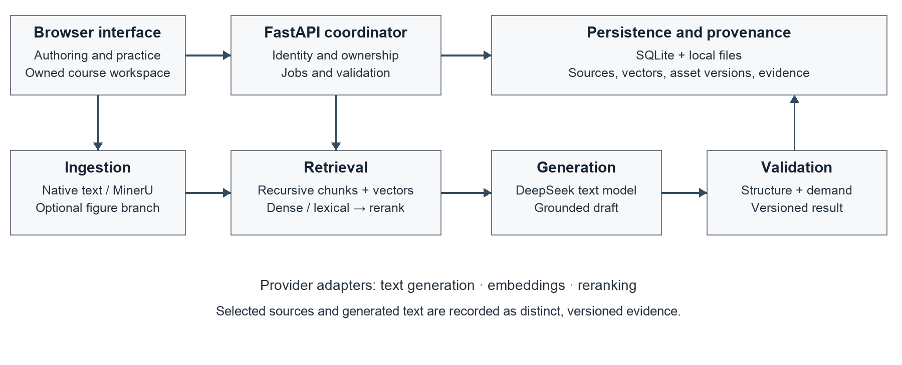
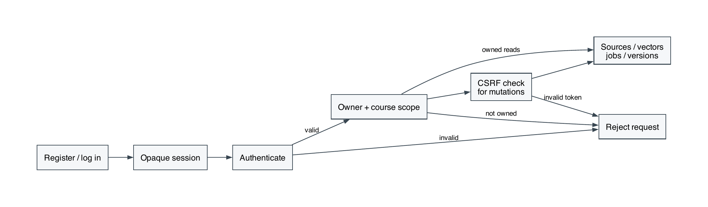
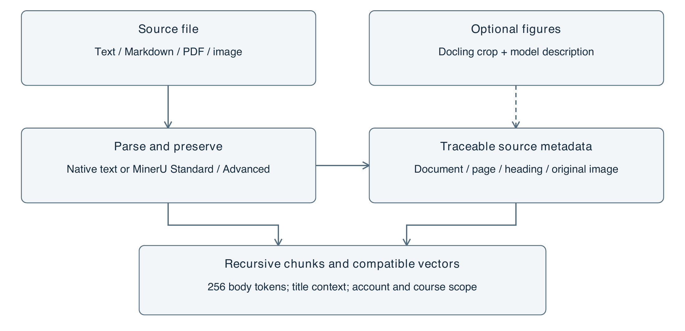
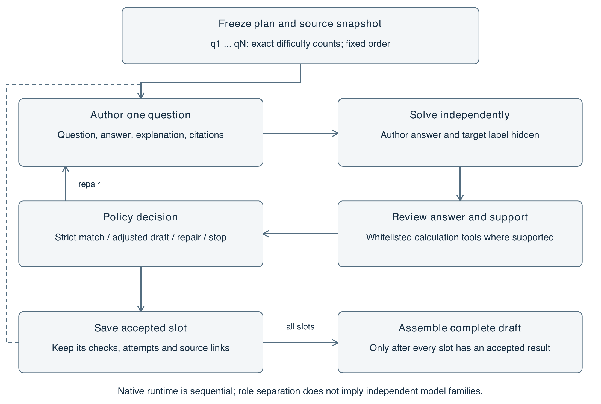
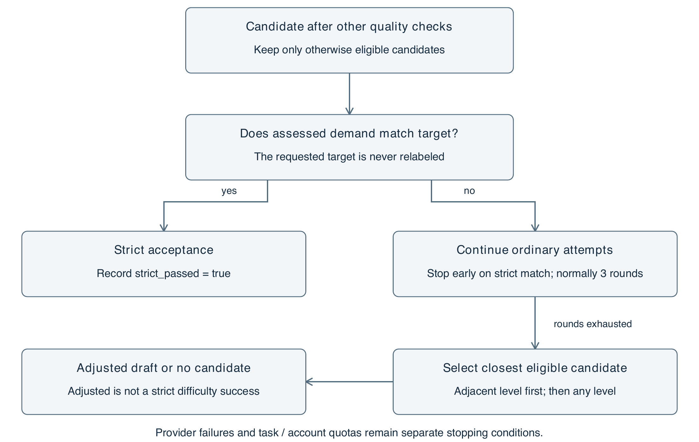
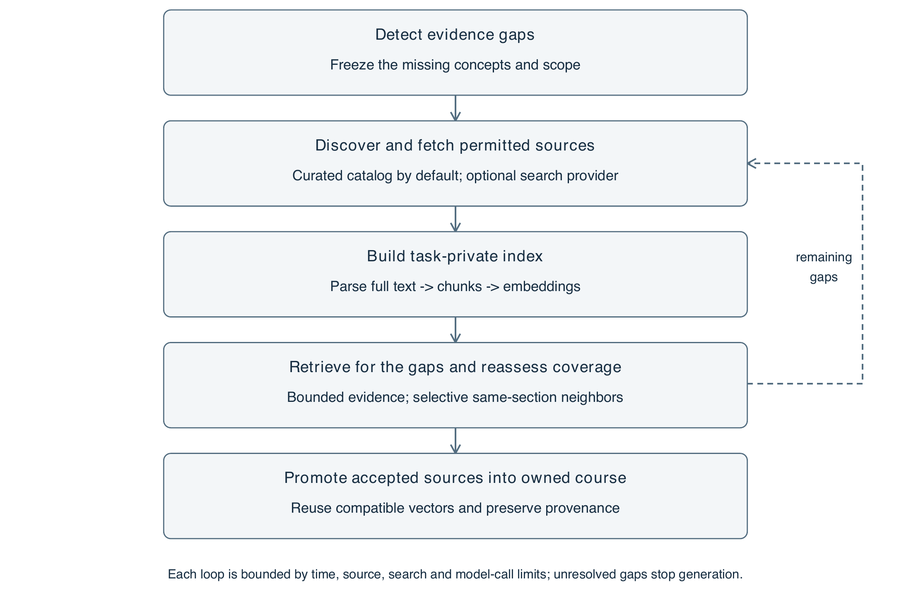
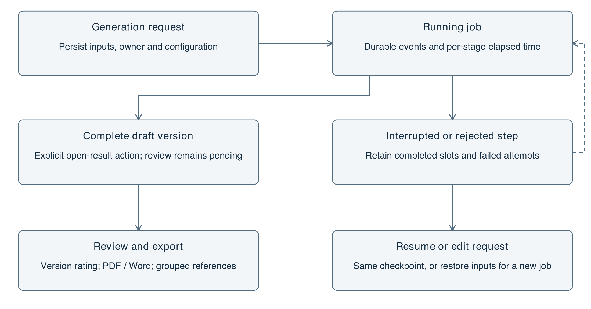
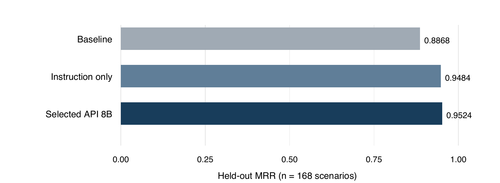
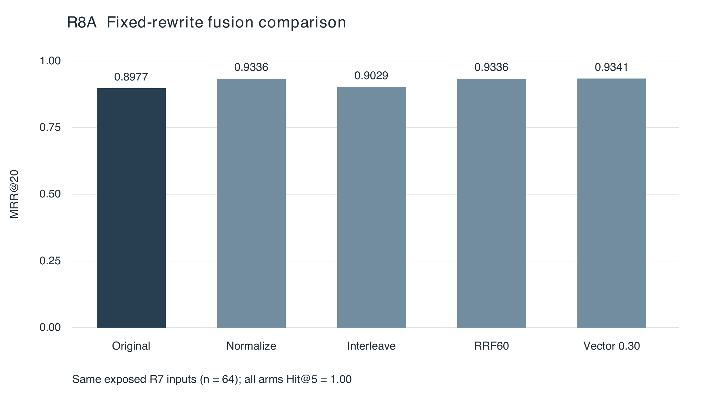

# Lumori
## Course-Grounded Educational Content and Assessment Generation
### Interim thesis manuscript — Part I

AI-Powered Multimodal Content & Assessment Generation for Educational Applications

Core text generation, retrieval and difficulty control

20 September 2026 · Version 0.3

Prepared for the CA1 stage of the AY 2026/2027 final-year project

This manuscript documents the implemented text-based foundation and its evidence. Multimodal output generation and learner studies are reserved for subsequent research. It is a working thesis manuscript, not an institution-approved submission template.

<!-- PAGE -->
# Abstract

Generating educational materials with a large language model requires more than fluent text. The materials should remain grounded in course evidence, expose their provenance and satisfy an explicit assessment plan. This report presents Lumori, a web prototype for producing explanations, quizzes and assignments from user-owned course materials. Its architecture combines document ingestion, retrieval-augmented generation (RAG), versioned evidence and exact question-level difficulty allocations. A separate model request screens intended cognitive demand, while deterministic validation checks the requested structure and citation identifiers.

A staged experimental programme compares dense and lexical retrieval, recursive segmentation, token budgets, reranking and query translation using synthetic pilot data and restricted subsets of external benchmarks. The selected configuration uses recursive 256-token chunks, title context, a retrieval instruction, bounded lexical augmentation and an API reranker. In the R4 held-out evaluation, it preserves answer-span hit rate at 97.02% while increasing mean reciprocal rank from 0.8868 to 0.9524. Translation provides direction-dependent results: in R5, English-to-Chinese retrieval does not improve, and the aggregate paired uncertainty interval includes zero. Automatic translation is therefore not enabled by default.

Historical live runs demonstrate the core generation workflow and exact difficulty allocation on small demonstration cases. An AI-assisted audit examines 23 units from five archived assets and recommends revisions to ten units, including insufficient citation support and ambiguous scenario boundaries. These findings show why successful generation and valid identifiers cannot establish educational correctness. Later colloquial-query experiments show ranking gains on an exposed small set, but a new selective-clarification pilot does not improve held-out retrieval metrics. These negative results constrain default behavior. The prototype supports the technical foundation of CA1; independent subject-expert evaluation, student-derived difficulty calibration and controlled evidence of learning or workflow benefits remain outstanding.

Keywords: educational question generation; retrieval-augmented generation; bilingual retrieval; document chunking; difficulty control; evidence provenance.

### Scope and evidence declaration

Results dated 12 September and the later R6–R8 experiments are preserved historical runs, not evaluations rerun while preparing this manuscript. Implementation descriptions were refreshed on 20 September; policy changes do not rewrite earlier outcomes. Screenshots were captured from the current application in light mode on 19 September. Content judgments in this manuscript are explicitly AI-assisted; no human reviewer scores, learner outcomes or supervisor approval are asserted. The writing and audit were prepared with assistance from Codex.

<!-- PAGE -->
# Contents

{{CONTENTS}}

### Reading the evidence

The report separates published research, implementation inspection, automated software tests, historical live provider calls and AI-assisted content judgments. These evidence types answer different questions. A passing regression suite establishes only the behavior exercised by its tests; it does not establish pedagogical quality. A held-out retrieval result applies to its documented subset and budget; it is not a university-course learning outcome.

Chapters 1–4 establish the problem, research basis and implemented system. Chapters 5–6 describe the evaluation protocol and results, including negative findings. Chapter 7 identifies the remaining work. Appendix A contains the content-audit procedure and examples. Appendix B maps the major claims to archived evidence and reproduction materials.

<!-- PAGE -->
# List of Figures

{{FIGURE_LIST}}

The workflow diagrams are original illustrations of the implemented system. Figure 1 reproduces a licensed external research result; Figures 4, 5 and 15 are dated interface captures.

<!-- PAGE -->
# 1  Introduction
## 1.1  Problem and motivation

Educators and students both construct practice materials from lectures, notes and reference texts. This work involves selecting relevant concepts, writing answerable questions, explaining answers and adjusting the intended demand for a particular learner. A general-purpose language model can accelerate drafting, but fluent output may introduce unsupported claims or depart from the supplied curriculum. An authoring interface therefore needs an evidence workflow as well as a generation workflow.

The project brief asks for educational content and assessment generation with precise control over difficulty, RAG integration and later multimodal transformations [1]. At CA1, the stated deliverables are a literature survey, system design and an initial functional prototype with core text generation and RAG. This manuscript addresses that stage. It does not treat the project's anticipated benefits—more efficient educator workflows and personalized learning—as experimentally demonstrated outcomes.

Lumori uses one course-oriented application for both authoring and self-practice. An educator may create an assignment; a student may create questions for revision. These uses share ingestion, retrieval and generation functionality. Separate teacher and student products are not necessary to demonstrate the present research objective. Account isolation is implemented, while institutional permissions and secure examination delivery are outside the current prototype.

## 1.2  Research questions

RQ1 asks how chunk boundaries, lexical signals and reranking affect retrieval under a fixed evidence budget. RQ2 asks whether query translation improves retrieval when a Chinese or English prompt targets material in the other language. RQ3 asks what the current system can demonstrably control about question difficulty and which quality defects remain after automated checks. RQ4 asks when preserving, rewriting or clarifying a bilingual course query improves evidence retrieval without changing the user's intent. Together these questions connect infrastructure choices to the reliability of reviewable educational drafts.

## 1.3  Contributions and boundaries

The implemented contribution is an integrated, inspectable workflow: account-scoped materials are indexed; selected evidence is passed to generation; question allocations are validated; outputs and their source snapshots are versioned. The empirical contribution is a traceable sequence of retrieval comparisons with explicit selection decisions and preserved negative results. The methodological contribution is the separation of intended difficulty, model judgments, source support and actual learner difficulty.

These contributions are bounded. The external datasets provide existing relevance or answer annotations, but not a representative gold standard for undergraduate computer-science teaching. The live generation corpus is small and self-authored. The work does not establish a universally strongest retriever, a calibrated difficulty scale or a reduction in educator workload. Its immediate purpose is to build a defensible foundation for those later studies.

<!-- PAGE -->
# 2  Literature Review
## 2.1  Review method and educational generation

This is a targeted narrative review, extending the project's 11 September literature survey with retrieval and chunking research inspected during the subsequent experiments. Sources include ACL Anthology, arXiv and PMLR. Selection prioritizes educational question generation, difficulty estimation, evidence retrieval and evaluation. Publication metadata and the original source ledger are retained. The review is neither exhaustive nor a systematic survey of all publications available in 2026; preprints are identified in the bibliography.

Du et al. [2] study neural question generation for reading comprehension. Their formulation establishes a useful passage-to-question foundation, but an educational application also needs objectives, reference answers and reviewable explanations. KHANQ [3] focuses attention on deeper learner questions, motivating evaluation beyond grammaticality. For Lumori, the unit of authoring is consequently a learning asset containing an explanation, assessment items, answers and supporting passages, rather than a question in isolation.

Maity et al. [4] compare in-context and retrieval-based approaches for educational question generation. Such comparisons motivate grounding, but model differences complicate attribution: a stronger generator and a better retrieval mechanism are distinct interventions. A future generation ablation in this project should hold the generator and output schema constant while varying the available evidence. The current retrieval experiments do not constitute that generation-quality ablation.

Objective-led planning in educational mathematics [5] provides a further design principle: an instruction such as “make this difficult” should be decomposed into an inspectable task plan. Domain-specific results do not establish transfer to all undergraduate subjects. Lumori adopts the general principle of explicit objectives and constraints without claiming to reproduce the paper's mathematics-specific method.

## 2.2  Intended cognitive demand and measured difficulty

Park et al. [6] investigate model-based difficulty estimation against student-derived information. Difficulty estimation and difficulty-controlled generation are related but different tasks. A model may judge a question hard without demonstrating that the intended learner population finds it hard, or that the item discriminates between levels of understanding.

Lumori operationalizes difficulty through the required cognitive task, available context and expected marking points. These descriptors support authoring and review; they do not map directly to a probability of a correct answer. Long wording, many steps and the verb “analyze” are insufficient evidence of difficulty. The same item can be routine for one cohort and unfamiliar for another. The interface therefore records learner background, and the evaluation keeps exact allocation compliance separate from model-assessed demand and future student performance.

<!-- PAGE -->
## 2.3  Retrieval, segmentation and evidence selection

RAG [7] motivates conditioning generation on retrieved material, while dense passage retrieval [8] supplies a practical semantic search mechanism. Their relevance here is architectural: external evidence can be selected at request time without retraining the generator. Neither design guarantees that the selected evidence is correct, sufficient or faithfully used. Retrieval and generation must therefore be evaluated separately.

Long-context findings [9] caution against assuming that adding more source text always improves use of evidence. For this project, a fixed source budget is both a cost control and an experimental constraint. Chunk size changes how many semantic units fit within that budget; overlap can preserve boundary context but also duplicate text. Returning five short chunks is not comparable to returning thirteen passages under a much larger budget unless both conditions are stated.

Qu et al. [16] examine whether semantic chunking's computational expense is justified by consistent gains. Their findings motivate a measured comparison rather than selecting the most elaborate segmenter by reputation. Lumori initially favors recursive structural boundaries, then tests token-sized alternatives. A content-aware method remains a candidate, not an automatically superior replacement.

Late chunking [17] preserves wider document context by pooling chunk representations after contextual token encoding. It is conceptually different from splitting text before an ordinary embedding request. The present API path returns pooled embeddings and does not expose the token representations needed to reproduce that procedure. The report therefore treats late chunking as a future controlled experiment rather than relabeling title prefixes or parent expansion as an implementation of it.

Qwen3 Embedding [18] offers multilingual embedding and reranking models. This motivates testing instruction-sensitive retrieval and cross-language search locally. Published benchmark strength does not predict this application's exact corpus, language direction or provider reliability. Lumori's choice of an 8B reranker is supported by its bounded development experiment, with a cheaper instruction-only alternative retained for comparison.

## 2.4  Evaluating support rather than surface plausibility

Citation-oriented generation [10] highlights the importance of checking whether claims are supported by their references. RAGAs [11] and ARES [12] motivate separating retrieval relevance, faithfulness and answer quality. Automated evaluators can make large-scale screening feasible, but they remain measurement instruments with their own errors. A model judging its own model family's output is not independent expert validation.

Question-generation evaluation also depends on how acceptable alternatives are represented [13]. Open-ended questions can admit multiple valid answers; a single reference is an incomplete description of quality. MIRROR [14] further motivates structured evaluation of open-ended generation. Lumori consequently preserves exact source snapshots and assesses answerability, ambiguity and support as distinct dimensions. The September 19 audit in Chapter 6 uses these distinctions qualitatively and does not present its judgments as a validated benchmark score.

<!-- PAGE -->
## 2.5  Quantitative evidence for retrieval and segmentation

Published retrieval scores are useful only with their task and denominator. DPR [8, Table 2, p. 6773] reports top-20 answer-containing passage retrieval on open-domain QA over English Wikipedia. On Natural Questions, the single-dataset DPR model reaches 78.4%, compared with 59.1% for BM25, an absolute difference of 19.3 percentage points. On SQuAD, however, BM25 reaches 68.8% and single-dataset DPR 63.2%. The same model class therefore has different advantages under different query construction and supervision conditions. These values are not a baseline for Lumori's bilingual course corpus.

Qu et al. [16] provide a more direct comparison of chunk construction. Their document-retrieval experiment samples 100 queries per dataset and maps retrieved chunks back to source documents. Some short-document datasets are artificially stitched into longer documents. On stitched NQ, breakpoint segmentation has a large F1@5 advantage; on non-stitched HotpotQA the fixed-size method is stronger. The distinction matters because concatenating unrelated passages creates boundaries that a semantic detector is particularly suited to finding.

Table L1. Published segmentation results from Qu et al. [16, Tables 1–2, p. 2158]. All values are percentages; F1@5 is not the probability that a query has any relevant hit.

| Task and dataset | Fixed size | Breakpoint | Clustering |
|---|---:|---:|---:|
| Document retrieval, stitched NQ | 43.79 | 63.93 | 41.01 |
| Document retrieval, HotpotQA | 90.59 | 87.37 | 84.79 |
| Evidence retrieval, TechQA | 28.98 | 28.49 | 27.96 |
| Evidence retrieval, Qasper | 8.66 | 8.16 | 8.50 |

The table supports a task-dependent comparison rather than a universal ranking of chunkers. Our recursive policy preserves structural boundaries with a token limit; it is not identical to the paper's fixed-size baseline. A valid local comparison must hold the corpus, embedding model, final source budget and evaluation spans constant. Otherwise, a larger chunk can appear to improve coverage simply because more text is supplied.

Late chunking [17] addresses contextual representation rather than only breakpoint placement. It encodes a document before pooling token representations into chunks, whereas an ordinary embedding API encodes each submitted chunk separately. Title prefixes approximate contextual cues but do not reproduce that mechanism. Since the deployed provider path exposes pooled vectors, implementing late chunking would require a compatible encoder interface and a separately costed index rebuild.

<!-- PAGE -->
## 2.6  Context position and evidence use

Liu et al. [9] separate the presence of an answer-bearing passage from the model's ability to use it. Their multi-document QA protocol varies the position of the relevant passage while controlling the surrounding documents. Figure 1 reproduces the original study's illustrative result. Accuracy is highest near the beginning or end and weaker in the middle, even though the evidence remains in the input.

![Figure 1. Context-position sensitivity in an external study. Reproduced from Liu et al. [9], original Figure 1, p. 158, under CC BY 4.0 (https://creativecommons.org/licenses/by/4.0/). Cropped to the chart, axes and legend; data are unchanged. This is GPT-3.5-Turbo-0613 with 20 retrieved documents, approximately 4,000 tokens, not a Lumori experiment.](figures/literature-middle.png)

For that study's GPT-3.5-Turbo setting, Table 1 reports 56.1% closed-book accuracy and 88.3% oracle accuracy with the answer-containing document. The figure shows why an oracle result cannot be assumed when irrelevant passages are added. Neither number predicts DeepSeek's performance on educational authoring.

The implication for our design is to budget and order evidence deliberately, then evaluate generated support separately. Reranking can improve where a useful passage appears without discovering any additional answer span. Conversely, a retrieval hit does not ensure that an explanation uses the passage correctly. Lumori therefore stores the exact submitted source snapshot, permitting later support judgments against what the model received rather than the full source document.

This motivates a future context-use ablation: retain the same accepted evidence, vary its position and distractor count, and measure claim support with the same generator. It is distinct from the existing chunk-retrieval experiments and has not yet been run.

<!-- PAGE -->
## 2.7  Objective alignment and educational validity

Educational generation introduces criteria that passage retrieval cannot measure. Cheng et al. [5] formulate objective-directed mathematical question generation as planning and iterative refinement. Their EQPR framework uses a search procedure to improve questions against educational objectives. Lumori borrows the principle of an explicit plan and separate review; its native sequential controller does not implement their Monte Carlo tree search.

Table L2. Selected results from Cheng et al. [5, Tables 1–2, p. 12843]. These are the paper's mathematical-question settings and evaluators, not our computer-science results.

| Condition | Comparator | EQPR | Interpretation |
|---|---:|---:|---|
| EduMath-CQ, DeepSeek-V3, model-evaluated win rate | DEAR 41.81% | 46.23% | 4.42 percentage-point difference |
| EduMath-CQ, DeepSeek-V3, pass rate | DEAR 37.88% | 43.11% | Objective-related evaluation in the paper |
| Human win rate, CQ sample | ReAct 35.00% | 36.67% | 100 samples, three degree-qualified evaluators |

The human comparison is smaller than the model-evaluated contrast and uses a different comparator. It should not be presented as independent confirmation of the same effect size. The reported Fleiss' kappa for human win judgments is 0.47, compared with 0.71 for clarity. This disagreement is relevant to rubric design: readable questions are not necessarily easy to rank by educational quality.

A separate question is difficulty. A model assessment based on cognitive operations is a useful authoring signal, but does not estimate the proportion of students who will answer correctly. Park et al. [6] motivate relating model estimates to student information; our prototype has no such student calibration. Difficulty acceptance must therefore distinguish the requested label, model-assessed demand and observed learner response. A delivered adjusted draft satisfies a usability policy, not a strict difficulty experiment.

Citation evaluation adds another independent dimension. ALCE [10] measures whether cited passages support generated statements and whether included citations are relevant; RAGAs [11] and ARES [12] similarly decompose evaluation. An identifier that resolves to a real passage can still support only part of a claim. Our export now groups references by source document for readability, while retaining passage-level provenance. The shorter bibliography does not reduce the granularity required for support review.

<!-- PAGE -->
## 2.8  Rewriting and preserving the original query

Query rewriting can bridge everyday language and course terminology, but it can also introduce a premise or answer that the user never supplied. Ma et al. [21] establish a Rewrite–Retrieve–Read framework and study a trained rewriter using downstream feedback. Our prompt-based normalization does not reproduce that training. We separate faithful terminology recovery from hypothetical-answer expansion: an invented answer may be useful as a search probe, but is not factual evidence.

Recent work makes the integration mechanism explicit. Sun and Surdeanu's AnchorQE [22] fixes generated expansions and compares how they enter a frozen dense retriever. It encodes original and expanded queries separately and combines their normalized vectors. Its stream-calibrated variant estimates a weight from eight unlabeled prefix queries and then freezes it. This is not per-question intent detection. Its equivalence to linear score fusion assumes one document vector space and complete dot-product ranking; it does not establish equivalence to truncated RRF or our lexical augmentation.

Shanian et al. [23] examine rewriting under a fixed dense-retrieval, reranking and diversification pipeline. In their Enterprise simulation, routing expansion to 39.0% of queries raises HIT@10 from 39.22% to 43.55%; always merging reaches 47.94%. On AmbigNQ, always merging instead gives 93.42%, below the original 93.67%. These values are from the paper's routing analysis, not an online user experiment. The enterprise corpus is synthetic, and the routing threshold must not be transplanted as a calibrated confidence probability.

These studies motivate our R8A design: reuse the exact same rewrites and vectors, then vary interleaving, reciprocal-rank fusion and vector interpolation. RRF sums reciprocal ranks with a constant of 60 over the two lists; a missing item contributes zero. This combines ranking evidence without assuming comparable raw scores. It can retain an original-query route, but cannot prove that the rewrite preserved intent.

Equal output size is necessary but insufficient for fair comparison. Two queries that each retrieve twenty candidates perform more retrieval work than one query returning twenty, even when both final lists are truncated to twenty. We therefore separate candidate limits, actual requests, latency and final evidence budget. An integration method should be selected on new held-out topics after development, rather than declared strongest from a small exposed test group.

<!-- PAGE -->
## 2.9  Clarification and the cost of interaction

Clarification obtains information from a user; rewriting only rearranges the information already available. Formal wording can omit a decisive constraint, while colloquial wording can be complete. Asking every colloquial user a question would conflate language style with missing intent. Zhang and Choi [24] investigate selective interaction through intent uncertainty and use oracle clarification to isolate the decision to ask. That setting does not by itself validate automatically generated questions or real user replies.

Huang et al.'s Clarify-Then-Search [25] evaluates 518 curated underspecified queries derived from Baidu queries. Its closed-book protocol separates the hidden intent, clarifier, constrained simulated user and rewriter. A fixed search backend measures restored evidence nuggets against a static reference. Selection favors cases where clarification is useful, so the sample cannot estimate how often everyday users need a follow-up.

Table L3. External clarification results from Huang et al. [25, Tables 2 and 4], one question per instance, n = 518. Restoration is the paper's score out of 100, not retrieval recall or student accuracy.

| System label in paper | Mean restoration | Change from original | Unknown reply fraction |
|---|---:|---:|---:|
| Original query | 19.434 | Reference | Not applicable |
| DeepSeek | 23.234 | +3.799 | 0.622 |
| GPT | 26.474 | +7.040 | 0.618 |
| Claude | 25.911 | +6.477 | 0.600 |

The large unknown fractions are as informative as the mean gains. A plausible question often asks for a detail the hidden intent does not contain. We therefore evaluate the intermediate reply and the final query, not only a resolver's self-reported success. The published model labels above identify that study's systems; they do not refer to Lumori's configured deepseek-flash endpoint.

Our R8B pilot follows this separation with new course information needs, but only two actual clarifications occur. Both simulated replies have semantic defects. The product subsequently uses a real user response, deterministically appended to the original request, rather than a simulated user and model resolver. This is an engineering response to an observed failure mode, not evidence that the newer interface has improved retrieval.

Across the review, the unresolved research problem is conditional intervention: preserve the original query when adequate, add a faithful alternate route when useful, and request a missing constraint when it changes the task. Each intervention needs a distinct failure measure. A single aggregate hit rate cannot establish faithful rewriting, successful clarification and educational validity simultaneously.

<!-- PAGE -->
# 3  Requirements and System Design
## 3.1  Functional scope

The system accepts course materials, maintains a searchable index and generates explanations, quizzes or assignments for a specified objective and learner background. Assessments accept exact counts for easy, medium and hard questions, including zero for unused levels. Outputs expose their source evidence, support revision and preserve version-specific review state. Registration and authentication separate each account's courses, documents, jobs and generated assets.

Table 1. Requirements and the evidence needed to assess them.

| Requirement | Implemented mechanism | Evidence boundary |
|---|---|---|
| Course grounding | Scoped retrieval and stored source snapshots | Relevant retrieval is not proof of faithful generation |
| Exact allocation | Fixed slots and deterministic distribution checks | Label compliance is not student difficulty |
| Reviewable output | Answers, explanations, citations and versions | Approval requires a real reviewer action |
| Account separation | Authenticated ownership checks throughout APIs | Not an independently audited production security claim |
| Reproducible evaluation | Frozen subsets, configuration and call records | Provider behavior may change between runs |

## 3.2  Architecture

A FastAPI application serves a browser interface and coordinates ingestion and generation jobs. SQLite stores application records; local storage holds uploaded files and associated artifacts. Provider adapters separate text generation, embeddings and reranking. This organization supports a small deployable prototype without introducing a distributed infrastructure whose performance has not been evaluated.

<!-- PAGE -->
## 3.3  Ownership, provenance and state transitions

Ownership is attached to application data rather than inferred only from visible navigation. Requests resolve the authenticated account before accessing a course or its descendants. Retrieval is scoped to the requested owned course, so unauthorized material is excluded before ranking. Foreign objects are treated as unavailable. The same boundary applies to evidence and export endpoints; hiding an item in the interface alone would be insufficient.

Authentication uses salted scrypt password hashes and opaque sessions whose stored representation is hashed. Cookies are HTTP-only with SameSite protection, and state-changing requests use CSRF defenses. The prototype does not yet implement email verification, password recovery or institution-managed roles. These omissions should be considered before wider deployment, independently of the CA1 research evaluation.

Two kinds of state must remain distinct. An index contains representations of source passages; an asset version contains generated or edited teaching text. Changing an embedding model requires compatible source embeddings, but does not itself rewrite a previously generated explanation. Editing that explanation creates a new asset version and invalidates the applicability of an earlier approval to the new text. Historical evidence remains attached to the version for which it was recorded.

Table 2. Representative state changes and their consequences.

| Event | Index consequence | Asset and review consequence |
|---|---|---|
| Embedding configuration changes | Rebuild incompatible source vectors | Existing generated text remains historical |
| Generated explanation is edited | No automatic source reindex | Create a new draft; obtain renewed review |
| API credential is rotated | No semantic incompatibility by itself | Existing evidence remains valid as history |
| Old-version approval is submitted | No index change | Reject stale approval for a newer version |

The embedding signature records compatibility-relevant configuration without including credentials. Equal vector dimensions alone are insufficient to establish compatibility between different embedding spaces. Likewise, a citation identifier only establishes a relationship to a stored passage; semantic support must still be checked against that passage.

## 3.4  Evidence-preserving failure behavior

The workflow distinguishes insufficient source evidence from transport, configuration and validation failures. Insufficient evidence can trigger optional bounded exploration; if acceptable evidence still cannot be obtained, generation stops without fabricating a successful learning asset. Bounded repair attempts address eligible generation defects; network or malformed review failures do not silently trigger unlimited retries. Failed attempts are retained in evidence exports because excluding them would make both reliability and cost appear better than observed.

Versioning, ownership and refusal are complementary controls. None proves that a generated answer is correct, but together they make the output inspectable and prevent several classes of misleading success state. The audit later demonstrates why a final semantic review remains necessary even when these controls function as designed.

<!-- PAGE -->
## 3.5  Account and course boundaries

Authentication resolves an opaque session to an account. Resource access then resolves the requested course and object within that account's scope. Mutations additionally require the session-bound CSRF token. This ordering matters: knowing a document or job identifier must not grant access to its text, vectors, evidence or generated versions.

The same ownership boundary applies to retrieval, generation jobs and exports. Local account registration does not automatically assign preserved legacy data. The rejection branches shown here summarize access failures; rate limits, session expiry and transaction details remain implementation concerns rather than additional trust domains.

<!-- PAGE -->
# 4  Implementation
## 4.1  Ingestion and chunk construction

Plain-text and Markdown sources follow a native text ingestion path. PDF and image ingestion now exposes MinerU Standard and Advanced choices. An optional Docling-based branch extracts document figures for description and association with the source. This is input processing; it does not satisfy the separate future requirement to transform generated learning assets into multiple output modalities. The present thesis section concentrates on text retrieval and does not compare parser accuracy across representative scanned-document populations.

The current retrieval configuration uses recursive structural splitting with a nominal 256-token body limit and no fixed overlap. Heading paths and source metadata preserve context and provenance. Structural boundaries are preferred before smaller fallback splits. Large or irregular structures can still require subdivision; tables, equations and code blocks are not assumed to remain semantically intact in every document.

Titles provide encoding context, while source identifiers and offsets support traceability. The body-token limit and the final evidence budget are measured using the pinned retrieval tokenizer. They are not the generator provider's billing-token counts, and a title prefix is not silently counted as part of the chunk-body limit. Explicit token accounting is essential when comparing different chunk sizes.

## 4.2  Selected retrieval pipeline

The query receives a computer-science retrieval instruction and is embedded with qwen/qwen3-embedding-8b. Dense ranking is supplemented by lexical matching. The lexical tokenizer normalizes text and handles technical identifiers alongside Chinese unigram and bigram signals. BM25 uses k1 = 1.2 and b = 0.75. A normalized lexical bonus is capped at 0.05, preserving the main influence of cosine similarity instead of equating two differently scaled raw scores.

Algorithm 1. Current text retrieval policy.

| Step | Operation |
|---|---|
| 1 | Resolve the authenticated owner, course and compatible indexed passages. |
| 2 | Encode the instructed query; compute dense and BM25 rankings. |
| 3 | Union the leading candidates from both routes and apply bounded lexical augmentation. |
| 4 | Send at most 20 fused candidates to qwen/qwen3-reranker-8b. |
| 5 | Select up to five passages within a 1,024-token source-body budget. |
| 6 | Preserve selected evidence and pass it to the generation workflow. |

The ordinary selected retrieval path has no parent-window expansion, no additional metadata-score weight and no automatic query translation. The later exploration path may add bounded same-section neighbors when assessing a source gap; it is a separate policy, not a change to the R4 experiment. These choices follow the observed comparisons in Chapter 6, not a claim that the omitted methods are ineffective for every corpus. The text model is configured as deepseek-flash; a proposed future model identifier is not presented as a deployed or evaluated replacement.

<!-- PAGE -->
## 4.3  Precise difficulty allocation

Difficulty allocation is represented as an integer plan. If a request contains N questions, the non-negative counts for easy, medium and hard must sum exactly to N. The current assessment interface supports one to fifty questions, subject to the task and account call budgets. A request for three hard questions is valid as (0, 0, 3); the system does not impose a balanced distribution. Fixed slots prevent a model from satisfying a request by silently changing labels or rearranging the requested plan.

The operational rubric defines easy questions as recognition or explanation of a clear concept, usually with one or two marking points. Medium questions apply or analyze related concepts in a concrete situation, with two or three linked points. Hard questions integrate concepts, handle constraints and justify a judgment or design, with three to six points. Point counts make the intended design inspectable; they are not themselves a difficulty metric. The learner profile provides the context in which these tasks are intended to be interpreted.

The historical whole-asset pipeline uses a separate, target-blind assessment request. The current native assessment Agent adds an independent solve stage that does not receive the author answer or target difficulty, followed by answer and evidence review. The text roles use the same model family and can share errors. These are different evaluation paths; the September 12 results are not retroactively attributed to the newer Agent.

New tasks normally allow three ordinary attempts. Eligible candidates that fail only difficulty matching are retained. After the strict rounds, the controller can deliver the closest eligible candidate with an explicit adjusted status; target labels remain unchanged. Other quality checks are not relaxed. Section 4.8 specifies this policy and distinguishes completion from strict matching. Historical experiments retain their original retry policy. Actual student difficulty still requires response data.

<!-- PAGE -->
## 4.4  Reviewing and revising a learning asset

The material view presents the generated explanation alongside questions, reference answers and accessible source evidence. The evidence panel supports checking what the system actually retrieved rather than assuming the entire uploaded document was available to the generator. Version-specific records distinguish original model checks, later edits and explicit approval actions.

For self-practice, the learning view can conceal answers until requested. This is a usability feature, not a secure assessment boundary. The system does not claim to prevent a learner from accessing solutions in an authoring account. Institutional assessment delivery would require a different permission and release model.

The distinction between model screening and approval is visible in the data model as well as the interface. An edit must not inherit a stale model assessment as though the new text had been screened. Similarly, a teacher's approval does not create a model-review result retroactively. Historical materials without the newer screening fields remain readable with their evidence limitations intact.

## 4.5  Operational constraints

The prototype bounds document size, indexing work and provider requests. Local storage and a single application process remain deployment assumptions. Persisted Agent checkpoints support eligible interrupted steps, but do not establish exactly-once billing or recovery from every ingestion and exploration state. Broader load and restart evaluation remains necessary.

<!-- PAGE -->
## 4.6  Input enrichment and query routing

The ingestion path records a source's identity before generating retrieval units. The ingestion diagram separates text parsing from optional visual enrichment. A figure description is generated metadata linked to an original crop and location; it is not a substitute for inspecting the image. Scanned pages, equations and diagrams require evaluation at the region and semantic level in a later parsing study.

Source records and chunk records serve different purposes. The source retains the original material and location; the chunk supplies a bounded retrieval unit. A description can make a diagram searchable, but its generated keywords must remain distinguishable from literal source text. This is especially important for educational figures where labels, arrows or numerical values carry the meaning.

<!-- PAGE -->
## 4.6.1  Chunk boundaries and provenance

Chunking preserves a relationship between the retrieval representation and the original page. Structural units are split more finely when they exceed the configured budget, rather than discarding their locations. For the selected token policy, the source-body target is 256 tokens with no overlap; title context is added for the embedding representation.

This metadata serves two purposes. It allows evaluation against source spans rather than unstable display numbers, and it lets a citation lead back to the original passage or figure. It is not a claim that metadata weighting improves retrieval: the selected ranking policy keeps the extra metadata-score weight at zero.

<!-- PAGE -->
## 4.6.2  Query preparation and optional fusion

The runtime also separates the pre-generation needs check from optional query fusion. The check can ask one question and records the actual response. A skipped or uncertain answer does not supply a hidden constraint. When enabled in Settings, fusion keeps the original route and adds a model-proposed query; ambiguity or failure falls back to the original. Fusion is off by default. These decisions are configured per request and preserved with its evidence.

The default precheck is a usability decision, not an experimentally validated retrieval improvement. It receives the objective, material type, learner background and language; it does not receive source contents or hidden evaluation intents. When necessary, a short follow-up asks for missing conditions. Actual user answers and the offered options are preserved so that later generation can interpret references such as “the second option” without treating an unselected option as a fact.

The response is bound to the account and submitted parameters. Changed requirements invalidate an old preparation result. A failed check is shown explicitly and the user can continue with the original input. In the fusion path, the original request remains available alongside the proposed query; an unresolved or skipped clarification does not justify inventing a more specific question.

<!-- PAGE -->
## 4.7  Bounded generation with independent roles

Assessments use the native agent_v1 workflow with sequential orchestration by default; learning explanations retain their separate text workflow. The controller fixes question slots, type, order and target allocation before authoring. Each question is created and reviewed in a fresh role context. Independent solving hides the author's answer and target difficulty; subsequent review compares answers and source support. Three calls to one model family remain correlated judgments.

For supported scheduling calculations, whitelisted Python functions compute results from validated parameters. The model cannot execute arbitrary code. Correct tool output establishes the computation for those inputs; it does not establish that the inputs faithfully encode the question or that the explanation describes the trace correctly. Unsupported reasoning remains dependent on model review.

Accepted slots and their attempts are saved before deterministic assembly. A fifty-question request is supported structurally, but its minimum role-call demand can exceed the default daily allowance; no fifty-question paid quality evaluation is claimed. Optional Harness and supervisor variants explore other orchestration and answer contracts. They are experimental configurations and must not be presented as the default or as measured parallel speedups.

<!-- PAGE -->
## 4.7.1  Main agent and isolated subagents

The optional supervisor mode adds model-authored planning before the per-question loop. The host freezes and validates the resulting briefs; workers execute serially with fresh role contexts and a shared task/account budget.

The main agent does not rewrite accepted answers during assembly. The default native sequential mode omits the model planning step; this diagram does not imply concurrent workers or independent model families.

<!-- PAGE -->
## 4.8  Difficulty acceptance and recoverable failure

The September 20 policy prioritizes retaining useful work while exposing imperfect difficulty matching. It first seeks a strict result. Ordinary attempts normally allow three rounds, although invalid responses consume attempts and quotas may interrupt earlier. Candidates are retained for difficulty adjustment only after the workflow's other applicable checks pass; low joint-quality confidence is not treated as a difficulty-only defect.

After strict attempts, selection first considers adjacent levels, then other eligible levels. The controller orders candidates by maximum level discrepancy, total discrepancy, confidence and recency. This local choice adds no generation call. A draft with any adjusted question records strict_passed = false; retaining its requested target does not mean the assessed demand matched it.

Pure format differences can follow a compatibility path that reparses preserved author output and still applies substantive checks. An unsupported answer, wrong question type or illegal citation is not a format exception. Where a complete failed-slot checkpoint exists, explicit “continue correction” adds three attempts to the same job while retaining prior successes and cumulative usage. Editing a request instead restores its inputs for a new job. Neither operation guarantees recovery from exhausted quotas or every incomplete exploration state.

<!-- PAGE -->
## 4.9  Exploration through a temporary source index

Optional exploration addresses missing materials by searching for evidence rather than generating unsupported substitutes. Its default discovery provider searches a curated public-source catalog; an external search provider is optional. Catalog coverage is therefore a real limit. The machine-learning introduction incident was not primarily an English-query problem: the earlier catalog omitted the topic despite correctly generated bilingual search queries.

Candidate text is fetched under address, size and storage-permission checks, parsed and embedded. The temporary index lets retrieval examine evidence throughout a long source, avoiding acceptance based only on an introductory excerpt. Coverage assessment consumes actual retrieved passages and their identifiers. Selective same-section neighbor expansion can preserve a definition's surrounding explanation under a bounded budget.

Only accepted sources are promoted to the owned course, with compatible vectors reused and provenance retained. Rejected candidates do not become trusted references merely because they were downloaded. If the loop cannot fill a required gap, the result remains insufficient evidence. A source's accessibility, apparent relevance and coverage-model judgment are separate conditions; none establishes that every eventual claim is correct.

<!-- PAGE -->
## 4.10  Progress records and versioned delivery

The progress page reports persisted stages and elapsed time in compact or detailed views. Its event descriptions summarize executed actions and validation outcomes; they are not a disclosure of a model's private reasoning. Both views use the same job state. Completion offers an explicit action to open the draft for review.

A provider interruption preserves completed work where checkpoints exist. Because an interrupted external request may already have been billed, continuation can repeat uncertain work. The September 20 provider incident is archived separately from retrieval failures: a 503 response cannot be interpreted as a difficult or ambiguous educational request.

Ratings are associated with content versions and return their saved values; updating a rating does not create another independent review observation. The review section is normally collapsed. Word and PDF downloads use the saved version, can include answers and explanations, and group passages from one source into a shared bibliographic entry with location information. Passage-level evidence remains inspectable. Future audio/video downloads have an extension boundary, but no generated-media results are claimed here.

<!-- PAGE -->
## 4.11  Review and export boundaries

Review, rating and export are separate operations over a saved version. Editing creates a new version that must be reviewed in its own right. A rating is updated for its version rather than counted as a new independent assessment whenever the panel is reopened.

The export builder maps passage identifiers to source-level reference groups, preserving locations while avoiding repeated bibliography entries for the same document. It first uses document identity, with source URLs as a fallback; title equality alone is not sufficient because different documents can share a title. The complete passage-level record remains in evidence exports.

<!-- PAGE -->
## 4.12  Current configuration and export interface

The current settings sheet places fusion and exploration alongside model connections, with compact and detailed progress views. The export sheet exposes the file format and whether answers should be included. Both captures below show actual current controls, not proposed interface designs.

!PAIR[Figure 15. Live light-mode controls captured on 20 September 2026. Left: settings with fusion, exploration and progress preferences. Right: version-specific PDF, Word and Markdown export. Provider configuration labels indicate configured connections, not successful calls or validated media outputs.](figures/v0.4/ui-settings-light.png|figures/v0.4/ui-export-light.png)

Opening these controls for capture did not create a generation job, modify a stored rating or approve any content. The screenshots retain the browser's current narrow responsive layout. They document the controls that were visible at capture time; the thesis does not infer undisplayed backend behavior from appearance alone.

<!-- PAGE -->
# 5  Evaluation Methodology
## 5.1  Evidence hierarchy and dataset construction

Five retrieval rounds were conducted on 12 September and preserved as configurations, outputs and comparison tables. R1 was a synthetic pilot; R2 introduced external labels; R3 isolated recursive segmentation comparisons; R4 compared budgeted retrieval configurations; R5 examined query translation. These rounds differ in data and constraints. Their scores must not be plotted as a single continuously improving accuracy curve.

Table 3. Evaluation material and its principal limitation.

| Study | Material and local split | Principal limitation |
|---|---|---|
| R1 | 14 development and 14 test answerable queries | Assistant-authored pilot; no independent labels |
| R2 MLQA | 92 queries; 12 development, 80 test | Answer-derived relevance; restricted bilingual subset |
| R2 T2Ranking | 20 technical queries; 10 development, 10 test | Both local splits drawn from upstream development data |
| R3 | R2 MLQA queries; 12 real course documents for structural audit | Course documents lack human relevance judgments |
| R4 | 184 development and 168 held-out scenarios | Answer-span benchmark; not a full course assessment corpus |
| R5 | 96 development and 124 held-out scenarios | Paired language scenarios and source dependence |

MLQA [19] supplies multilingual extractive question-answering annotations. Its original answer spans support identifying whether retrieved evidence contains an answer, but do not provide exhaustive passage-relevance judgments for this educational task. The T2Ranking [20] subset contains 339 passages with 157 positive and 182 negative query–passage pairs. Its binary labels come from the C-MTEB derivative, not a reconstruction of the original four-level scores; unjudged cross-query pairs are not confirmed negatives.

The real-course collection contains six Chinese Hello Algorithm documents and six English OpenDSA documents. These support inspection of segmentation behavior on authentic educational text. They do not yet supply a manually labeled retrieval test set. “Real course material” and “human-annotated course retrieval benchmark” must therefore remain distinct descriptions.

In R4, development data contain 46 bilingual families and the held-out set contains 42 fresh families. Two query languages and two retrieval conditions produce the scenario counts in Table 3. Full-text families are separated, although titles can overlap. In R5, 31 held-out bilingual families produce 62 mixed-language and 62 cross-language scenarios. Related scenarios are not independent samples simply because their query strings differ.

The later query studies extend this protocol without merging denominators. R6 uses paired bilingual benchmark-derived scenarios; R7 varies colloquiality over course information needs. R8A reuses R7's exposed split for an integration ablation, whereas R8B freezes eight new needs on the same textbooks and separates information sufficiency from wording style. AI-assisted span and intent labels remain distinct from independent teacher judgments. Sections 6.8–6.10 give the sample structure, candidate limits and semantic failure analysis for each study.

<!-- PAGE -->
## 5.2  Metrics, budgets and uncertainty

Recall@k is the proportion of labeled relevant passages retrieved among the first k results, averaged over queries. Hit@k records whether at least one relevant result appears. Mean reciprocal rank, MRR@k, rewards an earlier first relevant result. For chunking experiments, answer-span hit instead asks whether the retrieved text contains the annotated answer span. It is not synonymous with exhaustive relevance recall.

For a query q, let Gq be the labeled relevant set, Rq,k the retrieved top-k set and rq the rank of its first relevant result. The query-level recall is |Gq ∩ Rq,k| / |Gq|, hit is 1 if the intersection is non-empty and 0 otherwise, and reciprocal rank is 1/rq if rq ≤ k and 0 otherwise. Reported macro averages weight each query equally. Denominators and truncation policies must accompany these metrics.

The R3 comparison reports both top-five retrieval and a separate 6,000-character condition. The latter can admit substantially more passages and must not be interpreted as a chunking-only gain over the former. R4 and R5 use a fixed source-body token budget. Token counts are measured by the retrieval tokenizer; they do not estimate monetary cost without corresponding provider usage data.

R5 compares methods on paired scenarios. Its paired bootstrap groups scenarios using 25 source-connected components, reducing the risk of treating shared-source examples as independent. The resulting interval describes uncertainty within this restricted corpus, not all Chinese–English educational retrieval. Failed reranking calls remain in the denominators so that observed availability affects the end-to-end comparison rather than being deleted as inconvenient samples.

## 5.3  Configuration selection and audit protocol

R4 configuration selection used development results before the fresh held-out evaluation. Sixteen development configurations and fourteen held-out configurations were evaluated; the local 0.6B reranker variants were not run on the held-out set. An unrun cell is missing evidence, not a zero score. Reporting all tested alternatives also exposes when the selected configuration is not the retrospective leader on a held-out metric.

The new content audit is a separate retrospective exercise. It reads original version-one outputs and their cited source snapshots from five historical assets. Fifteen explanatory sections and eight short-answer questions form 23 review units. The reviewer checks direct support, reasonable inference, answerability, ambiguity, historical scope and intended demand. No multiple-choice questions or real student responses are present in this sample.

The audit is AI-assisted, non-blind and qualitative. It records a rationale and suggested correction for each unit and preserves hashes of the inputs. It does not populate human-review fields, change approval states or estimate a teacher agreement rate. These constraints are part of the method, not omissions to conceal when interpreting the results.

<!-- PAGE -->
## 5.4  Paired comparison and interpretation

The evaluation procedure separates ranking, semantic preservation and operational cost. Related wordings are grouped by information need because they are not independent topic samples. Any development/test split is interpreted in the context of the original experiment, including later reuse of exposed configurations.

The graphs in Chapter 6 visualize existing tables rather than introduce new runs. Bar charts use a zero baseline. The R7 line chart uses a disclosed restricted vertical range to make wording-level changes visible, and its horizontal positions represent ordered categories rather than equal measured distances. A mean gain does not establish preserved meaning or a successful clarification.

<!-- PAGE -->
# 6  Results and Discussion
## 6.1  Dense and lexical retrieval: R1–R2

The R1 pilot favored dense retrieval: test Recall@5 was 90.48%, compared with 46.43% for the tested BM25, reciprocal-rank fusion and MMR variants. Because its examples were assistant-authored, this result was used to identify a risk in indiscriminate fusion rather than to establish a strong retrieval claim. R2 then tested existing external annotations.

Table 4. R2 local test Recall@5 (%). MLQA has 80 queries; T2Ranking has 10. Absolute scores are not directly comparable across datasets.

| Retrieval method | MLQA | T2Ranking |
|---|---:|---:|
| Dense | 91.25 | 40.58 |
| BM25 | 47.50 | 37.31 |
| Reciprocal-rank fusion | 61.25 | 47.02 |
| Fusion with MMR | 50.00 | 28.29 |
| Bounded dense–lexical augmentation | 91.88 | 44.74 |

Unrestricted fusion did not consistently improve the dense baseline. On MLQA, it sacrificed recall substantially; on the small T2Ranking subset it produced the highest recall among these methods. The bounded lexical method retained the dense route's strength on MLQA while improving T2Ranking recall relative to dense retrieval. This supported its use as a controlled candidate for subsequent experiments, rather than proving a universal advantage.

Other metrics reinforce the trade-off. MLQA MRR@5 increased from 0.8858 to 0.9390 with bounded augmentation, whereas T2Ranking MRR@5 changed from 0.7333 to 0.7167. The latter retrieves a larger fraction of labeled positives without placing the first positive earlier on average. Reporting only recall would obscure that difference. The ten-query T2Ranking test subset is also too small to justify broad domain claims.

## 6.2  Recursive boundaries: R3

On the 80-query MLQA test subset, legacy 1,200-character splitting and recursive 1,200-character splitting both achieved 96.25% answer-span hit under top-five dense retrieval. Recursive 800-character chunks reached 95.00%. Under the separate 6,000-character condition, the corresponding values were 100.00%, 100.00% and 97.50%. These results do not show an isolated hit-rate improvement from recursion.

The real-course structural audit nevertheless provides a practical reason to improve boundaries. Across twelve documents, chunk count increased from 75 to 115 while the recorded repeated-character fraction fell from 9.20% to 3.41%. Cleaner boundaries reduced measured duplication, but more chunks can require more embedding and indexing work. This is a structural trade-off, not proof of lower total cost or higher semantic relevance. Hybrid R3 results change retrieval as well as chunking and cannot isolate the segmenter's contribution.

<!-- PAGE -->
## 6.3  Budgeted configuration selection: R4

R4 compared chunk sizes, title context, query instructions, lexical fusion, reranking and context expansion. The selected API reranker configuration without expansion achieved development answer-span hit of 98.37% and MRR of 0.9570, compared with 88.04% and 0.8053 for the baseline. It was selected before the fresh held-out evaluation.

Table 5. Selected R4 comparisons. Each held-out row contains 168 scenarios; context is mean source-body tokens. MRR is computed from leaf-chunk ranking.

| Configuration | Dev hit (%) | Held-out hit (%) | Held-out MRR | Context |
|---|---:|---:|---:|---:|
| Baseline | 88.04 | 97.02 | 0.8868 | 493.4 |
| Query instruction only | 95.65 | 97.02 | 0.9484 | 598.7 |
| Token 128 | 86.96 | 98.21 | 0.8949 | 369.1 |
| Token hybrid | 96.20 | 96.43 | 0.9334 | 608.3 |
| API 8B, no expansion | 98.37 | 97.02 | 0.9524 | 553.4 |
| API 8B, parent expansion | 98.37 | 97.02 | 0.9524 | 591.8 |

On held-out data, the selected configuration preserved hit at 97.02% and increased MRR by 0.0656. It did not improve held-out hit over baseline. Token-128 achieved a higher held-out hit rate, but lower MRR, and had performed worse on development data. Retrospectively switching the claimed winner based on that held-out result would undermine the original selection procedure.

The instruction-only alternative was competitive: its held-out MRR was 0.9484 without the added reranker stage. Consequently, the full baseline-to-selected gain cannot be attributed solely to reranking. Parent expansion consumed more context without improving these selected metrics, so no expansion remained the default. The evidence supports a defensible operating point, not the claim that the chosen policy is the strongest or most efficient on every relevant objective.

<!-- PAGE -->
## 6.4  Does translation help? R5

R5 compared the original query, a translated query and a dual-query route under the same downstream candidate and context constraints. The shared evaluation corpus contained 207 sources and 236 chunks, including older distractor material. The original policy was retained after a development tie before held-out evaluation; translation was not selected retrospectively from a favorable language slice.

Table 6. R5 held-out answer-span hits. Direction indicates query language to source language; mixed permits both source languages.

| Retrieval condition | Original | Translated | Dual query |
|---|---:|---:|---:|
| English → Chinese (n = 31) | 29/31 (93.55%) | 29/31 (93.55%) | 28/31 (90.32%) |
| Chinese → English (n = 31) | 25/31 (80.65%) | 29/31 (93.55%) | 29/31 (93.55%) |
| Mixed corpus (n = 62) | 55/62 (88.71%) | 53/62 (85.48%) | 53/62 (85.48%) |
| All scenarios (n = 124) | 109/124 (87.90%) | 111/124 (89.52%) | 110/124 (88.71%) |

The aggregate translated-query difference was +1.61 percentage points, with a grouped paired 95% interval of −4.84 to +7.50 points. For dual queries, the difference was +0.81 points with an interval of −4.17 to +5.56. Both intervals include zero. These findings do not establish a reliable aggregate translation benefit on this corpus.

The directional result is especially relevant to an English prompt over Chinese course material. Translation did not improve that slice, while dual retrieval slightly reduced hit. Chinese-to-English retrieval improved numerically, but three of its four net gains corresponded to failures in the original route's API calls. The observed difference therefore mixes availability with semantic retrieval behavior. It cannot all be credited to better translation.

Across development and held-out runs, 660 reranking attempts included 21 HTTP 503 failures; 20 occurred in held-out evaluation. Held-out failure counts were six, six and eight for the original, translated and dual policies respectively, and were retained in scoring. An observed translation also confused “foundation” as a concept with an organization name, illustrating potential query drift.

Mean recorded stage-composite times were approximately 3,552, 3,838 and 4,851 ms for original, translated and dual retrieval. These are experiment-stage measurements, not served application latency. Given uncertain aggregate gains, added work and language-specific regressions, automatic translation remains disabled. A later conditional policy should be evaluated on new source-disjoint course data with availability effects reported separately.

<!-- PAGE -->
## 6.5  Functional validation and generation evidence

The preserved education-v2 live run indexed fourteen demonstration chunks and produced an explanation, a one-question quiz and a one-question assignment. An out-of-scope request produced an insufficient-evidence response. Ten workflow checks passed across nine provider attempts. An earlier unsuccessful run remains archived: an explanation incorrectly contained a question before the conflicting instruction was corrected. The final run is evidence of a small real workflow, not a broad generation benchmark.

The later education-v3 difficulty run requested three hard questions and a mixed allocation of one easy, one medium and one hard question. Both final distributions matched the requested counts, and six final questions passed model screening. One observed rejection led to regeneration. These results support allocation enforcement on the tested cases; they do not validate student difficulty or independent correctness.

Table 7. Validation evidence and permissible interpretation.

| Evidence | Recorded result | What it establishes |
|---|---|---|
| Historical core live run | 3 assets; refusal case; 9 provider attempts | Small real API workflow under its recorded version |
| Historical difficulty run | 2 allocations; 6 final questions | Count compliance and model screening on these cases |
| September 19 core regression | 112 Python tests passed | Exercised software behaviors at the inspected revision |
| September 19 frontend regression | 55 tests passed | Exercised frontend logic, not a learner usability study |
| September 19 AI audit | 23 units; 10 revisions recommended | Qualitative defects in the inspected historical sample |

The September 19 preflight confirmed configured text and embedding providers, but explicitly did not verify a new live model run. Historical generation results must not be relabeled as validation of the complete present parser–retriever–generator stack. A fresh controlled demonstration of that stack remains an appropriate pre-submission check.

## 6.6  AI-assisted review findings

Thirteen units were judged supported without a required revision and ten received revision recommendations. All inspected citation identifiers belonged to the recorded evidence, yet some associated claims lacked direct support. Problems included citations that did not contain the retrieval mechanism being asserted, unclear distinctions between source reindexing and generated-content editing, and remedies that did not actually correct an unsupported conclusion.

These counts describe a convenience sample and an assistant's judgments, not a quality pass rate. The audit was not blind to the original difficulty targets and used no independent expert raters. Nevertheless, its itemized reasoning reveals defects missed by structural checks and earlier model screening. Its immediate value is to guide revision and strengthen the next evaluation protocol. Appendix A provides concrete examples and identifies all eight reviewed questions.

<!-- PAGE -->
## 6.7  Cost, reliability and reproducibility

The archived R1–R5 ledger contains 1,432 provider attempts: 309 embedding, 110 text and 1,013 reranking attempts. Twenty-eight failures were recorded. The sum of available provider cost fields is 0.86078402, but 138 calls lack a cost value. This incomplete field sum must not be treated as a complete account bill or an exact cost of operating Lumori. Historical CA1 calls, subsequent application activity, local compute and downloads are outside this experiment ledger.

Retries, failures and missing billing fields affect how a retrieval policy should be assessed. A policy can improve rank on successful responses but reduce availability or increase delay. The R5 results expose this problem directly. Future comparisons should report conditional semantic retrieval quality alongside unconditional success, observed latency and complete cost coverage, using the same repeated trial schedule across alternatives.

Reproduction depends on more than the model name. Corpus snapshots, split manifests, chunking configuration, tokenizer revision, embedding compatibility, candidate limits and failure policies affect the results. Archived vectors support analysis without additional embedding calls, while fresh provider calls may differ because hosted models and service conditions evolve. Reproduction should distinguish replaying stored outputs from rerunning the full external computation.

<!-- PAGE -->
## 6.8  Colloquial input experiments R6 and R7

R6 compared original, same-language rewrite and dual retrieval on forty synthetic bilingual inputs. A small apparent held-out gain was confounded by unequal reranker service failures; the successful paired comparisons did not establish a hit-rate benefit. It therefore did not justify unconditional rewriting. R7 introduced graded wording and separated strong colloquial language from genuine ambiguity.

R7 uses twelve course information needs with English and Chinese variants at five levels, producing 120 inputs. The corpus contains 219 sources and 380 chunks, including twelve course excerpts from two textbooks and public distractors. L0–L3 represent increasing colloquiality with identifiable intent; L4 lacks a unique interpretation and is evaluated separately. AI-assisted inputs and span judgments are not teacher gold labels or collected student queries.

Table R1. R7 first-stage MRR@20 in the original test grouping, sixteen inputs per non-ambiguous level. Related expressions share information needs; these are not sixteen independent topics per row.

| Wording level | Original | Normalize | Original-first interleave |
|---|---:|---:|---:|
| L0 formal | 1.000000 | 1.000000 | 1.000000 |
| L1 mild colloquial | 1.000000 | 0.953125 | 1.000000 |
| L2 everyday substitutions | 0.840625 | 0.890625 | 0.859375 |
| L3 strong colloquial, identifiable intent | 0.750000 | 0.890625 | 0.752083 |
| All four levels, n = 64 | 0.897656 | 0.933594 | 0.902865 |

The strongest wording group shows a ranking gain, while mild colloquial inputs can lose rank. Hit@5 is already 100% in these groups, so the change is not an increase in the fraction of queries with a retrieved hit. In the separate ambiguity evaluation, conservative processing identifies 15 of 16 test cases compared with 12 of 16 for normalization, but recognition is not a demonstration that a follow-up resolved the intended meaning.

These observations motivate a two-part evaluation: measure evidence ranking and separately audit semantic preservation. A rewrite can improve retrieval by adding the answer itself, or alter the requested scenario while retaining familiar terms. Such behavior cannot be rewarded solely because a known passage moves upward. R8A isolates integration with fixed rewrites; R8B introduces new information needs to test selective interaction.

<!-- PAGE -->
### 6.8.1  Ranking across wording levels

Normalization is stable between L2 and L3 in this grouping, while original-query and original-first interleaving decline. The decline at L1 shows why a rule that rewrites every informal request is not supported even by these favorable aggregate results. L4 is excluded because an under-specified request has no unique answer without an additional condition.

The figure emphasizes a conditional ranking pattern, not cross-course generalization. The exact values remain in Table R1; semantic drift and uncertainty retain the qualifications in Sections 6.8 and 6.10.

<!-- PAGE -->
## 6.9  Fixed-rewrite fusion R8A

R8A reuses the R7 rewrites, embeddings and already exposed grouping. Only the integration method changes. Each arm returns at most twenty first-stage candidates; dual retrieval can examine the union of two twenty-item lists. No reranking, final-context selection or content generation is rerun. The experiment makes zero new API calls because it reuses caches, not because deployment would be free.

Table R2. R8A results on the exposed R7 test group, n = 64. Change counts compare per-input MRR with the original query. All arms have Hit@5 = 100%.

| Strategy | MRR@20 | Improved | Unchanged | Harmed |
|---|---:|---:|---:|---:|
| Original | 0.897656 | — | — | — |
| Normalize | 0.933594 | 6 | 56 | 2 |
| Interleave | 0.902865 | 3 | 59 | 2 |
| RRF60 | 0.933594 | 7 | 56 | 1 |
| Vector, rewrite weight 0.30 | 0.934115 | 5 | 59 | 0 |

RRF and vector interpolation recover more benefit from the same rewrite than original-first interleaving. The vector result exceeds normalization by only 0.000521 in mean MRR, which is inadequate grounds for a general superiority claim. The vector arm also retains the original lexical query, so it is not simply a differently weighted version of the full normalization arm.

The post-hoc semantic audit is informative but small. Among three test rewrites judged at risk of changing scope, the vector arm preserves the original mean ranking, while normalization and RRF decline. This does not show that vector fusion detects or corrects semantic errors. On faithful rewrites, a stronger rewritten route can offer more gain. Preserving intent and exploiting useful terminology create a trade-off that should be tested on fresh source families.

The product exposes optional RRF fusion while keeping it off by default. This implementation choice allows controlled use and preserves the original route; it is not a declaration that the R8A winner has generalized. New evaluation should freeze the method, avoid further tuning on R7, and report both retrieval cost and final generated support.

<!-- PAGE -->
### 6.9.1  Aggregate gain and individual rank changes

Both views reproduce Table R2. The vector and RRF settings should therefore be assessed on fresh information needs, including scope preservation, instead of selecting a default solely from this exposed comparison.

<!-- PAGE -->
## 6.10  Selective clarification R8B

R8B adds eight information needs on previously seen textbooks. Each has English/Chinese, formal/colloquial and sufficient/insufficient variants, yielding 64 inputs. Six needs form the held-out group, with 24 sufficient and 24 insufficient inputs. The latter are evaluated against a declared simulated intent; another reasonable interpretation is not automatically incorrect. Five of the six held-out positive-source needs are Chinese, so query-language symmetry does not imply balanced source languages.

Table R3. R8B held-out first-stage retrieval. The selective arm may keep, rewrite or clarify. Each sufficiency group has n = 24; no reranking or educational generation is evaluated.

| Input condition | Strategy | Hit@5 | MRR@20 |
|---|---|---:|---:|
| Sufficient | Original | 21/24 | 0.7662 |
| Sufficient | Normalize | 22/24 | 0.7836 |
| Sufficient | Selective | 21/24 | 0.7662 |
| Insufficient, specified intent | Original | 20/24 | 0.6363 |
| Insufficient, specified intent | Normalize | 20/24 | 0.5809 |
| Insufficient, specified intent | Selective | 20/24 | 0.6363 |

Selective processing leaves all four reported metrics unchanged on 48/48 held-out inputs, although complete top-twenty rankings match on only 42/48. Across all 64 inputs it keeps 53, rewrites nine and asks twice. Both simulated replies fail aspects of the semantic protocol; two self-reported resolved flags therefore do not mean two successful clarifications.

Normalization's one additional sufficient-group hit introduces a quicksort optimization answer into a question that did not supply it. Its insufficient-group mean MRR change is −0.0554, with a small-sample clustered bootstrap interval of [−0.1179, −0.0011]. The interval uses 2,000 resamples and no multiple-comparison correction. These results neither validate the current policy nor establish that clarification is generally ineffective.

The valid run made 132 text calls and nine embedding batches. An earlier malformed JSON-mode request contract caused 129 failed text attempts, retained separately, for 270 known HTTP attempts overall. The known embedding charge is US$0.00006857; text costs are unavailable. This is not the total experiment price. Preserving those failures prevents an artificially favorable reliability or cost estimate.

<!-- PAGE -->
### 6.10.1  Sufficient and insufficient inputs

The grouped view makes the asymmetry clear: unconditional normalization gives a small average increase when requirements are sufficient, but declines when a condition is missing. For the insufficient group, its paired change is -0.0554 with clustered bootstrap interval [-0.1179, -0.0011]. These are six held-out information needs expressed in multiple ways, not 48 independent topics.

Selective processing does not improve the reported held-out retrieval metrics. This does not prove that interaction is unhelpful: only two clarification actions occurred in the full run and both simulated replies had semantic defects. The next study must examine actual user replies and the final generated material, rather than treating the present chart as a deployment success rate.

<!-- PAGE -->
## 6.11  Integration evidence and current policy limits

The exploration development record contains fifteen trials while the implementation changed. Early failures include missing catalog coverage, incomplete selection excerpts, response-contract mismatches, indexing time limits and address-resolution compatibility. The final archived English and Chinese runs, EN-08 and ZH-07, complete temporary indexing, gap retrieval, source promotion and generation. They support functional feasibility under those recorded conditions. They do not establish an algorithm success rate across fifteen trials, because the policy was not fixed.

The two successful runs also freeze different requirement scopes and receive different model responses. Their durations cannot estimate an English-versus-Chinese speed difference. An AI content review remains separate from workflow completion. A controlled follow-up should freeze catalog coverage, requirements, budgets and a held-out source set, then measure evidence coverage, erroneous source acceptance, latency and cost per acceptable draft.

The September 20 difficulty/export regression record reports 440 backend tests and 197 frontend tests, followed by a twenty-test API projection subset after its final change. The latter overlaps the earlier backend group and is not added as twenty new tests. These use controlled provider responses. They verify selected behavior, not the rate of pedagogically acceptable production outputs or complete current-revision performance.

For RQ4, the present evidence supports conditional rather than universal intervention. Strong colloquial wording can benefit from normalization, fixed-query fusion changes ranking, and interaction can still fail to supply a faithful constraint. R8B does not show a held-out metric improvement from the selective policy. A real-user study must now measure unnecessary questions, useful replies, preserved intent and final evidence support together.

For RQ3, the new adjusted-draft path adds an explicit distinction between delivery and strict matching. Future reports must give separate denominators for requested slots, accepted drafts, strictly matched items, adjusted items and unresolved tasks. A higher delivery fraction after relaxing demand cannot be described as improved difficulty accuracy. This distinction preserves the value of the project brief's precise-control requirement while acknowledging a practical recovery policy.

<!-- PAGE -->
## 6.12  Answers to the research questions

For RQ1, bounded lexical augmentation avoids some failures of unrestricted fusion, recursive splitting improves the measured structural duplication property, and the selected R4 policy improves held-out ranking over baseline without increasing hit. These are different findings with different denominators. No single number summarizes the entire optimization programme, and cheaper alternatives remain competitive.

For RQ2, translation is not uniformly helpful. In the tested English-query/Chinese-source condition it provides no hit-rate gain. The aggregate interval includes zero and part of the favorable reverse-direction result is confounded by API failures. The present evidence supports retaining the multilingual original-query default rather than translating every request.

For RQ3, the system can enforce exact allocations and preserve a record of intended and model-assessed demand. It has not established calibrated learner difficulty. The AI audit further demonstrates that structural validity and a model's difficulty judgment can coexist with insufficient citation support. A future evaluation must therefore measure semantic support and task clarity independently of allocation compliance.

For RQ4, rewriting can improve rank on strongly colloquial inputs but also introduce answers or alter scope. R8B provides no held-out improvement for the selective policy. Future comparisons need new source families and real-user replies.

Together, these results favor a transparent, bounded authoring workflow. The relevant engineering objective is not to maximize the number of model stages, but to obtain reviewable evidence and expose failures at an acceptable resource cost. Claims of educational effectiveness await a study with actual educators and learners.

<!-- PAGE -->
# 7  Limitations and Next Research Stage
## 7.1  Threats to validity

The main external-validity limitation is the gap between available benchmark subsets and undergraduate teaching practice. MLQA answer spans and web relevance labels help evaluate retrieval, but do not cover lecture-specific terminology, multi-step proofs, code interpretation or pedagogically useful distractors. The twelve authentic course documents have not yet received independent relevance annotations. A larger collection alone would not fix that missing evaluation layer.

Selection bias also matters. Multiple configurations were explored, and several experiments reuse related material. The R4 held-out family split and R5 grouped uncertainty analysis reduce specific risks but do not establish cross-course generalization. The AI-assisted audit is retrospective, small and unblinded. Its defect counts cannot be extrapolated to all generated assets or compared to teacher ratings that do not yet exist.

The difficulty rubric measures intended demand. Neither model agreement nor a correct allocation demonstrates learner success probability, item discrimination or personalization. Similarly, no timed educator study has measured drafting effort, correction time or usability. The project brief's proposed benefits remain hypotheses, not results.

## 7.2  Priorities before and after CA1

Before submission, the most valuable additions are a frozen current-revision demonstration covering the complete text path and an independent subject-expert review of source support, answerability and intended demand. The AI audit can prepare examples and suggested corrections, but should not occupy fields labeled human review. A held-out course evaluation should fix queries and relevance judgments before comparing revised retrieval policies, and keep source families separated.

A generation study should compare the same text model with and without retrieved evidence, then distinguish factual support, objective alignment and correction effort. Multiple-choice evaluation must additionally check whether distractors are plausible and whether exactly one answer is defensible. Student response collection, if undertaken under the appropriate institutional process, would support actual difficulty calibration rather than inference from authoring labels.

## 7.3  Multimodal extension

The later thesis stage will examine transformation of generated text into at least two alternative modalities, as required by the project scope. Audio explanations and visual-aid representations are candidate directions, not completed evaluated outputs. Existing figure extraction and description can provide grounded input evidence, but should be assessed separately for extraction coverage, description fidelity and retrieval usefulness. Multimodal RAG research [15] supplies context for this extension without establishing its performance in Lumori.

The current manuscript therefore concludes at the text-based foundation. The literature survey, architecture, implemented prototype and traceable experiments provide substantive CA1 material. Remaining quality evaluation and fresh integration evidence are explicit, while later multimodal chapters can build on the same provenance and versioning principles without rewriting the earlier experimental record.

<!-- PAGE -->
# References

{{REFERENCES_1}}

<!-- PAGE -->
# References (continued)

{{REFERENCES_2}}

<!-- PAGE -->
# References continued

{{REFERENCES_3}}

<!-- PAGE -->
# Appendix A  AI-Assisted Content Audit
## A.1  Procedure and traceability

The audit was conducted on 19 September using five archived version-one assets: the explanation, assignment and quiz from the final education-v2 run, followed by the all-hard and mixed assets from education-v3. It compared each unit's actual text with its cited retrieved excerpts. File hashes, original units, citation membership, rationales and proposed revisions are retained in the accompanying JSON and CSV. No original record was rewritten.

A unit was marked for revision when its cited excerpts did not adequately support the claim, the answer recommended an ineffective remedy, the question's state transition was ambiguous, or a historical system limitation could be mistaken for current behavior. Reasonable engineering inference was distinguished from an explicit statement in the source. “Supported” means no required correction was identified in this audit; it is not an expert endorsement.

Table A1. All reviewed short-answer questions. L denotes explanation, A assignment, Q quiz, H all-hard, and M mixed; section-level judgments are recorded separately.

| Review ID | Judgment | Main observation or required change |
|---|---|---|
| A-Q1 | Supported | Separates embedding rebuild from edited-content reapproval; add a concrete state sequence for stronger discrimination. |
| Q-Q1 | Supported | Correctly separates identifier validity and support; closely repeats the source example. |
| H-Q1 | Revise | Ratings or logs do not repair an unsupported assertion; require correction or withdrawal. |
| H-Q2 | Revise | Preserve the old review; create and review a new draft rather than ambiguously update history. |
| H-Q3 | Revise | Distinguish credentials from non-secret technical evidence and date the historical scenario. |
| M-Q1 | Revise | Retrieve and cite the passage directly supporting the role of retrieval. |
| M-Q2 | Supported | Compatibility claim is direct; rebuild is reasonable inference needing a clearer citation. |
| M-Q3 | Revise | Specify whether edited text is an indexed source or only a generated explanation. |

Of fifteen explanatory sections, ten were marked supported and five for revision. Of eight questions, three were marked supported and five required revision. The machine-readable totals are authoritative: thirteen supported units and ten revision recommendations overall.

The audit is not human review and does not measure inter-rater agreement. Targets and original model judgments were visible. A later independent protocol should hide those labels before demand assessment, use subject experts and report disagreements instead of replacing them with a single assistant judgment.

<!-- PAGE -->
## A.2  Two representative corrections

Example 1: correcting an unsupported conclusion. In H-Q1, the proposed answer suggests process changes such as additional ratings or logs in response to a claim whose citation does not support it. Those changes can improve traceability but do not repair the statement itself. The required correction is to compare the claim with its cited excerpt, identify the unsupported part, and either remove it or replace it with a narrower statement justified by the evidence. A further source can support a revised claim only after its relevance and entailment are checked.

Suggested marking expectation: identify the precise unsupported assertion; explain why identifier membership is insufficient; provide a source-consistent correction or explicit withdrawal; retain the original evidence so the change can be inspected. This rubric makes the remedy substantive rather than rewarding generic calls for more review. It remains an AI-proposed revision, not a newly validated question.

Example 2: separating two state transitions. In M-Q3, “edited content” is ambiguous between an indexed course source and a generated learning asset. Requiring reindexing after every edit would conflate these objects. A generated explanation that is not part of the source corpus does not need source re-embedding solely because its wording changes.

Suggested revised scenario: “The embedding model for uploaded source passages changes. Separately, a reviewer edits a generated explanation that has not been ingested as source material. State which vectors must be rebuilt, which content version requires renewed approval, and which historical records should remain unchanged.” The answer should rebuild source representations for compatibility, create and review the edited asset version, and preserve the earlier text and evidence. The question should cite excerpts that explicitly support both distinctions.

## A.3  What the audit changes

The review strengthens the thesis's interpretation rather than rewriting past success flags. Historical model screening remains a recorded event, and the later audit adds new evidence of its limitations. The inspected units demonstrate that reference membership, answerability and direct support are separate checks. They also show why long, multi-part wording should not be accepted as sufficient evidence of high cognitive demand.

The immediate revision backlog is concrete: repair the five flagged questions and five flagged explanatory sections according to the detailed row-level record. Revisions must be saved as new versions and evaluated again before any approval. The present task has documented the judgments and suggestions; it has not silently changed the application's teaching assets or registered an assistant as a human reviewer.

The full audit record is located at docs/thesis/review/AI_Content_Review.md, with corresponding CSV and JSON files. Those files retain more detail than the condensed table, including exact source snapshots. A future reviewer can disagree with the assistant's decision while still inspecting the evidence on which it was based.

<!-- PAGE -->
# Appendix B  Evidence and Reproduction Index

Paths below are relative to the research repository. The deployment-only Lumori repository intentionally omits most research artifacts; it is not a replacement for the evidence archive.

Table B1. Principal local evidence sources.

| ID | Source | Use in this manuscript |
|---|---|---|
| E1 | docs/ca1/literature/Source_Ledger.md | Original publication inspection and literature boundaries |
| E2 | docs/rag/daily-records/20260912/comparison-tables.md | R1–R5 numerical tables and provider ledger |
| E3 | docs/rag/R4_RESULTS_20260912.md | R4 configuration selection and held-out results |
| E4 | docs/rag/R5_RESULTS_20260912.md | Translation directions, failures and uncertainty |
| E5 | docs/ca1/evidence/live-20260912T040126795872Z/ | Historical core generation and source snapshots |
| E6 | docs/ca1/evidence/difficulty-20260912T042551358609Z/ | Historical difficulty allocations and model reviews |
| E7 | docs/ca1/CA1_Readiness_Audit_20260919.md | Current inspection and regression-check boundaries |
| E8 | docs/thesis/review/ | New AI-assisted unit judgments and immutable input hashes |
| E9 | docs/thesis/figures/ | Actual light-mode screenshots and analytical figures |

## B.1  Version and reconstruction

The inspected research baseline is commit 3e61644a251e9e88e450463ebd57ea0d28c41238, associated with checkpoint-2026-09-18. The current working tree contains subsequent implementation and documentation changes. The baseline commit is not a frozen identifier for v0.4; source hashes are retained with this build. Individual experimental outputs retain their own historical configurations; the baseline commit does not imply that every experiment used the current runtime defaults.

Editable source is docs/thesis/Manuscript.md; scripts/build_thesis_report.py builds Word. The audit builder serializes preserved judgments rather than performing a new evaluation. Final Word and PDF files use the Lumori_Thesis_Part_I_v0.4 name in output/.

Reproducing numerical analysis should begin with the archived comparison tables and raw result files. Fresh external experiments should use separate output directories, retain failures and record provider identifiers and configuration. Do not overwrite old outputs or treat a replay as a new provider run. Credentials and personal account data are deliberately excluded from the manuscript and its figures.

## B.2  Subsequent thesis integration

Later chapters will add parsing, multimodal and educational results when available. Institutional formatting remains to be confirmed.

<!-- PAGE -->
# Appendix C  Additions and Figure Provenance

## C.1  Evidence added in version 0.3

Table C1. New evidence pointers, relative to the research repository. These extend Appendix B without overwriting earlier runs.

| ID | Source | Purpose |
|---|---|---|
| E10 | docs/rag/R7_RESULTS_20260920.md | Colloquiality levels and semantic audit |
| E11 | docs/rag/R8A_FUSION_RESULTS_20260920.md | Fixed-rewrite fusion and exposed split |
| E12 | docs/rag/R8B_RESULTS_20260920.md | Selective clarification, failure ledger and uncertainty |
| E13 | docs/rag/auto-exploration/ml-discovery-20260920/ | Development trials and final source-index workflow |
| E14 | docs/Difficulty_Control.md | Current versus historical acceptance policies |
| E15 | docs/ui/difficulty-export-polish-20260920/ | Dated regression evidence and export changes |
| E16 | docs/thesis/literature/v0.3/ | Primary-source PDFs and numerical verification ledger |

## C.2  Figure attribution and reproducibility

Architecture and workflow figures describe the inspected implementation. Programmatic drawing sources are scripts/build_thesis_figures.py and scripts/build_thesis_visuals_v04.py; the latter retains directed-graph specifications and chart data. Three diagrams were refined through the built-in image-generation tool from these specifications and checked for node and edge consistency. Its model identifier was not exposed, so no image-model version is asserted. The overview is drawn by scripts/build_thesis_report.py. Vector companions apply to programmatic figures, while image-assisted figures retain raster originals and their source graphs.

The reproduced context-position chart is Liu et al.'s Figure 1, printed page 158, from the ACL Anthology PDF of Lost in the Middle [9]. The first-page copyright statement licenses the article under CC BY 4.0. The crop retains the complete chart, axes and legend; only surrounding text and the original caption are removed. The thesis caption provides attribution and the license link. Crop coordinates and the source SHA-256 are stored in literature-middle-provenance.json.

The four interface screenshots in this version were captured on 20 September in light mode. Earlier September 19 captures remain archived outside this manuscript. Workflow figures describe the inspected logic. No downloaded diagram is labeled as our architecture, and no published score is merged into a Lumori improvement curve.

The numerical ledger records each external result's source table, sample or setting, units and limits. The references distinguish peer-reviewed venue records from arXiv versions. Sources were checked on 20 September 2026; inclusion of recent research does not make this a systematic literature review.

Version 0.4 adds current interface captures, supervisor and module diagrams, and four plots of existing R7/R8A/R8B results. Generated figure prompts, accepted assets and checked source graphs are archived in figures/v0.4/.
